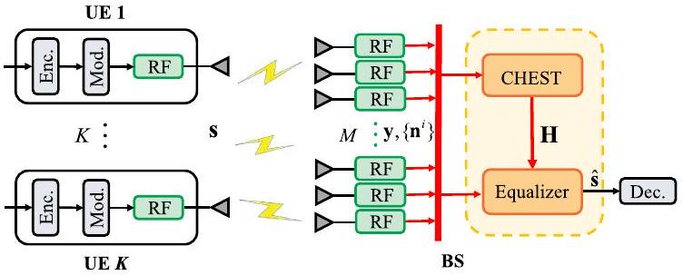
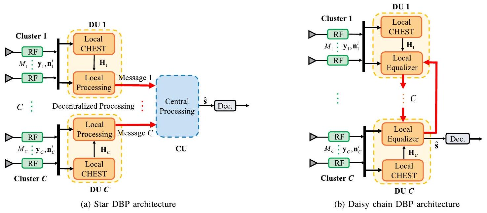
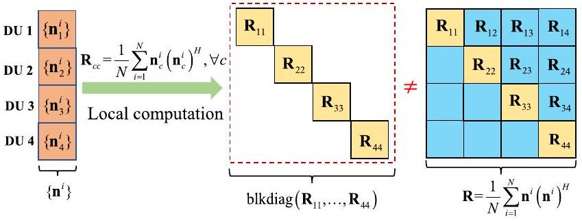
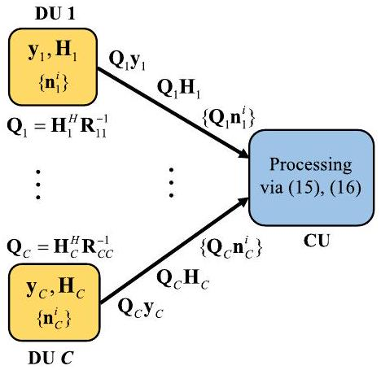
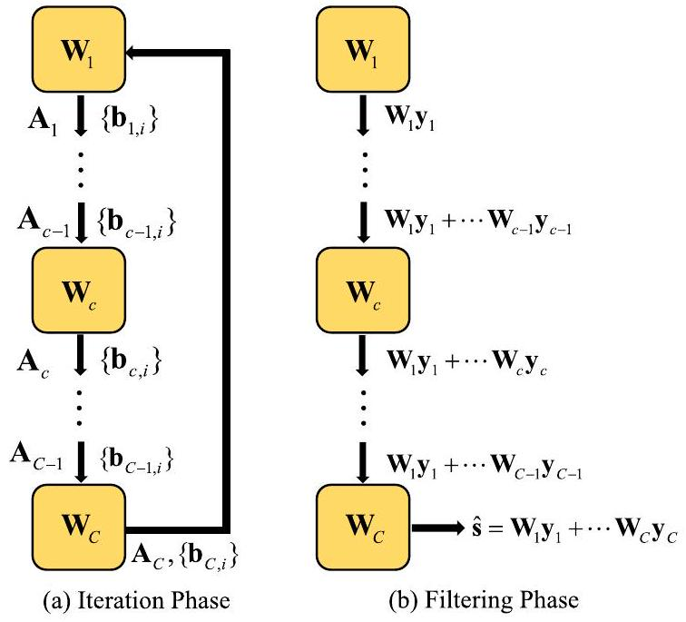
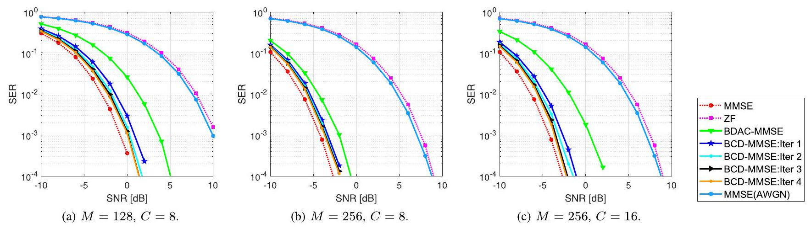
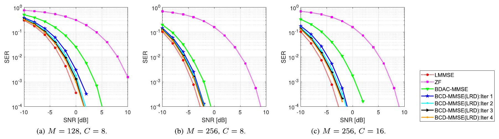
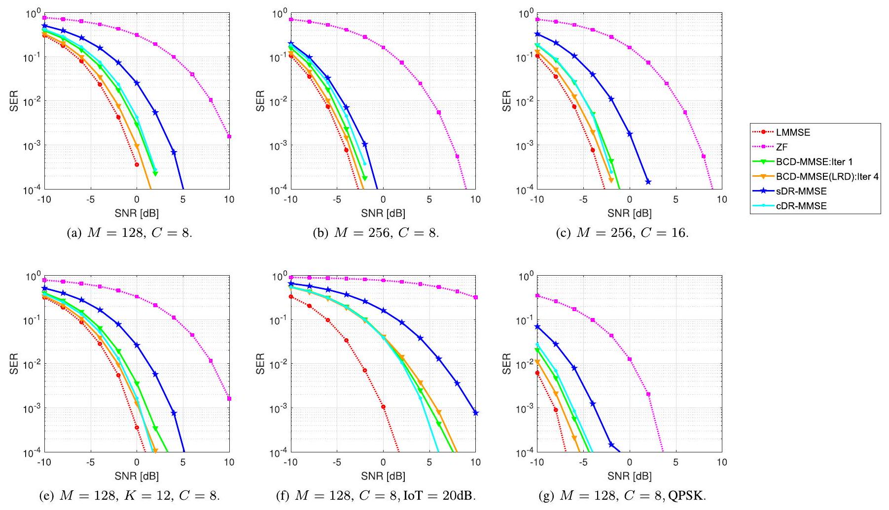
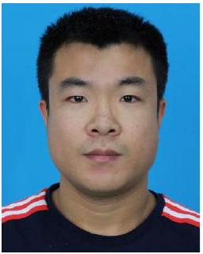
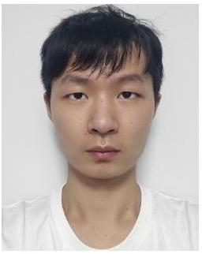

# Efficient LMMSE Equalization for Massive MIMO Systems Under Decentralized Baseband Processing Architecture 

Xiaotong Zhao ${ }^{\text {® }}$, Mian Li ${ }^{\text {® }}$, Bo Wang ${ }^{\text {® }}$, Enbin Song ${ }^{\text {® }}$, Tsung-Hui Chang ${ }^{\text {® }}$, Fellow, IEEE, and Qingjiang Shi ${ }^{\text {(iD) }}$, Member, IEEE


#### Abstract

Recently, the decentralized baseband processing (DBP) paradigm and relevant uplink detection methods have been proposed to enable extremely large-scale massive multiple-input multiple-output technology. Under the DBP architecture, base station antennas are divided into several independent clusters, each connected to a local computing fabric. However, current detection methods tailored to DBP only consider ideal white Gaussian noise scenarios, while in practice, the noise is often colored due to interference from neighboring cells. Moreover, in the DBP architecture, linear minimum mean-square error (LMMSE) detection methods require the knowledge of noise covariance matrix which must be estimated using distributedly stored noise samples. This presents a significant challenge for decentralized LMMSE-based equalizer design. To address this issue, this paper proposes decentralized LMMSE equalization methods under colored noise scenarios for both star and daisy chain DBP architectures. Specifically, we first propose two decentralized equalizers for the star DBP architecture based on dimensionality reduction techniques. Then, we derive an optimal decentralized equalizer using the block coordinate descent method for the daisy chain DBP architecture with a bandwidth reduction enhancement scheme based on decentralized low-rank decomposition. Finally, simulation results demonstrate that our proposed methods can achieve excellent detection performance while requiring much less communication bandwidth.


Received 3 March 2024; revised 13 August 2024; accepted 7 November 2024. Date of publication 4 February 2025; date of current version 27 February 2025. The work of Qingjiang Shi was supported by the NSFC under Grant 62231019 and Grant U23B2005. The work of Enbin Song was supported by the NSFC under Grant U2066203. The work of Tsung-Hui Chang was supported in part by Shenzhen Science and Technology Program under Grant RCJC20210609104448114 and Grant ZDSYS20230626091302006, in part by the NSFC under Grant 62071409, and in part by Guangdong Provincial Key Laboratory of Big Data Computing. An earlier version of this paper was presented in part at the IEEE Global Communications Conference (GLOBECOM), Madrid, Spain, December 2021 [DOI: 10.1109/GLOBE-COM46510.2021.9685271]. (Corresponding author: Qingjiang Shi.)
Xiaotong Zhao is with the School of Computer Science and Technology, Tongji University, Shanghai 201804, China (e-mail: xiaotongzhao@ tongji.edu.cn).
Mian Li and Tsung-Hui Chang are with the School of Science and Engineering, The Chinese University of Hong Kong Shenzhen (CUHK-SZ), Shenzhen 518172, China, and also with Shenzhen Research Institute of Big Data, Shenzhen 518172, China (e-mail: mianli1@link.cuhk.edu.cn; tsunghui.chang@ieee.org).
Bo Wang is with the Wireless Network RAN Algorithm Department, Xi'an Huawei Technologies Company Ltd., Xi'an 710000, China (e-mail: wangbo169@huawei.com).
Enbin Song is with the College of Mathematics, Sichuan University, Chengdu 610065, China (e-mail: e.b.song@163.com).
Qingjiang Shi is with the School of Computer Science and Technology, Tongji University, Shanghai 201804, China, and also with Shenzhen Research Institute of Big Data, Shenzhen 518172, China (e-mail: shiqj@tongji.edu.cn). Digital Object Identifier 10.1109/JSAC.2025.3531524

Index Terms-Massive MIMO, decentralized baseband processing, data detection, LMMSE, colored noise.

## I. Introduction

MASSIVE multiple-input multiple-output (MIMO) is a critical technology for both fifth-generation (5G) and sixth-generation systems due to its high spectral and power efficiency [2], [3], [4]. With extremely large-scale antenna arrays comprising hundreds or even thousands of antennas, a base station (BS) is capable of simultaneously serving multiple user equipments (UEs) within the same time-frequency resource. Data detection techniques are crucial in the uplink of massive MIMO systems. While the optimal detector is the nonlinear maximum-likelihood detector [5], its complexity grows exponentially with the number of transmit antennas, rendering it impractical for real-world systems. Consequently, low-complexity linear equalization-based detection methods such as maximum ratio combining (MRC), zero-forcing (ZF), and linear minimum mean-square error (LMMSE) detectors are preferred. Among these methods, the LMMSE detector is widely adopted due to its near-optimal detection performance [5].

Conventional LMMSE detection in practical massive MIMO systems relies on centralized baseband processing (CBP) in a single computing fabric, as shown in Fig. 1. However, extremely large antenna array in the next generation wireless systems poses two major challenges: 1) Excessive communication bandwidth: The rapid growth in the number of BS antennas results in an exceedingly high amount of raw baseband data, including channel state information (CSI), received signal, and noise samples (for noise covariance estimation), that must be transferred between the radio-frequency (RF) chains and the centralized computing fabric shown in Fig. 1 with red arrow lines [6], [7]. This issue is evident in a 256 -antenna BS with an 80 MHz bandwidth and 12 -bit digital-to-analog converters, where the raw baseband data throughput reaches 1Tbps, greatly exceeding the existing capacity of BS internal interface standards [8]. 2) High computational complexity: Traditional LMMSE equalization requires a high-dimensional matrix inversion with a complexity cubic in the number of BS antennas. This results in a formidable requirement for computation capability, making the CBP architecture impractical for massive MIMO settings [6].


Fig. 1. Block diagram of a centralized baseband processing architecture for the massive MU-MIMO uplink. "CHEST" is short for channel estimation.

To address the limitations of traditional CBP architectures, recent studies have explored a promising next-generation transceiver architecture called decentralized baseband processing (DBP) [6], [7], [9], [10], [11], [12], [13], [14], [15], [16], [17], [18], [19], [20]. As shown in Fig. 2, DBP replaces the centralized computing fabric with multiple local computing fabrics called distributed units (DUs). Additionally, the BS antennas are divided into several independent clusters, each connected to a DU. The DUs communicate with each other through a topology such as a star or a daisy chain, as shown in Fig. 2(a) and (b), respectively. As a result, each DU stores local information like CSI, received signals, and noise/interference samples. This setup enables decentralized data detection with moderate information exchange among DUs. Compared to CBP, the DBP paradigm effectively mitigates bandwidth and computation bottlenecks.

Numerous studies have investigated detection and equalization designs in DBP architectures. To simplify the complicated matrix inversion in centralized ZF and LMMSE equalizers, decentralized iterative methods were proposed. These methods, such as conjugate gradient [6], alternating direction method of multipliers [6], coordinate descent [10], and Newton methods [17], combined the local matched filter, local Gram matrix, and intermediate variables in a decentralized manner. Maximum a posterior estimation-based decentralized detection algorithms, such as large-MIMO approximate message passing [11], expectation propagation [12], [13], and Gaussian message passing [16], were proposed to attain higher detection performance at the expense of increased computational complexity. Notably, all the aforementioned methods aimed to estimate symbols rather than obtain an equalization matrix directly. However, equalization methods have a significant advantage over symbol estimation methods: the equalization matrix can be reused across multiple coherence blocks of channels. In contrast, the symbol estimation algorithms mentioned above must be performed for each channel, resulting in high computational complexity and communication bandwidth. Given this consideration, the authors in [9] presented a decentralized implementation that directly obtained MRC, ZF, and LMMSE equalization matrices in a feedforward DBP architecture. Meanwhile, a decentralized algorithm based on gradient descent was proposed in [7] to obtain the ZF equalization matrix for a daisy chain architecture. Recently, [18] proposed a parallel iterative MMSE equalizer in a decentralized bidirectional-chain equalizer architecture.

Prior works [6], [7], [9], [10], [11], [12], [13], [14], [15], [16], [17], [18], and [19] all assumed that the BS receiver noise follows an ideal additive white Gaussian noise (AWGN) model with a diagonal covariance matrix. This naturally facilitates the distributed implementation of LMMSE equalization in DBP architectures using multiple diagonal submatrices. However, in practical systems, interference from other non-target UEs in neighboring cells must be modeled as part of the background noise [21], [22], i.e., results in colored noise with a non-diagonal covariance matrix. ${ }^{1}$ Moreover, the exact noise covariance matrix at the BS is unknown and needs to be estimated by averaging a finite number of noise samples. In DBP architectures (see Fig. 2 below), each DU has only local noise samples for the corresponding antenna cluster. Consequently, computing the non-diagonal covariance matrix of colored noise requires collecting noise samples from all clusters. However, this is hampered by prohibitively high communication bandwidth and computational complexity, as the sample dimension is related to the number of BS antennas (which can be extremely large). Therefore, LMMSE equalization in DBP architectures under the colored noise remains a significant challenge, necessitating a completely new algorithmic design that considers limited communication bandwidth and low computational complexity. This paper seeks to address this challenge.

In summary, our main contributions are given as follows:

- Colored Noise and Covariance Estimation in DBP. To the best of our knowledge, all the existing detection methods designed for DBP focus solely on ideal white Gaussian noise scenarios. We here for the first time consider the more practical colored noise case. Particularly, for the DBP architectures, we show how to efficiently and implicitly implement decentralized estimation of the noise covariance matrix during the LMMSE process through averaging distributedly stored noise samples.
- Decentralized Equalization for the Star DBP Architecture. By investigating the closed-form expression for the LMMSE equalization matrix, we propose two decentralized equalizers that employ dimensionality reduction (DR) techniques under the star DBP architecture. In both methods, each DU embeds its local information into a low-dimensional representation via linear transformation and transmits it to the CU. The CU then either superimposes or concatenates the compressed data to perform LMMSE equalization. Both methods reduce data transfer size from the number of BS antennas to the number of UEs, alleviating the bandwidth and computation bottlenecks, while achieving performance close to centralized LMMSE equalization.
- Decentralized Equalization for the Daisy Chain DBP Architecture. To obtain an optimal decentralized equalizer, we reshape the original optimization problem of LMMSE and investigate the distributed storage structure in the daisy chain DBP architecture. Then, we design an efficient decentralized iterative algorithm using the block coordinate descent (BCD) method [25] with guaranteed convergence. During the BCD iteration, data transfer

[^0]size is significantly reduced, depending only on the number of UEs rather than BS antennas. To further reduce the data transfer size for the case when the number of noise samples is very large, we present an improved BCD-based decentralized LMMSE equalizer by deliberately using a low-rank approximation of the noise covariance matrix. While preserving near-optimal performance, this approach requires the data transfer size independent of the number of noise samples, significantly reducing the bandwidth and computation burden.
The remainder of this paper is organized as follows. Section II introduces the uplink system model and the DBP architectures. Section III proposes two decentralized equalization methods using DR techniques for the star architecture. Section IV develops a BCD-based decentralized equalization method for the daisy chain architecture and a low-rank decomposition scheme for noise covariance matrix to further reduce the communication bandwidth. Section V presents computational complexity and communication bandwidth analysis. The simulation results are provided in Section VI. Finally, this article is concluded in Section VII.

Notations: Throughout this paper, scalars are denoted by both lower and upper case letters, while vectors and matrices are denoted by boldface lower case and boldface upper case letters, respectively. For a matrix $\mathbf{A}, \mathbf{A}^{T}, \mathbf{A}^{H}, \mathbf{A}^{-1}, \operatorname{Tr}(\mathbf{A})$ and $R(\mathbf{A})$ denote its transpose, conjugate transpose, inverse, trace, and range space, respectively. The Euclidean norm of a vector $\mathbf{x}$ is defined as $\|\mathbf{x}\|_{2}=\sqrt{\mathbf{x}^{H} \mathbf{x}}$. In addition, $\mathbb{E}[\cdot]$ denotes the expectation operation. The notation $\mathbf{I}$ is the identity matrix, and blkdiag $\left(\mathbf{A}_{1}, \ldots, \mathbf{A}_{C}\right)$ denotes a block diagonal matrix with $\mathbf{A}_{1}, \ldots, \mathbf{A}_{C}$ being its diagonal blocks.

## II. Systems Model and DBP Architectures

This section introduces the uplink massive MIMO system model and the LMMSE equalization method. Two uplink DBP architectures are then presented along with the challenges posed by the decentralized LMMSE design.

## A. Uplink System Model and LMMSE Equalization

1) Uplink System Model: Consider an uplink massive MIMO system where $K$ target UEs, each with a single antenna, transmit data to a BS equipped with $M$ antennas, where $M \gg K$. The received signal $\mathbf{y} \in \mathbb{C}^{M \times 1}$ at the BS is expressed as:

$$
\begin{equation*}
\mathbf{y}=\mathbf{H s}+\mathbf{n}, \tag{1}
\end{equation*}
$$

where $\mathbf{H} \in \mathbb{C}^{M \times K}$ represents the channel matrix between the BS and UEs, $\mathbf{s} \in \mathcal{S}^{K \times 1}$ denotes the transmitted symbol vector with $\mathcal{S}$ representing the constellation set for some modulation scheme (e.g., 16-QAM), and $\mathbf{n} \sim \mathcal{C} \mathcal{N}(\mathbf{0}, \mathbf{R})$ denotes the additional white Gaussian noise (AWGN) with $\mathbf{R} \triangleq \mathbb{E}\left[\mathbf{n} \mathbf{n}^{H}\right]$ being the covariance matrix.
2) LMMSE Equalization: Typically, the CSI is considered almost constant across several contiguous symbols [15], which enables the reuse of the equalization matrix. Consequently, it is more cost-effective to compute the equalization matrix and reuse it, rather than estimating symbols directly for each instance. Therefore, we focus on obtaining an equalization matrix instead of directly estimating symbols.

Assuming the channel matrix $\mathbf{H}$ is perfectly known, ${ }^{2}$ LMMSE equalization aims to find a linear estimate by solving the following problem:

$$
\begin{equation*}
\min _{\mathbf{W}} \mathbb{E}\left[\|\mathbf{W} \mathbf{y}-\mathbf{s}\|_{2}^{2}\right], \tag{2}
\end{equation*}
$$

which leads to the well-known LMMSE receiver [28]:

$$
\begin{equation*}
\mathbf{W}_{\mathrm{MMSE}}=\left(\mathbf{H}^{H} \mathbf{R}^{-1} \mathbf{H}+\frac{1}{E_{s}} \mathbf{I}\right)^{-1} \mathbf{H}^{H} \mathbf{R}^{-1}, \tag{3}
\end{equation*}
$$

where $E_{s}$ denotes the average energy per symbol. The LMMSE estimate $\hat{\mathbf{s}}_{\text {MMSE }}$ is obtained by applying the equalization matrix $\mathbf{W}_{\text {MMSE }}$ to the received signal $\mathbf{y}$, i.e., $\hat{\mathbf{s}}_{\text {MMSE }}=$ $\mathbf{W}_{\text {MMSE }} \mathbf{y}$. Finally, the detector quantizes each entry of $\hat{\mathbf{s}}_{\text {MMSE }}$ to the nearest neighbor point in the constellation set $\mathcal{S}$.

In conventional centralized LMMSE equalization, computing the equalization matrix in (3) requires complete knowledge of $\mathbf{H} \in \mathbb{C}^{M \times K}$ and $\mathbf{R} \in \mathbb{C}^{M \times M}$, which must be collected from the RF chains to a centralized computing fabric. Furthermore, the $M$-dimensional matrix inversion operation $\mathbf{R}^{-1}$ in (3) results in a computational complexity of $\mathcal{O}\left(M^{3}\right)$. Consequently, centralized processing imposes significant bandwidth and computational demands that are unaffordable when $M$ is extremely large in massive MIMO settings. This motivates the decentralized design of the LMMSE equalization under certain decentralized baseband processing architecture, which is introduced in the sequel.

## B. Decentralized Baseband Processing: Architectures, Challenges, and A Baseline Solution

1) DBP Architectures: To address the complexity and bandwidth issues of traditional CBP architectures, recent studies (e.g., [6], [7]) have explored the DBP architecture. As illustrated in Fig. 2, the uplink DBP architecture divides $M$ BS antenna elements into $C$ antenna clusters each with $M_{c}$ antennas (i.e., $\sum_{c=1}^{C} M_{c}=M$ ). In particular, each cluster has its own local RF and computing fabric called DU.

In this paper, we consider two DBP architectures: the star architecture in Fig. 2(a) and the daisy chain architecture in Fig. 2(b). In the star architecture, all DUs are connected to a central unit (CU), and each DU performs data compression and subsequently transmits some message (i.e., intermediate results as required) to the CU in parallel for the final equalization operation. In contrast to the star architecture, there is no CU in the daisy chain architecture. Instead, the DUs are connected via unidirectional links, while an additional link connects the last and first DUs to form a ring. Only one DU outputs the symbol estimate and is directly linked to the decoder.

The star architecture requires a higher communication bandwidth between the CU and DUs, resulting in complex chip

[^1]
Fig. 2. The DBP architectures in which the received signal $\mathbf{y}$ and each noise sample $\mathbf{n}^{i}$ are both distributed over multiple DUs.

input/output interfaces at the CU. Nevertheless, the star architecture has less latency than the daisy chain architecture since the star architecture enables parallel processing. In contrast, the interface design in the daisy chain architecture is simple, low-cost, and easier to extend but often has higher latency.

Under the DBP architectures, the received vector, channel matrix, and noise vector in Eq. (1) are accordingly partitioned as $\mathbf{y}=\left[\mathbf{y}_{1}^{T}, \mathbf{y}_{2}^{T}, \ldots, \mathbf{y}_{C}^{T}\right]^{T}, \mathbf{H}=\left[\mathbf{H}_{1}^{T}, \mathbf{H}_{2}^{T}, \ldots, \mathbf{H}_{C}^{T}\right]^{T}$, and $\mathbf{n}=\left[\mathbf{n}_{1}^{T}, \mathbf{n}_{2}^{T}, \ldots, \mathbf{n}_{C}^{T}\right]^{T}$, respectively. Therefore, the local received signal $\mathbf{y}_{c} \in \mathbb{C}^{M_{\mathrm{c}} \times 1}$ at cluster $c$ is represented by

$$
\begin{equation*}
\mathbf{y}_{c}=\mathbf{H}_{c} \mathbf{s}+\mathbf{n}_{c}, \quad c=1,2, \ldots, C, \tag{4}
\end{equation*}
$$

where $\mathbf{H}_{c} \in \mathbb{C}^{M_{c} \times K}$ and $\mathbf{n}_{c} \in \mathbb{C}^{M_{c} \times 1}$ denote the local channel matrix and the local noise vector with respect to cluster $c$, respectively. Note that, $\mathbf{H}_{c}$ and $\mathbf{y}_{c}$ are only known locally to the DU $c$ and are not allowed to be directly exchanged among DUs to save bandwidth overhead.
2) Challenges Imposed by DBP on Decentralized LMMSE: Previous works on decentralized equalization under DBP architectures all assumed AWGN noise with diagonal covariance matrix [6], [7], [9], [10], [11], [12], [13], [14], [15], [16], [17]. Under such an assumption, the noise covariance matrix can be naturally decomposed into multiple block diagonal submatrices that perfectly fit into the decentralized implementation of LMMSE equalization under DBP architectures. ${ }^{3}$ However, the noise at the BS is often colored due to the existence of interference signals from non-target UEs in neighboring cells [21], [22]. In interference scenarios, the baseband model in (1) can be expressed in more detail as follows:

$$
\begin{equation*}
\mathbf{y}=\mathbf{H s}+\underbrace{\mathbf{n}}_{\text {colored noise }}=\mathbf{H s}+\underbrace{\overline{\mathbf{H}} \overline{\mathbf{s}}}_{\text {interference }}+\underbrace{\overline{\mathbf{n}}}_{\text {AWGN }}, \tag{5}
\end{equation*}
$$

[^2]where $\overline{\mathbf{H}} \in \mathbb{C}^{M \times r}$ and $\overline{\mathbf{s}} \in \mathcal{S}^{r \times 1}$ respectively denote the channel matrix and interference signals of $r$ non-target UEs, and $\overline{\mathbf{n}} \in \mathbb{C}^{M \times 1}$ is the background AWGN with distribution $\mathcal{C} \mathcal{N}\left(\mathbf{0}, \sigma^{2} \mathbf{I}\right)$. Then, the colored noise covariance matrix $\mathbf{R}=$ $\beta \overline{\mathbf{H}} \overline{\mathbf{H}}^{H}+\sigma^{2} \mathbf{I}$, where $\beta$ is the power of interference signals. In this scenario, R becomes non-block-diagonal. Moreover, the decentralized estimation of $\mathbf{R}$ is not possible because directly exchanging interference signals among DUs is forbidden due to bandwidth limitation. This imposes a huge challenge for decentralized LMMSE equalization design.

To better understand the challenge mentioned above, we write down the best estimation ${ }^{4}$ of $\mathbf{R}$ as [21], [22], and [29]:

$$
\begin{equation*}
\hat{\mathbf{R}}=\frac{1}{N} \sum_{i=1}^{N} \mathbf{n}^{i}\left(\mathbf{n}^{i}\right)^{H}, \tag{6}
\end{equation*}
$$

which is done by averaging the noise samples in $N$ pilot resource elements (REs). Here, $N \gg K$ holds to ensure the accuracy of estimation, and $\mathbf{n}^{i} \in \mathbb{C}^{M \times 1}$ is the noise sample in the $i$-th pilot RE. ${ }^{5}$

Corresponding to the antennas clustering in DBP architectures, the $i$-th noise sample $\mathbf{n}^{i}$ can be divided as $\mathbf{n}^{i}=$ $\left[\left(\mathbf{n}_{1}^{i}\right)^{T},\left(\mathbf{n}_{2}^{i}\right)^{T}, \ldots,\left(\mathbf{n}_{C}^{i}\right)^{T}\right]^{T}, \forall i$, where $\left\{\mathbf{n}_{c}^{i}\right\}_{i=1}^{N}$ are stored in cluster $c$ (illustrated with orange color in Fig. 3). Similarly, the noise covariance matrix R can be regarded as a block matrix with $C \times C$ blocks, where the ( $m, n$ )-th block submatrix is denoted by $\mathbf{R}_{m n}=\mathbb{E}\left[\mathbf{n}_{m} \mathbf{n}_{n}^{H}\right]$. Accurate estimation of R is crucial for effective LMMSE equalization. However, only the diagonal blocks of $\mathbf{R}$ (denoted by $\hat{\mathbf{R}}_{c c}$ as illustrated in yellow in Fig. 3) can be locally estimated by each cluster $c$ using $\hat{\mathbf{R}}_{c c}=(1 / N) \sum_{i=1}^{N} \mathbf{n}_{c}^{i}\left(\mathbf{n}_{c}^{i}\right)^{H}$. The main challenge lies in accurately obtaining the off-diagonal blocks of $\mathbf{R}$ (i.e., $\mathbf{R}_{m n}, m \neq n$ illustrated in blue in Fig. 3). Note that the

[^3]
Fig. 3. An illustrative example of the colored noise assumption in a DBP architecture with $C=4$. The computation of off-diagonal blocks of R requires data transfer among DUs.

direct exchange of noise samples among DUs would result in high-dimensional data transfer with size $M \times N$, which is prohibited for massive MIMO scenarios. Moreover, traditional whitening noise methods cannot be applied because they don't allow distributed implementation in DBP. As a result, decentralized computation of the LMMSE equalization matrix in (3) under stringent bandwidth constraints poses a significant challenge.
3) A Baseline Solution: We first propose a straightforward solution to roughly tackle this challenge, i.e., approximating $\mathbf{R}$ with a block diagonal matrix, denoted by $\mathbf{R}_{\mathrm{B}} \triangleq$ blkdiag $\left(\mathbf{R}_{11}, \mathbf{R}_{22}, \ldots, \mathbf{R}_{C C}\right)$, where all off-diagonal blocks are set to zero. Here, $\mathrm{blkdiag}\left(\mathbf{A}_{1}, \ldots, \mathbf{A}_{C}\right)$ denotes a block diagonal matrix with $\mathbf{A}_{1}, \ldots, \mathbf{A}_{C}$ being its diagonal blocks. This approach enables the approximation of the LMMSE equalization matrix in (3) as

$$
\begin{align*}
& \left(\mathbf{H}^{H} \mathbf{R}_{\mathrm{B}}^{-1} \mathbf{H}+\frac{1}{E_{s}} \mathbf{I}\right)^{-1} \mathbf{H}^{H} \mathbf{R}_{\mathrm{B}}^{-1} \\
& =\left(\sum_{c=1}^{C} \mathbf{H}_{c}^{H} \mathbf{R}_{c c}^{-1} \mathbf{H}_{c}+\frac{1}{E_{s}} \mathbf{I}\right)^{-1}\left[\mathbf{H}_{1}^{H} \mathbf{R}_{11}^{-1}, \ldots, \mathbf{H}_{C}^{H} \mathbf{R}_{C C}^{-1}\right] . \tag{7}
\end{align*}
$$

It is possible to implement (7) in a decentralized manner. Specifically, each DU $c=1,2, \ldots, C$ first computes $\mathbf{H}_{c}^{H} \mathbf{R}_{c c}^{-1} \mathbf{H}_{c}$ locally, which is then collected together for summation and inversion operations. Finally, the matrix inverse result is broadcasted to all DUs, allowing them to compute their local equalization matrices. This decentralized implementation of obtaining the approximate equalization matrix in (7) is called the block diagonal approximate covariance MMSE (BDAC-MMSE) equalizer. The transfer of only low-dimensional matrices with size $K \times K$ requires minimal communication bandwidth. Note that this simple approximation leads to a performance loss in colored noise scenarios. Therefore, algorithms with better performance will be proposed in the following sections. Nevertheless, BDAC-MMSE can serve as a good initial point for our proposed decentralized BCD-based equalizers in Section IV, as well as a baseline algorithm.

Remark 1: : Recent works [23], [24] have investigated the design of MMSE receivers for cell-free massive MIMO systems under colored noise conditions, where geographically separated access points (APs) jointly receive signals from all mobile users. In this scenario, the APs can be seen as the DU in the DBP architecture. However, their problem formulations differ significantly from ours. Specifically, they considered colored noise caused by channel estimation error and employed a Kalman filtering-based method to provide a sequential implementation of centralized LMMSE using local noise covariance matrices. However, they assumed that the noise covariance matrix is a block diagonal matrix comprising multiple local covariance matrices, with each decentralized node having knowledge of its corresponding local covariance matrix. Consequently, the algorithms proposed in [23] and [24] for colored noise with block-diagonal covariance matrix are not suitable for our decentralized LMMSE equalization problem with more general noise covariance matrix.

## III. Dimensionality Reduction MMSE Equalization for Star DBP Architecture

This section introduces the DR technique for the star DBP architecture and formulates the LMMSE problem under two types of compression matrices. Then, two DR-based decentralized equalization methods are designed.

## A. Dimensionality Reduction in DBP

To reduce the bandwidth burden in DBP architectures, a straightforward idea is to reduce the dimension of local information while preserving equalization performance, which matches the concept of the DR technique [30], [31]. Specifically, in the star DBP architecture, through a fat local compression matrix $\mathbf{Q}_{c} \in \mathbb{C}^{L_{c} \times M_{c}}$, where $L_{c}<M_{c}$, each DU parallelly transfers the compressed local received vector $\mathbf{Q}_{c} \mathbf{y}_{c}$, channel matrix $\mathbf{Q}_{c} \mathbf{H}_{c}$, and noise samples $\left\{\mathbf{Q}_{c} \mathbf{n}_{c}^{i}\right\}_{i=1}^{N}$ to the CU. Based on these compressed data, an LMMSE estimate of s is formed through an equalization matrix $\mathbf{W}$. Since $L_{c}<M_{c}$, the bandwidth can be significantly reduced. We assume local compression dimension $L_{c}=L$ for brevity.

The compression matrix can be an arbitrary fat matrix. For the star DBP architecture, we focus on the following two scenarios of compression matrices:

1) Superimposed Compression: The compressed received signals from each DU are superimposed at the CU as
$$
\begin{equation*}
\tilde{\mathbf{y}}\left(\mathbf{Q}_{1}, \ldots, \mathbf{Q}_{C}\right)=\sum_{c=1}^{C} \mathbf{Q}_{c} \mathbf{y}_{c}=\left[\mathbf{Q}_{1}, \ldots, \mathbf{Q}_{C}\right] \mathbf{y} \tag{8}
\end{equation*}
$$
2) Concatenated Compression: The CU concatenates the compressed data of individual DUs to form a vector
$$
\begin{equation*}
\tilde{\mathbf{y}}\left(\mathbf{Q}_{1}, \ldots, \mathbf{Q}_{C}\right)=\operatorname{blkdiag}\left(\mathbf{Q}_{1}, \ldots, \mathbf{Q}_{C}\right) \mathbf{y} . \tag{9}
\end{equation*}
$$

The dimension of $\tilde{\mathbf{y}}\left(\mathbf{Q}_{1}, \ldots, \mathbf{Q}_{C}\right)$ in the superimposed and concatenated scenarios are $L \times 1$ and $C L \times 1$, respectively. $\left[\mathbf{Q}_{1}, \ldots, \mathbf{Q}_{C}\right]$ and $\operatorname{blkdiag}\left(\mathbf{Q}_{1}, \ldots, \mathbf{Q}_{C}\right)$ are global compression matrices. For both scenarios, we aim to design MSE optimal equalization matrices $\tilde{\mathbf{W}}$ and local compression matrices $\left\{\mathbf{Q}_{c}\right\}_{c=1}^{C}$ as follows:

$$
\begin{equation*}
\min _{\tilde{\mathbf{w}},\left\{\mathbf{Q}_{c}\right\}_{c=1}^{C}} \mathbb{E}\left[\left\|\mathbf{s}-\tilde{\mathbf{W}} \tilde{\mathbf{y}}\left(\mathbf{Q}_{1}, \ldots, \mathbf{Q}_{C}\right)\right\|_{2}^{2}\right], \tag{10}
\end{equation*}
$$

where $\tilde{\mathbf{y}}\left(\mathbf{Q}_{1}, \ldots, \mathbf{Q}_{C}\right)$ is given by either (8) or (9). In general, concatenating has a better performance but with higher complexity compared to superimposing. Although many articles
have investigated problem (10), they all assumed that the statistical properties of the signal and noise are available at a central node [30], [31]. However, the biggest challenge in this paper is that the non-diagonal noise covariance matrix can only be estimated by the noise samples, which are separately stored at each DU. Thus, the global optimization methods in [31] for problem (10) will inevitably lead to a heavy bandwidth burden. Consequently, we need to reconsider the problem (10) and find a reasonable approximate solution with the trade-off between bandwidth and performance. Since the optimal $\tilde{\mathbf{W}}$ in problem (10) is obviously given by the LMMSE solution after $\left\{\mathbf{Q}_{c}\right\}_{c=1}^{C}$ are obtained, we will focus on the design of compression matrices $\left\{\mathbf{Q}_{c}\right\}_{c=1}^{C}$.

A fundamental question is, under what conditions the compression is lossless? Here, lossless means no MSE performance gap exists between performing LMMSE equalization with compressed and uncompressed information. The following theorem answers this question:

Theorem 1: : Consider system model (1), i.e., $\mathbf{y}=\mathbf{H s}+\mathbf{n}$. Denote $\mathbf{Q} \in \mathbb{C}^{L \times M}$ as the global compression matrix. The minimal compression dimension without performance loss is $\operatorname{rank}(\mathbf{H})=K$, and $\mathbf{Q}=\mathbf{P} \mathbf{H}^{H} \mathbf{R}^{-1} \in \mathbb{C}^{K \times M}$ for an arbitrary invertible matrix $\mathbf{P} \in \mathbb{C}^{K \times K}$ is a lossless compression matrix.

Proof: See Appendix A. $\square$

Following Theorem 1, setting $\mathbf{P}=\mathbf{I}$ results in a lossless compression matrix $\mathbf{H}^{H} \mathbf{R}^{-1} \in \mathbb{C}^{K \times M}$. However, this cannot be utilized directly for the DBP architectures because $\mathbf{R}^{-1}$ is unavailable without collecting $\left\{\mathbf{n}_{c}^{i}\right\}_{i=1}^{N}$ from each DU to the CU, which is infeasible due to bandwidth limitations. Therefore, we use a lossy compromise by using $\mathbf{Q}_{c}=\mathbf{H}_{c}^{H} \mathbf{R}_{c c}^{-1} \in$ $\mathbb{C}^{K \times M_{c}}$ as a local compression matrix at each DU $c$. The following subsections show that it will be a lossless local compression matrix when $\mathbf{R}=\mathbf{R}_{\mathrm{B}}$, and simulation results confirm its effectiveness. The subsequent two subsections derive the compression matrices and corresponding equalization methods for different scenarios.

## B. Superimposed DR-MMSE Equalization

We first consider the superimposed scenario. Adopting $\mathbf{Q}_{c}=\mathbf{H}_{c}^{H} \mathbf{R}_{c c}^{-1}$ as the local compression matrix at DU $c$, the global superimposed compression matrix is given by

$$
\begin{align*}
\check{\mathbf{Q}} & =\left[\mathbf{Q}_{1}, \mathbf{Q}_{2}, \ldots, \mathbf{Q}_{C}\right] \\
& =\left[\mathbf{H}_{1}^{H} \mathbf{R}_{11}^{-1}, \mathbf{H}_{2}^{H} \mathbf{R}_{22}^{-1}, \ldots, \mathbf{H}_{C}^{H} \mathbf{R}_{C C}^{-1}\right] \\
& =\mathbf{H}^{H} \mathbf{R}_{\mathrm{B}}^{-1}, \tag{11}
\end{align*}
$$

which is an approximation to the lossless compression matrix $\mathbf{H}^{H} \mathbf{R}^{-1}$. Applying the compression to (1), we obtain the effective compressed channel model at the CU as

$$
\begin{equation*}
\check{\mathbf{y}}=\check{\mathbf{H}} \mathbf{s}+\check{\mathbf{n}}, \tag{12}
\end{equation*}
$$

where

$$
\begin{align*}
\check{\mathbf{y}} & =\check{\mathbf{Q}} \mathbf{y}=\sum_{c=1}^{C} \mathbf{Q}_{c} \mathbf{y}_{c}, \check{\mathbf{H}}=\check{\mathbf{Q}} \mathbf{H}=\sum_{c=1}^{C} \mathbf{Q}_{c} \mathbf{H}_{c},  \tag{13a}\\
\check{\mathbf{n}} & =\check{\mathbf{Q}} \mathbf{n}=\sum_{c=1}^{C} \mathbf{Q}_{c} \mathbf{n}_{c} . \tag{13b}
\end{align*}
$$

```
Algorithm 1 The Proposed sDR-MMSE Equalization
Input: $\mathbf{y}_{c}, \mathbf{H}_{c},\left\{\mathbf{n}_{c}^{i}\right\}_{i=1}^{N}, c=1,2, \ldots, C$, and $E_{s}$.
    Decentralized preprocessing at each DU:
    for $c=1$ to $C$ do
        $\mathbf{Q}_{c} \leftarrow \mathbf{H}_{c}^{H} \mathbf{R}_{c c}^{-1} ;$
        Compute $\mathbf{Q}_{c} \mathbf{y}_{c}, \mathbf{Q}_{c} \mathbf{H}_{c}$, and $\left\{\mathbf{Q}_{c} \mathbf{n}_{c}^{i}\right\}_{i=1}^{N}$; // Send to $C U$
    end for
    Central processing at the CU:
    Compute y and $\mathbf{H}$ via (13);
    Compute $\check{\mathbf{R}}$ via (14);
    $\mathbf{W}_{\text {sDR-mmse }}$ is given by (15);
    $\hat{\mathbf{s}}_{\text {sDR-MMSE }}$ is given by (16);
```

Output: $\mathbf{W}_{\text {sDR-MMSE }}$ and $\hat{\mathbf{s}}_{\text {sDR-MMSE }}$.

The effective noise covariance matrix can be expressed by

$$
\begin{align*}
\check{\mathbf{R}} & =\check{\mathbf{Q}} \mathbf{R} \check{\mathbf{Q}}^{H}=\check{\mathbf{Q}}\left(\frac{1}{N} \sum_{i=1}^{N} \mathbf{n}^{i}\left(\mathbf{n}^{i}\right)^{H}\right) \check{\mathbf{Q}}^{H} \\
& =\sum_{m=1}^{C} \sum_{l=1}^{C}\left(\mathbf{Q}_{m}\left(\frac{1}{N} \sum_{i=1}^{N} \mathbf{n}_{m}^{i}\left(\mathbf{n}_{l}^{i}\right)^{H}\right) \mathbf{Q}_{l}^{H}\right) \\
& =\frac{1}{N} \sum_{m=1}^{C} \sum_{l=1}^{C} \sum_{i=1}^{N} \mathbf{Q}_{m} \mathbf{n}_{m}^{i}\left(\mathbf{Q}_{l} \mathbf{n}_{l}^{i}\right)^{H} \tag{14}
\end{align*}
$$

After the low-dimensional compressed information $\mathbf{Q}_{c} \mathbf{y}_{c}, \mathbf{Q}_{c} \mathbf{H}_{c}$, and $\left\{\mathbf{Q}_{c} \mathbf{n}_{c}^{i}\right\}_{i=1}^{N}$ are collected from all the DUs, the CU calculates the equalization matrix as follows:

$$
\begin{equation*}
\mathbf{W}_{\text {sDR-MMSE }}=\left(\check{\mathbf{H}}^{H} \check{\mathbf{R}}^{-1} \check{\mathbf{H}}+\frac{1}{E_{s}} \mathbf{I}\right)^{-1} \check{\mathbf{H}}^{H} \check{\mathbf{R}}^{-1}, \tag{15}
\end{equation*}
$$

and the estimated symbol is given by

$$
\begin{equation*}
\hat{\mathbf{s}}_{\text {sDR-MMSE }}=\mathbf{W}_{\text {sDR-MMSE }} \check{\mathbf{y}} . \tag{16}
\end{equation*}
$$

The proposed algorithm, named superimposed dimensionality reduction (sDR)-MMSE, is summarized in Algorithm 1. In the preprocessing phase, $\mathbf{Q}_{c} \mathbf{y}_{c}, \mathbf{Q}_{c} \mathbf{H}_{c}$ and $\left\{\mathbf{Q}_{c} \mathbf{n}_{c}^{i}\right\}_{i=1}^{N}$ are calculated locally at each DU and then transmitted to the CU. Later in the equalization phase, the compressed information is superimposed to obtain the equalization matrix in (15). Finally, multiplying the compressed received signal provides the estimate of s in (16). Fig. 4 illustrates the information transfer in the proposed sDR-MMSE equalization. The data transfer size is independent of the number of BS antennas.

Remark 2: Since $\mathbf{H}^{H} \mathbf{R}^{-1}$ is a lossless compression matrix, the sDR-MMSE equalization is equivalent to the centralized LMMSE equalization when $\mathbf{R}=\mathbf{R}_{\mathrm{B}}$. Moreover, the performance degradation caused by compression will be minor if the off-diagonal elements of $\mathbf{R}$ are relatively small compared to the diagonal part. Fortunately, noise covariance matrix R often tends to block diagonally dominant in practical scenarios.

## C. Concatenated DR-MMSE Equalization

The sDR-MMSE equalization results in information loss due to the superimposition of information from each DU. A potential approach to improve performance is to concatenate


Fig. 4. The communication and computation operations during the sDR-MMSE equalization process.

compressed information instead of superimposing, although this comes at the cost of increased complexity. Therefore, we consider scenario 2) of the compression matrix in (9).

We still adopt the local compression matrix as $\mathbf{Q}_{c}=$ $\mathbf{H}_{c}^{H} \mathbf{R}_{c c}^{-1}$ at the $c$-th DU. But different from (11), the global concatenated compression matrix is given by

$$
\begin{align*}
\tilde{\mathbf{Q}} & =\operatorname{blkdiag}\left(\mathbf{Q}_{1}, \mathbf{Q}_{2}, \ldots, \mathbf{Q}_{C}\right) \\
& =\operatorname{blkdiag}\left(\mathbf{H}_{1}^{H} \mathbf{R}_{11}^{-1}, \mathbf{H}_{2}^{H} \mathbf{R}_{22}^{-1}, \ldots, \mathbf{H}_{C}^{H} \mathbf{R}_{C C}^{-1}\right) . \tag{17}
\end{align*}
$$

Thus, the effective channel model at the CU is given by

$$
\begin{equation*}
\tilde{\mathbf{y}}=\tilde{\mathbf{H}} \mathbf{s}+\tilde{\mathbf{n}}, \tag{18}
\end{equation*}
$$

where

$$
\tilde{\mathbf{y}}=\left[\begin{array}{c}
\mathbf{Q}_{1} \mathbf{y}_{1}  \tag{19}\\
\vdots \\
\mathbf{Q}_{C} \mathbf{y}_{C}
\end{array}\right], \tilde{\mathbf{H}}=\left[\begin{array}{c}
\mathbf{Q}_{1} \mathbf{H}_{1} \\
\vdots \\
\mathbf{Q}_{C} \mathbf{H}_{C}
\end{array}\right], \tilde{\mathbf{n}}=\left[\begin{array}{c}
\mathbf{Q}_{1} \mathbf{n}_{1} \\
\vdots \\
\mathbf{Q}_{C} \mathbf{n}_{C}
\end{array}\right] .
$$

The effective noise covariance matrix can be expressed by

$$
\tilde{\mathbf{R}}=\left[\begin{array}{ccc}
\mathbf{Q}_{1} \mathbf{R}_{11} \mathbf{Q}_{1}^{H} & \ldots & \mathbf{Q}_{1} \mathbf{R}_{1 C} \mathbf{Q}_{C}^{H}  \tag{20}\\
\vdots & \ddots & \vdots \\
\mathbf{Q}_{C} \mathbf{R}_{C 1} \mathbf{Q}_{1}^{H} & \ldots & \mathbf{Q}_{C} \mathbf{R}_{C C} \mathbf{Q}_{C}^{H}
\end{array}\right],
$$

where

$$
\begin{align*}
\mathbf{Q}_{m} \mathbf{R}_{m l} \mathbf{Q}_{l}^{H} & =\mathbf{Q}_{m}\left(\frac{1}{N} \sum_{i=1}^{N} \mathbf{n}_{m}^{i}\left(\mathbf{n}_{l}^{i}\right)^{H}\right) \mathbf{Q}_{l}^{H} \\
& =\frac{1}{N} \sum_{i=1}^{N} \mathbf{Q}_{m} \mathbf{n}_{m}^{i}\left(\mathbf{Q}_{l} \mathbf{n}_{l}^{i}\right)^{H} \tag{21}
\end{align*}
$$

Consequently, after collecting the compressed information $\mathbf{Q}_{c} \mathbf{y}_{c}, \mathbf{Q}_{c} \mathbf{H}_{c}$, and $\left\{\mathbf{Q}_{c} \mathbf{n}_{c}^{i}\right\}_{i=1}^{N}$ from all the DUs, the CU calculates the equalization matrix as follows:

$$
\begin{equation*}
\mathbf{W}_{\text {cDR-MMSE }}=\left(\tilde{\mathbf{H}}^{H} \tilde{\mathbf{R}}^{-1} \tilde{\mathbf{H}}+\frac{1}{E_{s}} \mathbf{I}\right)^{-1} \tilde{\mathbf{H}}^{H} \tilde{\mathbf{R}}^{-1}, \tag{22}
\end{equation*}
$$

and the estimated symbol is given by

$$
\begin{equation*}
\hat{\mathbf{s}}_{\mathrm{cDR}-\mathrm{MMSE}}=\mathbf{W}_{\mathrm{cDR}-\mathrm{MMSE}} \tilde{\mathbf{y}} . \tag{23}
\end{equation*}
$$

The resulting algorithm is called concatenated dimensionality reduction (cDR)-MMSE equalization and is summarized in Algorithm 2. The preprocessing stage of cDR-MMSE equalization is the same as that of sDR-MMSE equalization,

```
Algorithm 2 The Proposed cDR-MMSE Equalization
Input: $\mathbf{y}_{c}, \mathbf{H}_{c},\left\{\mathbf{n}_{c}^{i}\right\}_{i=1}^{N}, c=1,2, \ldots, C$, and $E_{s}$.
    Decentralized preprocessing at each DU:
    for $c=1$ to $C$ do
        $\mathbf{Q}_{c} \leftarrow \mathbf{H}_{c}^{H} \mathbf{R}_{c c}^{-1} ;$
        Compute $\mathbf{Q}_{c} \mathbf{y}_{c}, \mathbf{Q}_{c} \mathbf{H}_{c}$, and $\left\{\mathbf{Q}_{c} \mathbf{n}_{c}^{i}\right\}_{i=1}^{N}$; // Send to $C U$
    end for
    Central processing at the CU:
    Compute $\tilde{\mathbf{y}}$ and $\mathbf{H}$ via (19);
    Compute $\tilde{\mathbf{R}}$ via (20);
    $\mathbf{W}_{\text {cDR-mmSE }}$ is given by (22);
    $\hat{\mathrm{s}}_{\mathrm{cDR}-\mathrm{MMSE}}$ is given by (23);
Output: $\mathbf{W}_{\text {cDR-mmse }}$ and $\hat{\mathbf{s}}_{\mathrm{cDR}-\text { mmse }}$.
```

i.e., $\mathbf{Q}_{c} \mathbf{y}_{c}, \mathbf{Q}_{c} \mathbf{H}_{c}$ and $\left\{\mathbf{Q}_{c} \mathbf{n}_{c}^{i}\right\}_{i=1}^{N}$ are calculated locally at each DU and then sent to the CU. Whereas at the CU, the compressed information is concatenated to obtain the LMMSE equalization matrix in (22) instead of being superimposed. The information transfer of the cDR-MMSE equalization is identical to that of the sDR-MMSE equalization illustrated in Fig. 4, except that the central processing at the CU should be replaced by (22) and (23).

The cDR-MMSE equalizer outperforms the sDR-MMSE equalizer due to the concatenation operation. Proposition 1 provides a rigorous analysis of this performance improvement. However, the cDR-MMSE equalizer has a higher computational complexity due to the high-dimensional matrix inversion $\tilde{\mathbf{R}}^{-1}$ at the CU.

Proposition 1.: The MSE matrix $\mathbf{E}_{\mathrm{sDR}} \succeq \mathbf{E}_{\mathrm{cDR}}$, where $\mathbf{E}_{\mathrm{sDR}} \triangleq \mathbb{E}\left[\left(\hat{\mathbf{s}}_{\mathrm{sDR}-\mathrm{MMSE}}-\mathbf{s}\right)\left(\hat{\mathbf{s}}_{\mathrm{sDR}-\mathrm{MMSE}}-\mathbf{s}\right)^{H}\right]$ and $\mathbf{E}_{\mathrm{cDR}} \triangleq$ $\mathbb{E}\left[\left(\hat{\mathbf{s}}_{\text {cDR-MMSE }}-\mathbf{s}\right)\left(\hat{\mathbf{s}}_{\text {cDR-MMSE }}-\mathbf{s}\right)^{H}\right]$. Moreover, we have $\mathbb{E}\left[\left\|\hat{\mathbf{s}}_{\text {sDR-MMSE }}-\mathbf{s}\right\|_{2}^{2}\right] \geq \mathbb{E}\left[\left\|\hat{\mathbf{s}}_{\text {cDR-MMSE }}-\mathbf{s}\right\|_{2}^{2}\right]$.

The proof is given in Appendix B. Here, $\mathbf{A} \succeq \mathbf{0}$ is a generalized inequality meaning A is a positive semidefinite matrix. Proposition 1 shows that the MSE of the cDR-MMSE equalizer is no larger than that of the sDR-MMSE equalizer.

Remark 3 (Application in the Daisy Chain Architecture): The sDR-MMSE equalizer still works in the daisy chain architecture since the summation operation will not increase bandwidth and computational complexity. However, the sequential nature of the daisy chain architecture leads to increased latency. In contrast, the cDR-MMSE equalizer only works with the star architecture since the concatenation operation increases the bandwidth sharply in the daisy chain architecture due to the accumulation of information dimensions.

## IV. BCD-Based LMMSE Equalization for the Daisy Chain Architecture

This section proposes an optimal BCD-based LMMSE equalizer for the daisy chain architecture and improves it by utilizing a decentralized low-rank decomposition method for further bandwidth reduction.

## A. BCD-Based LMMSE Equalization

The DR-based LMMSE equalizers can be viewed as a decentralized implementation of the closed-form expression of the equalization matrix in (3). Although the sDR-MMSE can be adapted for the daisy chain architecture, the DR-based equalizers are only suboptimal solutions to the original LMMSE problem (2). Therefore, we aim to design an optimal decentralized equalizer for the daisy chain architecture by reconsidering problem (2). Incorporating the baseband model (1) and covariance estimation (6) into problem (2), and considering the independence of n and s, we can reformulate problem (2) equivalently as follows:

$$
\begin{equation*}
\min _{\mathbf{W}} \frac{1}{N} \sum_{i=1}^{N} \mathbb{E}\left[\left\|\mathbf{W H s}+\mathbf{W} \mathbf{n}^{i}-\mathbf{s}\right\|_{2}^{2}\right] . \tag{24}
\end{equation*}
$$

The objective function of the above problem has only one random variable $\mathbf{s}$, and the other variables are deterministic. It should be noted that $\mathbf{n}^{i}$ is stored separately at each DU. Thus we deliberately partition the equalization matrix $\mathbf{W}$ into block matrix as $\mathbf{W}=\left[\mathbf{W}_{1}, \mathbf{W}_{2}, \ldots, \mathbf{W}_{C}\right]$ with $\mathbf{W}_{c} \in \mathbb{C}^{K \times M_{c}}$. Then, problem (24) can be rewritten as

$$
\begin{array}{r}
\min _{\mathbf{W}} \frac{1}{N} \sum_{i=1}^{N} \mathbb{E}\left[\| \mathbf{W}_{c} \mathbf{H}_{c} \mathbf{s}+\sum_{j=1, j \neq c}^{C} \mathbf{W}_{j} \mathbf{H}_{j} \mathbf{s}\right. \\
\left.+\mathbf{W}_{c} \mathbf{n}_{c}^{i}+\sum_{j=1, j \neq c}^{C} \mathbf{W}_{j} \mathbf{n}_{j}^{i}-\mathbf{s} \|_{2}^{2}\right] . \tag{25}
\end{array}
$$

We then use the BCD method [25] to optimize $\left\{\mathbf{W}_{c}\right\}_{c=1}^{C}$, which is suitable for the decentralized daisy chain architecture. Importantly, $\mathbf{W}_{c} \in \mathbb{C}^{K \times M_{c}}$ can be seen as a dimensionality reduction matrix that decreases the dimension of the intermediate variables. Specifically, the objective function in problem (25) is minimized with respect to one block variable $\mathbf{W}_{c}$ while fixing $\mathbf{W}_{j}, j \neq c$ for $c=1,2, \ldots, C$ sequentially. The update of $\mathbf{W}_{c}$ is given by the following proposition.

Proposition 2: : While fixing $\mathbf{W}_{j}, j \neq c$ in problem (25), the optimal solution with respect to $\mathbf{W}_{c}$ in closed form is given by as in (26), shown at the bottom of the page.

Proof: See Appendix C. $\square$

We observe that $\sum_{j \neq c} \mathbf{W}_{j} \mathbf{H}_{j}$ and $\left\{\sum_{j \neq c} \mathbf{W}_{j} \mathbf{n}_{j}^{i}\right\}_{i=1}^{N}$ is needed for computing $\mathbf{W}_{c}^{*}$, and all the other terms in (26) can be computed via local information at DU $c$. Therefore, based on (26) and (27), we derive a BCD-based LMMSE equalizer for the daisy chain architecture. Adopting the Gauss-Seidel update rule [32], at the $l$-th iteration, the local equalization matrix $\mathbf{W}_{c}^{l}$ is updated by solving the following subproblem:

$$
\begin{equation*}
\mathbf{W}_{c}^{l}=\arg \min _{\mathbf{W}_{c}} f\left(\mathbf{W}_{1}^{l}, \ldots, \mathbf{W}_{c-1}^{l}, \mathbf{W}_{c}, \mathbf{W}_{c+1}^{l-1}, \ldots, \mathbf{W}_{C}^{l-1}\right), \tag{27}
\end{equation*}
$$

```
Algorithm 3 The Proposed BCD-MMSE Equalization
Input: $\mathbf{y}_{c}, \mathbf{H}_{c},\left\{\mathbf{n}_{c}^{i}\right\}_{i=1}^{N}, c=1,2, \ldots, C, E_{s}$, and total itera-
```

tion number $T$.

```
    Preprocessing:
        Initialize $\mathbf{W}^{0}$ using (7) in a decentralized manner;
        $\mathbf{A}_{0}^{0} \leftarrow \mathbf{0}$;
        $\mathbf{b}_{0, i}^{0} \leftarrow \mathbf{0}, i=1,2, \ldots, N ;$
        for $c=1$ to $C$ do
            $\mathbf{A}_{0}^{0} \leftarrow \mathbf{A}_{0}^{0}+\mathbf{W}_{c}^{0} \mathbf{H}_{c} ;$
            $\mathbf{b}_{0, i}^{0} \leftarrow \mathbf{b}_{0, i}^{0}+\mathbf{W}_{c}^{0} \mathbf{n}_{c}^{i}, i=1,2, \ldots, N ;$
        end for
    BCD iterations:
        for $l=1$ to $T$ do
            for $c=1$ to $C$ do
                Update $\mathbf{W}_{c}^{l}$ via (30);
                Update $\mathbf{A}_{c}^{l}$ via (28);
                Update $\mathbf{b}_{c, i}^{l}, i=1,2, \ldots, N$ via (29);
            end for
        end for
    Equalizer filter:
        $\hat{\mathbf{s}}_{\text {BCD-MMSE }} \leftarrow \mathbf{0}$;
        for $c=1$ to $C$ do
            $\hat{\mathbf{s}}_{\text {BCD-MMSE }} \leftarrow \hat{\mathbf{s}}_{\text {BCD-MMSE }}+\mathbf{W}_{c} \mathbf{y}_{c}$;
        end for
Output: $\mathbf{W}=\left[\mathbf{W}_{1}, \mathbf{W}_{2}, \ldots, \mathbf{W}_{C}\right]$ and $\hat{\mathbf{s}}_{\mathrm{BCD}-\mathrm{MMSE}}$.
```

where $f(\cdot)$ denotes the objective function of (25). Define $\mathbf{A}_{c}^{l} \in$ $\mathbb{C}^{K \times K}$ and $\left\{\mathbf{b}_{c, i}^{l} \in \mathbb{C}^{K \times 1}\right\}_{i=1}^{N}$ as the interaction variables at $c$-th DU and $l$-th iteration, which are updated recursively by

$$
\begin{align*}
\mathbf{A}_{c}^{l} & =\mathbf{A}_{c-1}^{l}-\mathbf{W}_{c}^{l-1} \mathbf{H}_{c}+\mathbf{W}_{c}^{l} \mathbf{H}_{c},  \tag{28}\\
\mathbf{b}_{c, i}^{l} & =\mathbf{b}_{c, i}^{l-1}-\mathbf{W}_{c}^{l-1} \mathbf{n}_{c}^{i}+\mathbf{W}_{c}^{l} \mathbf{n}_{c}^{i}, i=1,2, \ldots, N . \tag{29}
\end{align*}
$$

These communication variables can be seen as the summation of the compressed local channel matrices and compressed local noise samples, where the local equalization matrices act as local compression matrices. The initialization of these communication variables will be detailed in Algorithm 3. Specifically, the $c$-th DU receives the communication variables $\mathbf{A}_{c-1}^{l}$ and $\left\{\mathbf{b}_{c-1, i}^{l}\right\}_{i=1}^{N}$ from the previous DU. ${ }^{6}$ Then the local equalization matrix $\mathbf{W}_{c}^{l}$ is updated by as in (30), shown at the bottom of the next page. Except for the information received from the previous DU, all other terms in (30) can be computed locally. Finally, the $c$-th DU updates $\mathbf{A}_{c}^{l}$ and $\mathbf{b}_{c, i}^{l}$ by (28) and (29), respectively, and then transfers them to the next DU.

The BCD-based LMMSE equalization is summarized in Algorithm 3, termed BCD-MMSE equalization. Theoretically, the algorithm can be terminated if the objective function values
${ }^{6}$ Here, we assume the previous DU of the first DU is the $C$-th DU, i.e., $\mathbf{A}_{0}^{l}$ and $\left\{\mathbf{b}_{0, i}^{l}\right\}_{i=1}^{N}$ represent $\mathbf{A}_{C}^{l-1}$ and $\left\{\mathbf{b}_{C, i}^{l-1}\right\}_{i=1}^{N}$, respectively.

$$
\begin{equation*}
\mathbf{W}_{c}^{*}=\left(E_{s}\left(\mathbf{I}_{K}-\sum_{j=1, j \neq c}^{C} \mathbf{W}_{j} \mathbf{H}_{j}\right) \mathbf{H}_{c}^{H}-\frac{1}{N} \sum_{i=1}^{N} \sum_{j=1, j \neq c}^{C} \mathbf{W}_{j} \mathbf{n}_{j}^{i}\left(\mathbf{n}_{c}^{i}\right)^{H}\right) \times\left(E_{s} \mathbf{H}_{c} \mathbf{H}_{c}^{H}+\frac{1}{N} \sum_{i=1}^{N} \mathbf{n}_{c}^{i}\left(\mathbf{n}_{c}^{i}\right)^{H}\right)^{-1} . \tag{26}
\end{equation*}
$$


Fig. 5. The communication and computation operations during the BCD-MMSE equalization process.

at the two successive iterations are almost unchanged. In the simulation part, only the first four iterations of the BCD algorithms are considered due to bandwidth and computation limitations in practice. Thus the number $T$ of iterations can be chosen according to both the above two factors. Fig. 5(a) shows the communication transfer in the iteration phase of the proposed BCD-MMSE method, where the superscript $l$ is omitted for brevity. Fig. 5(b) shows the equalizer filter phase for estimating the transmitted symbol. Note that $\mathbf{W}_{c}^{l} \in \mathbb{C}^{K \times M_{c}}$ can be viewed as a dimensionality reduction matrix that reduces the dimension of $\mathbf{H}_{c}, \mathbf{n}_{c}^{i}$, and $\mathbf{y}_{c}$ before transferring since $K<M_{c}$. For example, to share the covariance matrix information among DUs, the BCD-MMSE equalization only requires exchanging $\mathbf{b}_{c, i}^{l} \in \mathbb{C}^{K \times 1}$ among DUs, which significantly reduces the bandwidth compared to directly exchanging $\mathbf{n}_{c}^{i} \in \mathbb{C}^{M_{c} \times 1}$. Therefore, the data transfer size of the BCD-MMSE equalizer is independent of the number of BS antennas.

Theorem 2 (Convergence Results of the BCD-MMSE Algorithm) The proposed BCD-MMSE algorithm is guaranteed to converge to the global minimum of problem (2).

Proof: Since the objective function of (25) is a continuously differentiable and strongly convex function with respect to $\mathbf{W}_{c}$. According to [25], The BCD-MMSE algorithm is guaranteed to converge to the global minimum of problem (2). $\square$

Remark 4 (Extension to Other DBP Architectures): Although the BCD-MMSE equalizer was originally proposed for the unidirectional daisy chain architecture shown in Fig. 2(b), it can be applied to other DBP architectures by modifying the update rule in (27). For instance, the symmetric Gauss-Seidel update rule [33] is suitable for the bidirectional daisy chain architecture without a ring, where DUs are connected through bidirectional links, and there is no link between the last DU and the first DU. Furthermore, this update rule has a guaranteed convergence to global optima. Regarding the star DBP architecture depicted in Fig. 2(a), we could use the Jacobi update rule [34] for BCD iterations.

## B. Low-Rank Decomposition Based BCD-MMSE

The proposed optimal BCD-MMSE equalizer effectively mitigates the bandwidth and computation limitations inherent in traditional centralized algorithm designs. However, the communication bandwidth required for each iteration still depends on the number of noise samples $(N)$, which may be very large and even exceed the number of BS antennas $(M)$ in certain scenarios. One straightforward way to address this issue is to reduce the number of noise samples used for covariance estimation. Unfortunately, this approach results in significant performance degradation since it leads to poor accuracy of covariance estimation. We below present an improved BCD-MMSE equalization method with lower bandwidth consumption for the case when $N$ is large.

Let us recall the interference scenario, where the noise covariance matrix $\mathbf{R}=\beta \overline{\mathbf{H}} \overline{\mathbf{H}}^{H}+\sigma^{2} \mathbf{I}$ with $\overline{\mathbf{H}} \in \mathbb{C}^{M \times r}$. Note that the number of non-target UEs in communication systems is limited such that $r \ll \min (M, N)$. Moreover, the interference power is generally much greater than the background AWGN power, i.e., $\beta \gg \sigma^{2}$. Consequently, the covariance matrix R can be deemed to be approximately low-rank, i.e., a rank- $r$ matrix, implying that, we may obtain its rank$r$ approximation instead of estimating $\mathbf{R} .^{7}$ As seen below, this way brings the benefit of low-interaction decentralized algorithm design for BCD-MMSE with possibly minor performance degradation.

Given a positive semidefinite matrix $\mathbf{R} \in \mathbb{C}^{M \times M}$, its rank$r$ approximation seeks a low-rank substitute $\mathbf{G} \in \mathbb{C}^{M \times r}$ of its square root such that $\mathbf{G G}^{H}$ closely approximates R, i.e.,

$$
\begin{equation*}
\mathbf{G}=\arg \min _{\operatorname{Rank}(\mathbf{G}) \leq r}\left\|\mathbf{R}-\mathbf{G} \mathbf{G}^{H}\right\|_{F}^{2}, \tag{31}
\end{equation*}
$$

which can be efficiently solved. Firstly, define $\mathbf{N} \triangleq 1 / \sqrt{N}$ $\left[\mathbf{n}^{1}, \ldots, \mathbf{n}^{N}\right]$ and rewrite the estimation of $\mathbf{R}$ in (6) as

$$
\hat{\mathbf{R}}=\frac{1}{N} \sum_{i=1}^{N} \mathbf{n}^{i}\left(\mathbf{n}^{i}\right)^{H}=\mathbf{N N}^{H}=\left(\begin{array}{c}
\mathbf{N}_{1}  \tag{32}\\
\vdots \\
\mathbf{N}_{C}
\end{array}\right)\left(\mathbf{N}_{1}^{H}, \ldots, \mathbf{N}_{C}^{H}\right),
$$

where $\mathbf{N}_{c} \in \mathbb{C}^{M_{c} \times N}$ is the local (scaled) noise samples stored at the $c$-th DU. Then, denote the SVD of $\mathbf{N} \in \mathbb{C}^{M \times N}$ by

$$
\begin{equation*}
\mathbf{N}=\mathbf{U} \boldsymbol{\Sigma} \mathbf{V}^{H}, \tag{33}
\end{equation*}
$$

[^4] 
$$
\begin{equation*}
\mathbf{W}_{c}^{l}=\left(E_{s}\left(\mathbf{I}_{K}-\mathbf{A}_{c-1}^{l}+\mathbf{W}_{c}^{l-1} \mathbf{H}_{c}\right) \mathbf{H}_{c}^{H}-\frac{1}{N} \sum_{i=1}^{N}\left(\left(\mathbf{b}_{c-1, i}^{l}-\mathbf{W}_{c}^{l-1} \mathbf{n}_{c}^{i}\right)\left(\mathbf{n}_{c}^{i}\right)^{H}\right)\right) \times\left(E_{s} \mathbf{H}_{c} \mathbf{H}_{c}^{H}+\frac{1}{N} \sum_{i=1}^{N} \mathbf{n}_{c}^{i}\left(\mathbf{n}_{c}^{i}\right)^{H}\right)^{-1} . \tag{30}
\end{equation*}
$$

```
Algorithm 4 The Proposed LRD Algorithm
        $\mathbf{N}=\left[\mathbf{N}_{1}^{T}, \mathbf{N}_{2}^{T}, \ldots, \mathbf{N}_{C}^{T}\right]^{T}$.
    for $c=1$ to $C-1$ do
        if $c=1$ then
            $\tilde{\mathbf{N}}_{0} \leftarrow \varnothing$;
        else
            $\tilde{\mathbf{N}}_{c-1} \leftarrow \mathbf{D}_{c-1} \mathbf{V}_{c-1}^{H} ;$
        end if
        Compute rank- $r$ decomposition of $\left[\tilde{\mathbf{N}}_{c-1}^{T}, \mathbf{N}_{c}^{T}\right]^{T}$ as =
        $\mathbf{U}_{c} \boldsymbol{\Sigma}_{c} \mathbf{V}_{c}^{H}$;
        $\mathbf{D}_{c} \leftarrow \mathbf{U}_{c} \boldsymbol{\Sigma}_{c} ;$
        Transfer $\mathbf{D}_{c}$ and $\mathbf{V}_{c}$ to the next DU;
    end for
    At the C-th DU:
    Compute rank- $r$ decomposition of $\left[\tilde{\mathbf{N}}_{C-1}^{T}, \mathbf{N}_{C}^{T}\right]^{T}$ as
    $\mathbf{U}_{C} \boldsymbol{\Sigma}_{C} \mathbf{V}_{C}^{H} ;$
    Broadcast and local computation:
    Broadcast $\mathbf{V}_{C}$ to each DU, and compute $\mathbf{G}_{c} \leftarrow \mathbf{N}_{c} \mathbf{V}_{C}$
    at each DU;
Output: $\mathbf{G}=\left[\mathbf{G}_{1}^{T}, \mathbf{G}_{2}^{T}, \ldots, \mathbf{G}_{C}^{T}\right]^{T}$.
```


where $\boldsymbol{\Sigma} \in \mathbb{C}^{M \times M}$ is a diagonal matrix with positive singular values sorted in descending order, $\mathbf{U} \in \mathbb{C}^{M \times M}$ and $\mathbf{V} \in$ $\mathbb{C}^{N \times M}$ are matrices containing the left and right singular vectors of N as their columns, respectively. According to Eckart-Young-Mirsky Theorem [35], the optimal solution to the rank- $r$ approximation problem (31) is given by

$$
\begin{equation*}
\mathbf{G}=\tilde{\mathbf{U}} \tilde{\boldsymbol{\Sigma}}=\mathbf{N} \tilde{\mathbf{V}}, \tag{34}
\end{equation*}
$$

where $\tilde{\boldsymbol{\Sigma}} \in \mathbb{C}^{r \times r}$ is a diagonal matrix consisting of the $r$ largest singular values of $\mathbf{N}, \tilde{\mathbf{U}} \in \mathbb{C}^{M \times r}$ and $\tilde{\mathbf{V}} \in \mathbb{C}^{N \times r}$ being associated left and right singular vectors corresponding with singular values in $\tilde{\boldsymbol{\Sigma}}$. In addition, we call $\tilde{\mathbf{U}} \tilde{\boldsymbol{\Sigma}} \tilde{\mathbf{V}}$ the rank- $r$ decomposition of $\mathbf{N}$.

We aim to replace $\mathbf{N}$ with $\mathbf{G}$ in the proposed BCD-MMSE algorithm, which can reduce the bandwidth burden at each iteration since $r \ll N$. Specifically, we focus on finding $\mathbf{G}=$ $\mathbf{N} \tilde{\mathbf{V}}$ in a decentralized manner, i.e., computing $\mathbf{G}_{c}=\mathbf{N}_{c} \tilde{\mathbf{V}}$ at DU $c$ with appropriate communication among DUs. The crucial step is to determine $\tilde{\mathbf{V}}$ since $\mathbf{N}_{c}$ is known at $\operatorname{DU} c$.

Traditionally, computing the SVD of matrix N needs to collect all noise samples. Specifically, the $c$-th DU needs to transmit $\left[\mathbf{N}_{1}^{T}, \ldots, \mathbf{N}_{c}^{T}\right]^{T} \in \mathbb{C}^{c M_{c} \times N}$ to the next DU. However, this results in a significant bandwidth burden due to the large data transfer size of $M \times N$ at the last DU. To address this issue, at the $c$-th DU, we transmit the rank$r$ decomposition (i.e., $\mathbf{U}_{c} \boldsymbol{\Sigma}_{c} \mathbf{V}_{c}^{H}$ ) of an approximation of $\left[\mathbf{N}_{1}^{T}, \ldots, \mathbf{N}_{c}^{T}\right]^{T}$, which significantly reduces the bandwidth requirements with only minor performance degradation due to the approximately low-rank property of $\mathbf{R}$. We summarize the proposed algorithm in Algorithm 4 and term it low-rank decomposition (LRD) algorithm. Note that the $c$-th DU transmits $\mathbf{D}_{c} \triangleq \mathbf{U}_{c} \boldsymbol{\Sigma}_{c} \in \mathbb{C}^{c M_{c} \times r}$ and $\mathbf{V}_{c} \in \mathbb{C}^{N \times r}$ to the next DU, with a size proportional to $(M+N) \times r$, which is far less than $M \times N$. In practice, the value of $r$ is unknown but can be determined by the number of large singular values of $\mathbf{N}$.

Based on the above discussions, we can represent the $N$ noise samples with the $r$ column vectors of G with little loss. Specifically, we first perform the LRD algorithm and then carry out the BCD-MMSE equalization by replacing N with $\mathbf{G}$. We refer to it as BCD-MMSE (LRD) equalization, which has a small bandwidth cost at each iteration.

## V. Complexity and Bandwidth Analysis

A. Computational Complexity Analysis

Throughout the section, we consider the common scenario where $\min \{M, N\}>M_{c}>K$. The computational complexity of the centralized LMMSE equalizer in (3) is $\mathcal{O}\left(M^{3}+N M^{2}\right)$. Since $M$ can be extremely large, the cubic complexity is impractical for massive MIMO systems.

The computational complexity of the proposed sDR-MMSE and cDR-MMSE equalizers are $\mathcal{O}\left(M M_{c}^{2}+N M M_{c}\right)$ and $\mathcal{O}\left(M M_{c}^{2}+N M M_{c}+K^{3} C^{3}\right)$, respectively. They have the same preprocessing with a complexity of $\mathcal{O}\left(M_{c}^{3}+N M_{c}^{2}\right)$ at each DU. The complexity of cDR-MMSE equalization is much higher than that of sDR-MMSE equalization because the concatenating and superimposing operation at the CU leads to a $C K \times C K$ and $K \times K$ matrix inversion, respectively.

The complexity of initializing the proposed BCD-MMSE and BCD-MMSE (LRD) equalization, known as the BDAC-MMSE algorithm, is dominated by $\mathcal{O}\left(M M_{c}^{2}+N M M_{c}\right)$. The proposed LRD algorithm only needs to be executed once and has a complexity of $\mathcal{O}\left(\min \left(M^{2} N, N^{2} M\right)\right)$. The per-iteration complexity of the BCD-MMSE equalization is $\mathcal{O}\left(N M K+M M_{c} K\right)$. Benefiting from the LRD algorithm, the per-iteration complexity of the BCD-MMSE (LRD) equalization is $\mathcal{O}\left(r M K+M M_{c} K\right)$, which is independent of $N$, where $r \ll N$. Therefore, increasing the number of iterations of the BCD-MMSE (LRD) algorithm requires only a small amount of computation.

The complexity of our proposed methods, except for the BCD-MMSE (LRD) method, scales linearly with $M$ instead of $\mathcal{O}\left(M^{3}\right)$. The BCD-MMSE (LRD) method has low per-iteration complexity that is independent of both $M$ and $N$. Therefore, all the proposed algorithms significantly alleviate the computational bottleneck in massive MIMO systems.
B. Communication Bandwidth Analysis

The communication bandwidth is evaluated by the total number of real-valued entries transferred among the DUs. We assume that the channel and noise covariance remain static across $N_{\text {coh }}$ contiguous symbols. This means that the equalization matrix and covariance estimation can be reused for different symbols, although they will change with every coherence block. Thus the data required for computing the equalization matrix is transferred only once for $N_{\text {coh }}$ symbols, while the received signal y must be transferred for each symbol.

The average data transfer size of the centralized LMMSE method is $2 M\left(N_{\text {coh }}+K+N\right) / N_{\text {coh }}$. The proposed sDR-MMSE and cDR-MMSE methods have the same average


Fig. 6. SER performance versus SNR for the first four iterations of the proposed BCD-MMSE equalizer.


Fig. 7. SER performance versus SNR for the first four iterations of the proposed BCD-MMSE (LRD) equalizer.

data transfer size of $2 C K\left(N_{\text {coh }}+K+N\right) / N_{\text {coh }}$. The average data transfer size of the proposed BCD-MMSE method is $C\left(4 K^{2}+2 N K\right) / N_{\text {coh }}+2 T C K(N+K) / N_{\text {coh }}+2 C K$, where the three terms are induced by preprocessing, $T$ iterations for computing equalization matrix, and symbol estimation, respectively. Notably, the average data transfer size of the aforementioned methods is independent of $M$. Additionally, the proposed BCD-MMSE (LRD) method only needs to transfer $((C-1) M r+4 C N r) / N_{\text {coh }}+C\left(4 K^{2}+2 K r\right) / N_{\text {coh }}+$ $2 T C K(r+K) / N_{\text {coh }}+2 C K$ entries. The first term is caused by the LRD algorithm, the second term is due to the preprocessing, the third term is induced by the iteration of the BCD-MMSE (LRD) method, and the last term is due to symbol estimation. Interestingly, the data transfer size at each iteration of the BCD-MMSE (LRD) method is independent of both $M$ and $N$. Therefore, all the proposed methods can achieve a decentralized baseband processing design with a relatively small communication bandwidth among DUs.

## VI. Simulation Results

## A. Simulation Setup

We investigate a single-cell massive MIMO system comprising of a BS equipped with $M=128$ or 256 antennas, divided into $C=8$ or 16 clusters, where each cluster has $M_{c}=M / C$ antennas. The number of target and non-target UEs is both set to $K=8$, and there are $N=192$ noise samples. The channel matrix is generated from the QuaDRiGa platform, which considers both large and small-scale fading. UEs are uniformly distributed within a $120^{\circ}$ sector of radius 50 ~ 100 m centered at BS. The signal-to-noise ratio (SNR) is defined as $\mathrm{SNR}=10 \log _{10}\left(E_{s} / \sigma^{2}\right)$, where $\sigma^{2}$ is the power of background AWGN. The colored noise is modeled as interference from $r$ non-target UEs plus background AWGN, where the non-target UEs are molded similarly to the target UEs. Specifically, the distribution of the colored noise follows a complex Gaussian distribution, denoted as $\mathcal{C} \mathcal{N}\left(\mathbf{0}, \beta \overline{\mathbf{H}} \overline{\mathbf{H}}^{H}+\sigma^{2} \mathbf{I}\right)$, where $\overline{\mathbf{H}} \in \mathbb{C}^{M \times r}$ denotes the channel matrix of $r$ non-target UEs, and $\beta$ signifies the power of non-target UEs. The interference over thermal (IoT) is used to measure the intensity of interference relative to background noise, i.e., IoT $=10 \log _{10}\left(\left(\beta+N_{0}\right) / \sigma^{2}\right)$. Large IoT leads to significant interference, i.e., the off-diagonal elements of the noise covariance matrix are more prominent. IoT = 10 dB is a default setting in the simulation since it is a typical scenario in practical systems. Under our settings, the noise covariance is approximately low-rank. The simulation results are averaged over 100 randomly generated channel realizations, and 480 symbols are drawn independently from the 16-QAM constellation for each channel.

## B. SER Performance of the Proposed BCD-Based Equalizers With Different Number of Iterations

This subsection evaluates the symbol error rate (SER) performance of the proposed BCD-based equalizers. Due to bandwidth and computation limitations, only the first four iterations of the BCD algorithms are considered. Four baselines are evaluated: the centralized ZF method, the centralized LMMSE method, the MMSE(AWGN), which denotes the

LMMSE equalizer considering only AWGN, and the proposed intuitive BDAC-MMSE method that serves as the initial point for the BCD-based algorithms.

Fig. 6 presents the SER performance of the first four iterations of the proposed BCD-MMSE equalizer. It can be observed that only 2 to 3 iterations are sufficient to approach the performance of the centralized LMMSE method for all cases. ${ }^{8}$ Even a single BCD iteration enables excellent SER performance. In addition, Fig. 6(a) and (b) illustrate that when the BS employs more antennas, the performance gap between the BCD-MMSE equalizer and LMMSE equalizer decreases, and all the equalizers attain better performance. Thus, the BCD-MMSE equalizer is suitable for extremely large antenna arrays. As the number of clusters increases, the BDAC-MMSE equalizer utilizes a smaller portion of the covariance matrix for decentralized processing, which incurs larger performance loss. Hence the performance of the BCD-MMSE equalizer decreases slightly, as shown in Fig. 6(a) and (c). Moreover, it can be seen that the performance of MMSE(AWGN) and ZF equalizers is close, and both are far worse than other algorithms. Therefore, the proposed methods are no longer compared to MMSE(AWGN) in subsequent simulations.

Fig. 7 illustrates the SER performance of the first four iterations of the BCD-MMSE (LRD) equalizer. The value of $r$ is selected as the number of non-target UEs, i.e., $K=8$. The performance of the BCD-MMSE (LRD) algorithm is almost the same as the BCD-MMSE algorithm in Fig. 6. According to the complexity and bandwidth analysis in Section V, the LRD algorithm significantly reduces the dimension of communication variables. Thus, the complexity and bandwidth at each iteration are considerably reduced.

## C. SER Performance of All the Proposed Equalizers

Fig. 8 shows the SER performance of all the proposed methods, including sDR-MMSE, cDR-MMSE, BCD-MMSE, and BCD-MMSE (LRD) equalizers. Considering the bandwidth limitation in practical systems, we run the BCD-MMSE and the BCD-MMSE (LRD) equalizers for one and four iterations, respectively, resulting in similar levels of communication bandwidth. Furthermore, we set $r=K$ for the LRD algorithm.

As shown in Fig. 8, the proposed equalizers' performance ranking is BCD-MMSE (LRD), BCD-MMSE, cDR-MMSE, and sDR-MMSE. Generally speaking, BCD-MMSE and cDR-MMSE methods have comparable performance. Specifically, Fig. 8(a) and (b) show that all methods achieve better performance with increasing the number of BS antennas. Fig. 8(b) and (c) imply that more clusters lead to a lower SER performance, as only a small portion of the covariance matrix becomes locally available. Additionally, Fig. 8(a) and (e) demonstrate that, with an increase in the number of UEs from 8 to 12, the cDR-MMSE equalizer's performance greatly improves due to the rising local compression dimension from 8 to 12. Finally, Fig. 8(f) shows SER performance under IoT $=20 \mathrm{~dB}$, where the performance of all equalizers is

[^5]TABLE I
Total Fronthaul Data Rate Comparison For Different SystemParameters [Tbps]
| Scenario | Case 1 | Case 2 | Case 3 |
| :--- | :--- | :--- | :--- |
| $M$ | 128 | 128 | 256 |
| $K$ | 8 | 8 | 8 |
| $C$ | 2 | 4 | 4 |
| C-MMSE | 42.98 | 42.98 | 85.98 |
| DR-MMSE | 5.37 | 10.75 | 10.75 |
| BCD-MMSE | 15.71 | 31.43 | 31.43 |
| BCD-MMSE (LRD) | 12.27 | 25.34 | 27.78 |


significantly degraded due to stronger interference in colored noise. Moreover, Fig. 8(g) compares the proposed equalizers' performance using QPSK modulation, which results in fewer error symbols than 16-QAM modulation.

To summarize, for the daisy chain architecture, the BCD-MMSE equalizer is an efficient algorithm with fast convergence and near-optimal SER performance. The LRD enhancement further improves the BCD-MMSE equalizer's performance with the same level of bandwidth. For the star architecture, the cDR-MMSE equalizer has better performance but higher complexity than the sDR-MMSE equalizer.

## D. Fronthaul Data-Rate Comparison

To evaluate the required data rate of the proposed decentralized equalization algorithms, we consider a frame structure in orthogonal frequency-division multiplexing (OFDM) systems. Specifically, we leverage channel correlation based on the physical resource block (PRB) concept outlined in the third-generation partnership project (3GPP) technical standards. A PRB is defined as a frequency-time stripe over which the wireless channel remains constant across all subcarriers. Within an OFDM symbol, the number of subcarriers in each PRB and the number of PRBs per symbol are specified as $N_{\text {sc,PRB }}$ and $N_{\text {PRB }}$, respectively. Each symbol contains $N_{\mathrm{u}} \triangleq$ $N_{\text {sc,PRB }} \times N_{\text {PRB }}$ subcarriers (a resource element in OFDM system) to carry user data within a duration of $T_{\text {OFDM }}$. Each PRB corresponds to a different channel matrix in the baseband model in (1).

1) Formulation phase: Define $\mathbf{A}$ as the set of all matrices transmitted during the equalization matrix formulation phase for a decentralized scheme. For example, A includes $\left\{\mathbf{Q}_{c} \mathbf{H}_{c},\left\{\mathbf{Q}_{c} \mathbf{n}_{c}^{i}\right\}_{i=1}^{N}\right\}_{c=1}^{C}$ for DR-MMSE. ${ }^{9}$ The average fronthaul data rate during the formulation phase can be calculated using the following equation:

$$
R_{\mathrm{form}}=\frac{w S_{\mathbf{A}} N_{\mathrm{PRB}}}{T_{\mathrm{OFDM}}},
$$

where $w$ is the bit-width of each element in $\mathbf{A}$ (including both real and imaginary parts), $S_{\mathbf{A}}$ is the total number of real elements in A, and the numerator represents the total number of bits required to transfer A within one OFDM symbol.
2) Filtering phase: The local processing results (e.g., $\left\{\mathbf{Q}_{c} \mathbf{y}_{c}\right\}_{c=1}^{C}$ for DR-MMSE.) are collected to obtain

[^6]
Fig. 8. SER versus SNR of the baselines and all the proposed equalizers.

the final estimate. The average fronthaul data rate during the filtering phase can be calculated as

$$
R_{\mathrm{fil}}=\frac{w S_{\mathrm{s}} N_{\mathrm{u}}}{T_{\mathrm{OFDM}}},
$$

where $S_{\mathrm{s}}$ denotes number of real elements in local processing results. The total data rate is given by

$$
R_{\text {total }}=R_{\text {form }}+R_{\text {fil }} .
$$

For the numerical results, we set $N=192, r=8$, and $w=12$. The remaining system parameters are configured as follows according to the worst case in 5G NR: $N_{u}=3300$, $N_{\text {PRB }}=275, N_{\text {sc }, \text { PRB }}=12$ and $T_{\text {OFDM }}=\frac{1}{120 \mathrm{KHz}}$. Table I presents a comparison of the total fronthaul data rate between the centralized and our proposed decentralized algorithms under the DBP architectures for different settings of $M, K$, and $C$. The iteration number of the BCD-MMSE and BCD-MMSE (LRD) algorithms are both set to 2. We observe that for most of the test cases, the DR-MMSE and BCD-MMSE, and BCD-MMSE (LRD) equalization schemes require 23\%, 44\%, and 37\% of the data rate needed by centralized MMSE (C-MMSE) algorithm. This portion can be further decreased as the ratio $M / K$ grows. Additionally, we find that the fronthaul data rates of the DR-MMSE and BCD-MMSE algorithms are independent of $M$, making them particularly beneficial for massive MIMO settings. In contrast to the BCD-MMSE algorithm, the fronthaul data-rate in BCD-MMSE (LRD) increases slowly with the number of iterations.

## VII. Conclusion

This paper has investigated the decentralized LMMSE equalizer design under the DBP architectures. The existing decentralized equalization algorithms only considered ideal AWGN assumption, whereas colored noise exists in practice. Therefore, we have proposed DR-based and BCD-based equalizers for the star and daisy chain architectures, respectively. The data transfer size of these equalizers is independent of the number of BS antennas, significantly mitigating the bandwidth and computation bottlenecks encountered in centralized counterparts. In addition, the communication bandwidth of the BCD-MMSE equalizer can be reduced further by applying the LRD algorithm. Extensive simulation results have shown the excellent performance of the proposed algorithms. Future work includes extending our decentralized equalization methods to other decentralized architectures such as cell-free massive MIMO systems. Additionally, deep learning techniques [36] may help mitigate bandwidth and computation limitations in our design.

## Appendix A <br> Proof of Theorem 1

Proof: The MSE matrix for the LMMSE estimate in (3) is given by

$$
\begin{align*}
\mathbf{E}_{\mathrm{MMSE}} & \triangleq \mathbb{E}\left[\left(\hat{\mathbf{s}}_{\mathrm{MMSE}}-\mathbf{s}\right)\left(\hat{\mathbf{s}}_{\mathrm{MMSE}}-\mathbf{s}\right)^{H}\right] \\
& =E_{s} \mathbf{I}-E_{s} \mathbf{H}^{H}\left(\mathbf{H} \mathbf{H}^{H}+\frac{1}{E_{s}} \mathbf{R}\right)^{-1} \mathbf{H} \tag{35}
\end{align*}
$$

Similarly, we obtain the MSE matrix for compression matrix $\mathbf{Q} \in \mathbb{C}^{L \times M}$ as follows:

$$
\begin{equation*}
\mathbf{E}_{\mathrm{C}}=E_{s} \mathbf{I}-E_{s} \mathbf{H}^{H} \mathbf{Q}^{H}\left(\mathbf{Q H H}^{H} \mathbf{Q}^{H}+\frac{1}{E_{s}} \mathbf{R}\right)^{-1} \mathbf{Q H} . \tag{36}
\end{equation*}
$$

With these definitions, we first prove that the minimal compression dimension without performance loss is $\operatorname{rank}(\mathbf{H})=K$. Specifically, we prove it via contradiction, Assume the contrary that $\mathbf{Q} \in \mathbb{C}^{L \times M}$ with $L<K$ is a lossless compression matrix, i.e., $\mathbf{E}_{\mathrm{C}}=\mathbf{E}_{\text {MMSE }}$, which yields

$$
\begin{align*}
& \mathbf{H}^{H}\left(\mathbf{H} \mathbf{H}^{H}+\frac{1}{E_{s}} \mathbf{R}\right)^{-1} \mathbf{H} \\
& \quad=\mathbf{H}^{H} \mathbf{Q}^{H}\left(\mathbf{Q} \mathbf{H} \mathbf{H}^{H} \mathbf{Q}^{H}+\frac{1}{E_{s}} \mathbf{R}\right)^{-1} \mathbf{Q} \mathbf{H} . \tag{37}
\end{align*}
$$

However, the rank of the left-hand side and right-hand side of (37) is $K$ and $L$, respectively. This leads to a contradiction.

Then we verify that $\mathbf{P} \mathbf{H}^{H} \mathbf{R}^{-1}$ for an arbitrary invertible matrix $\mathbf{P} \in \mathbb{C}^{K \times K}$ is a lossless compression matrix by the following derivation:

$$
\begin{align*}
\overline{\mathbf{s}}_{\mathrm{MMSE}}= & \left(\mathbf{H}^{H} \mathbf{Q}^{H}\left(\mathbf{Q R} \mathbf{Q}^{H}\right)^{-1} \mathbf{Q} \mathbf{H}+\frac{1}{E_{s}} \mathbf{I}\right)^{-1} \\
& \times \mathbf{H}^{H} \mathbf{Q}^{H}\left(\mathbf{Q} \mathbf{R} \mathbf{Q}^{H}\right)^{-1} \mathbf{Q y} \\
= & \left(\mathbf{H}^{H} \mathbf{R}^{-1} \mathbf{H}+\frac{1}{E_{s}} \mathbf{I}\right)^{-1} \mathbf{H}^{H} \mathbf{R}^{-1} \mathbf{y}, \tag{38}
\end{align*}
$$

where the first equality provides the LMMSE estimate (cf. (3)) of $\mathbf{s}$ based on the compressed received vector $\mathbf{Q y}$, and the second equality is obtained by taking $\mathbf{Q}=\mathbf{P} \mathbf{H}^{H} \mathbf{R}^{-1}$. The equivalence between (3) and (38) immediately shows that $\mathbf{P} \mathbf{H}^{H} \mathbf{R}^{-1}$ is a lossless compression matrix. $\square$

## Appendix B <br> Proof of Proposition 1

Proof: From the definition of $\mathbf{E}_{\mathrm{sd}}$, we have

$$
\begin{align*}
\mathbf{E}_{\mathrm{sDR}}= & E_{s} \mathbf{I}-E_{s} \mathbf{H}^{H} \check{\mathbf{Q}}^{H} \\
& \times\left(\check{\mathbf{Q}} \mathbf{H} \mathbf{H}^{H} \check{\mathbf{Q}}^{H}+\frac{1}{E_{s}} \check{\mathbf{Q}} \mathbf{R} \check{\mathbf{Q}}^{H}\right)^{-1} \check{\mathbf{Q}} \mathbf{H} . \tag{39}
\end{align*}
$$

By leveraging the Woodbury identity [37], one has

$$
\begin{equation*}
\mathbf{E}_{\mathrm{sDR}}^{-1}=\frac{1}{E_{s}} \mathbf{I}+\mathbf{H}^{H} \check{\mathbf{Q}}^{H}\left(\check{\mathbf{Q}} \mathbf{R} \check{\mathbf{Q}}^{H}\right)^{-1} \check{\mathbf{Q}} \mathbf{H} . \tag{40}
\end{equation*}
$$

Similarly, we can obtain $\mathbf{E}_{\mathrm{cDR}}^{-1}$ by substituting the in (40) with $\tilde{\mathbf{Q}}$. To prove $\mathbf{E}_{\mathrm{cDR}} \preceq \mathbf{E}_{\mathrm{sDR}}$, it is equivalent to show $\mathbf{E}_{\mathrm{cDR}}^{-1} \succeq \mathbf{E}_{\mathrm{sDR}}^{-1}$. Further, it is sufficient to show

$$
\begin{equation*}
\tilde{\mathbf{Q}}^{H}\left(\tilde{\mathbf{Q}} \mathbf{R} \tilde{\mathbf{Q}}^{H}\right)^{-1} \tilde{\mathbf{Q}} \succeq \check{\mathbf{Q}}^{H}\left(\check{\mathbf{Q}} \mathbf{R} \check{\mathbf{Q}}^{H}\right)^{-1} \check{\mathbf{Q}}, \tag{41}
\end{equation*}
$$

which is equivalent to

$$
\begin{equation*}
\mathbf{R}^{\frac{1}{2}} \tilde{\mathbf{Q}}^{H}\left(\tilde{\mathbf{Q}} \mathbf{R} \tilde{\mathbf{Q}}^{H}\right)^{-1} \tilde{\mathbf{Q}} \mathbf{R}^{\frac{1}{2}} \succeq \mathbf{R}^{\frac{1}{2}} \check{\mathbf{Q}}^{H}\left(\check{\mathbf{Q}} \mathbf{R} \check{\mathbf{Q}}^{H}\right)^{-1} \check{\mathbf{Q}} \mathbf{R}^{\frac{1}{2}} . \tag{42}
\end{equation*}
$$

We observe that $\mathbf{R}^{\frac{1}{2}} \tilde{\mathbf{Q}}^{H}\left(\tilde{\mathbf{Q}} \mathbf{R} \tilde{\mathbf{Q}}^{H}\right)^{-1} \tilde{\mathbf{Q}} \mathbf{R}^{\frac{1}{2}}$ is an orthogonal projection matrix with range space $R\left(\mathbf{R}^{\frac{1}{2}} \tilde{\mathbf{Q}}^{H}\right)$, and $R\left(\mathbf{R}^{\frac{1}{2}} \tilde{\mathbf{Q}}^{H}\right) \supseteq R\left(\mathbf{R}^{\frac{1}{2}} \check{\mathbf{Q}}^{H}\right)$ holds obviously (Notice that the opposite is not necessarily true). Therefore, (42) must hold. Thus we have $\mathbf{E}_{\mathrm{sDR}} \succeq \mathbf{E}_{\mathrm{cDR}}$, which immediately implies $\operatorname{Tr}\left(\mathbf{E}_{\mathrm{sDR}}\right) \geq \operatorname{Tr}\left(\mathbf{E}_{\mathrm{cDR}}\right)$. Further combining with $\operatorname{Tr}\left(\mathbf{E}_{\mathrm{sDR}}\right)=$ $\mathbb{E}\left[\left\|\hat{\mathbf{s}}_{\text {sDR-mMSE }}-\mathbf{s}\right\|_{2}^{2}\right]$. The proof is concluded. $\square$

## Appendix C <br> Proof of Proposition 2

Proof: Since the objective function of problem (25) is convex in $\mathbf{W}_{c}$, we could obtain the optimal solution by setting the gradient equal to $\mathbf{0}$. Note that the expectation in problem (25) is taken with respect to s, it can be rewritten as

$$
\begin{align*}
& \frac{1}{N} \sum_{i=1}^{N} \mathbb{E}\left[\| \mathbf{W}_{c} \mathbf{H}_{c} \mathbf{s}+\sum_{j=1, j \neq c}^{C} \mathbf{W}_{j} \mathbf{H}_{j} \mathbf{s}+\mathbf{W}_{c} \mathbf{n}_{c}^{i}\right. \\
& \left.\quad+\sum_{j=1, j \neq c}^{C} \mathbf{W}_{j} \mathbf{n}_{j}^{i}-\mathbf{s} \|_{2}^{2}\right] \\
& =\Re e\left(\operatorname { T r } \left(E_{s} \mathbf{W}_{c} \mathbf{H}_{c} \mathbf{H}_{c}^{H} \mathbf{W}_{c}^{H}+2 E_{s} \sum_{j=1, j \neq c}^{C} \mathbf{W}_{c} \mathbf{H}_{c} \mathbf{H}_{j}^{H} \mathbf{W}_{j}^{H}\right.\right. \\
& \quad-2 E_{s} \mathbf{W}_{c} \mathbf{H}_{c}+\mathbf{W}_{c}\left(\frac{1}{N} \sum_{i=1}^{N} \mathbf{n}_{c}^{i}\left(\mathbf{n}_{c}^{i}\right)^{H}\right) \mathbf{W}_{c}^{H} \\
& \left.\left.\quad+2 \sum_{j=1, j \neq c}^{C} \mathbf{W}_{c}\left(\frac{1}{N} \sum_{i=1}^{N} \mathbf{n}_{j}^{i}\left(\mathbf{n}_{c}^{i}\right)^{H}\right) \mathbf{W}_{j}^{H}\right)\right)+\mathrm{const}, \tag{43}
\end{align*}
$$

where $\Re e(a)$ is the real part of a complex scalar $a$, "const" denotes the terms independent of $\mathbf{W}_{c}$, and the equality is due to the independence of $\mathbf{s}$ and $\mathbf{n}$. Denote $f(\cdot)$ as the function in (43) and calculate its gradient w.r.t. $\mathbf{W}_{c}$, yielding

$$
\begin{align*}
\nabla_{\mathbf{W}_{c}} f\left(\mathbf{W}_{c}\right)= & 2 E_{s} \mathbf{W}_{c} \mathbf{H}_{c} \mathbf{H}_{c}^{H}+2 E_{s} \sum_{j=1, j \neq c}^{C} \mathbf{W}_{j} \mathbf{H}_{j} \mathbf{H}_{c}^{H} \\
& -2 E_{s} \mathbf{H}_{c}^{H}+2 \mathbf{W}_{c}\left(\frac{1}{N} \sum_{i=1}^{N} \mathbf{n}_{c}^{i}\left(\mathbf{n}_{c}^{i}\right)^{H}\right) \\
& +2 \sum_{j=1, j \neq c}^{C} \mathbf{W}_{j}\left(\frac{1}{N} \sum_{i=1}^{N} \mathbf{n}_{j}^{i}\left(\mathbf{n}_{c}^{i}\right)^{H}\right) \tag{44}
\end{align*}
$$

Letting $\nabla_{\mathbf{W}_{c}} f\left(\mathbf{W}_{c}^{*}\right)=\mathbf{0}$, we obtain the optimal solution $\mathbf{W}_{c}^{*}$ in closed form as in (26). $\square$

## References

[1] X. Zhao, X. Guan, M. Li, and Q. Shi, "Decentralized linear MMSE equalizer under colored noise for massive MIMO systems," in Proc. IEEE Global Commun. Conf. (GLOBECOM), Dec. 2021, pp. 1-6.
[2] J. Zhang, E. Björnson, M. Matthaiou, D. W. K. Ng, H. Yang, and D. J. Love, "Prospective multiple antenna technologies for beyond 5G," IEEE J. Sel. Areas Commun., vol. 38, no. 8, pp. 1637-1660, Aug. 2020.
[3] T. L. Marzetta and H. Q. Ngo, Fundamentals of Massive MIMO. Cambridge, U.K.: Cambridge Univ. Press, 2016.
[4] M. Wang, F. Gao, S. Jin, and H. Lin, "An overview of enhanced massive MIMO with array signal processing techniques," IEEE J. Sel. Topics Signal Process., vol. 13, no. 5, pp. 886-901, Sep. 2019.
[5] F. Rusek et al., "Scaling up MIMO: Opportunities and challenges with very large arrays," IEEE Signal Process. Mag., vol. 30, no. 1, pp. 40-60, Jan. 2013.

[6] K. Li, R. R. Sharan, Y. Chen, T. Goldstein, J. R. Cavallaro, and C. Studer, "Decentralized baseband processing for massive MU-MIMO systems," IEEE J. Emerg. Sel. Topics Circuits Syst., vol. 7, no. 4, pp. 491-507, Dec. 2017.
[7] J. Rodríguez Sánchez, F. Rusek, O. Edfors, M. Sarajlic, and L. Liu, "Decentralized massive MIMO processing exploring daisy-chain architecture and recursive algorithms," IEEE Trans. Signal Process., vol. 68, pp. 687-700, 2020.
[8] (2019). Common Public Radio Interface. [Online]. Available: http://www.cpri.info
[9] C. Jeon, K. Li, J. R. Cavallaro, and C. Studer, "Decentralized equalization with feedforward architectures for massive MU-MIMO," IEEE Trans. Signal Process., vol. 67, no. 17, pp. 4418-4432, Sep. 2019.
[10] K. Li, O. Castañeda, C. Jeon, J. R. Cavallaro, and C. Studer, "Decentralized coordinate-descent data detection and precoding for massive MU-MIMO," in Proc. IEEE Int. Symp. Circuits Syst. (ISCAS), May 2019, pp. 1-5.
[11] C. Jeon, K. Li, J. R. Cavallaro, and C. Studer, "On the achievable rates of decentralized equalization in massive MU-MIMO systems," in Proc. IEEE Int. Symp. Inf. Theory (ISIT), Jun. 2017, pp. 1102-1106.
[12] H. Wang, A. Kosasih, C.-K. Wen, S. Jin, and W. Hardjawana, "Expectation propagation detector for extra-large scale massive MIMO," IEEE Trans. Wireless Commun., vol. 19, no. 3, pp. 2036-2051, Mar. 2020.
[13] Z. Zhang, H. Li, Y. Dong, X. Wang, and X. Dai, "Decentralized signal detection via expectation propagation algorithm for uplink massive MIMO systems," IEEE Trans. Veh. Technol., vol. 69, no. 10, pp. 11233-11240, Oct. 2020.
[14] A. Amiri, C. N. Manchón, and E. De Carvalho, "Uncoordinated and decentralized processing in extra-large MIMO arrays," IEEE Wireless Commun. Lett., vol. 11, no. 1, pp. 81-85, Jan. 2022.
[15] J. R. Sánchez, J. Vidal Alegría, and F. Rusek, "Decentralized massive MIMO systems: Is there anything to be discussed?" in Proc. IEEE Int. Symp. Inf. Theory (ISIT), Jul. 2019, pp. 787-791.
[16] Z. Zhang, Y. Dong, K. Long, X. Wang, and X. Dai, "Decentralized baseband processing with Gaussian message passing detection for uplink massive MU-MIMO systems," IEEE Trans. Veh. Technol., vol. 71, no. 2, pp. 2152-2157, Feb. 2022.
[17] A. Kulkarni, M. A. Ouameur, and D. Massicotte, "Hardware topologies for decentralized large-scale MIMO detection using Newton method," IEEE Trans. Circuits Syst. I, Reg. Papers, vol. 68, no. 9, pp. 3732-3745, Sep. 2021.
[18] S. Cui, J. Zhang, J. Wang, and X. Gao, "Decentralized bidirectionalchain equalizer for massive MIMO," in Proc. IEEE 97th Veh. Technol. Conf. (VTC-Spring), Jun. 2023, pp. 1-7.
[19] J. V. Alegría and F. Rusek, "Trade-offs in decentralized multi-antenna architectures: Sparse combining modules for WAX decomposition," IEEE Trans. Signal Process., vol. 71, pp. 2879-2894, 2023.
[20] X. Zhao, M. Li, Y. Liu, T.-H. Chang, and Q. Shi, "Communicationefficient decentralized linear precoding for massive MU-MIMO systems," IEEE Trans. Signal Process., vol. 71, pp. 4045-4059, 2023.
[21] Y. Liu, T. F. Wong, and W. W. Hager, "Training signal design for estimation of correlated MIMO channels with colored interference," IEEE Trans. Signal Process., vol. 55, no. 4, pp. 1486-1497, Apr. 2007.
[22] S. Tomasin, R. Hasler, A. M. Tulino, and M. Sánchez-Fernández, "Estimation of interference correlation in mmWave cellular systems," 2023, arXiv:2304.14871.
[23] K. W. Helmersson, P. Frenger, and A. Helmersson, "Uplink D-MIMO with decentralized subset combining," in Proc. IEEE Int. Conf. Commun. (ICC), May 2022, pp. 5134-5139.
[24] Z. H. Shaik, E. Björnson, and E. G. Larsson, "MMSE-optimal sequential processing for cell-free massive MIMO with radio stripes," IEEE Trans. Commun., vol. 69, no. 11, pp. 7775-7789, Nov. 2021.
[25] D. P. Bertsekas, Nonlinear Programming. Cambridge, MA, USA: MIT Press, 1999.
[26] Y. Xu, B. Wang, E. Song, Q. Shi, and T.-H. Chang, "Low-complexity channel estimation for massive MIMO systems with decentralized baseband processing," 2022, arXiv:2210.15917.
[27] A. Rajoriya, R. Budhiraja, and L. Hanzo, "Centralized and decentralized channel estimation in FDD multi-user massive MIMO systems," IEEE Trans. Veh. Technol., vol. 71, no. 7, pp. 7325-7342, Jul. 2022.
[28] S. M. Kay, Fundamentals of Statistical Signal Processing: Estimation Theory. Upper Saddle River, NJ, USA: Prentice-Hall, 1993.
[29] G. Barriac and U. Madhow, "Space-time communication for OFDM with implicit channel feedback," IEEE Trans. Inf. Theory, vol. 50, no. 12, pp. 3111-3129, Dec. 2004.
[30] I.D. Schizas, G. B. Giannakis, and Z.-Q. Luo, "Distributed estimation using reduced-dimensionality sensor observations," IEEE Trans. Signal Process., vol. 55, no. 8, pp. 4284-4299, Aug. 2007.
[31] E. Song, Y. Zhu, and J. Zhou, "Sensors' optimal dimensionality compression matrix in estimation fusion," Automatica, vol. 41, no. 12, pp. 2131-2139, Dec. 2005.
[32] M. Hong, X. Wang, M. Razaviyayn, and Z.-Q. Luo, "Iteration complexity analysis of block coordinate descent methods," Math. Program., vol. 163, no. 1, pp. 85-114, May 2017.
[33] D. Sun, K.-C. Toh, and L. Yang, "An efficient inexact ABCD method for least squares semidefinite programming," SIAM J. Optim., vol. 26, no. 2, pp. 1072-1100, Jan. 2016.
[34] D. Bertsekas and J. Tsitsiklis, Parallel and Distributed Computation: Numerical Methods. Englewood Cliffs, NJ, USA: Prentice-Hall, 1989.
[35] C. Eckart and G. Young, "The approximation of one matrix by another of lower rank," Psychometrika, vol. 1, no. 3, pp. 211-218, Sep. 1936.
[36] W. Xu, Z. Yang, D. W. K. Ng, M. Levorato, Y. C. Eldar, and M. Debbah, "Edge learning for B5G networks with distributed signal processing: Semantic communication, edge computing, and wireless sensing," IEEE J. Sel. Topics Signal Process., vol. 17, no. 1, pp. 9-39, Jan. 2023.
[37] K. B. Petersen and M. S. Pedersen, "The matrix cookbook," Tech. Univ. Denmark, Lyngby, Denmark, Tech. Rep., 2006.



Xiaotong Zhao received the B.S. and M.S. degrees from the School of Mathematics, Sichuan University, Chengdu, China, in 2015 and 2020, respectively. He is currently pursuing the Ph.D. degree with the School of Software Engineering, Tongji University, Shanghai, China. His research interests include optimization theory and algorithms, and their applications to signal processing for wireless communications.


Mian Li received the B.S. degree from the Huazhong University of Science and Technology, Wuhan, China, in 2021. He is currently pursuing the Ph.D. degree with the School of Science and Engineering, The Chinese University of Hong Kong, Shenzhen, China. His research interests include optimization theory and algorithms, as well as machine learning theory and applications.


Bo Wang received the B.S. and Ph.D. degrees in information engineering from Xi'an Jiaotong University, Xi'an, China, in 2010 and 2017, respectively. He is currently with the Wireless Network RAN Algorithm Department, Xi'an Huawei Technologies Company Ltd. His research interests include signal processing techniques in wireless communication systems.


Enbin Song received the B.S. degree from Shandong Normal University, Jinan, China, in 2002, and the Ph.D. degree from Sichuan University, Chengdu, China, in 2007. From 2007 to 2009, he was a Post-Doctoral Researcher with the College of Computer Science. After that, he was an Associate Professor moved to the College of Mathematics, and since 2014, he has been a Full Professor. From 2010 to 2011, he was a Post-Doctoral Researcher with the Department of Electrical and Computer Engineering, University of Minnesota, Minneapolis, MN, USA. From 2013 to 2014, he was a Visiting Scholar with the Department of Systems Engineering and Engineering Management, The Chinese University of Hong Kong, Hong Kong, China. He is currently with Sichuan University. His research interests include information processing and nonlinear optimization with an emphasis on the design, analysis, and applications of optimization algorithms for multi-sensor estimation and decision fusion, statistics, and multiuser wireless communication. He was a recipient of the National Excellent Doctoral Dissertation Nomination Award in 2009.


Tsung-Hui Chang (Fellow, IEEE) received the B.S. degree in electrical engineering and the Ph.D. degree in communications engineering from National Tsing Hua University (NTHU), Hsinchu, Taiwan, in 2003 and 2008, respectively.
He is currently a Professor and the Associate Dean (Education) of the School of Science and Engineering (SSE), The Chinese University of Hong Kong, Shenzhen (CUHK-SZ), China, and the Associate Director of Guangdong Provincial Key Laboratory of Big Data Computing. Before joining the CUHKSZ, he was with the NTHU, the University of California, Davis, and the National Taiwan University of Science and Technology (NTUST), as a Post-Doctoral Researcher and a Faculty Member, respectively. His research interests include signal processing and optimization methods for data communications and machine learning. He has been an Elected Member of the IEEE Signal Processing Society (SPS) Signal Processing for Communications and Networking Technical Committee (SPCOM TC) since January 2020. He received the Young Scholar Research Award of NTUST in 2014, the IEEE ComSoc Asian-Pacific Outstanding Young Researcher Award in 2015, the IEEE SPS Best Paper Awards in 2018 and 2021, and the Outstanding Faculty Research Award of SSE of CUHK-SZ in 2021. He is the Founding Chair of the IEEE SPS Integrated Sensing and Communication Technical Working Group (ISAC TWG). He has been the elected Regional Directorat-Large of Board of Governors of IEEE SPS since 2022. He has served on the editorial board for major SP journals, including an Associate Editor for IEEE Transactions on Signal Processing from August 2014 to December 2018, IEEE Transactions on Signal and Information Processing Over Networks from January 2015 to December 2018, IEEE Open Journal of Signal Processing since January 2020, and a Senior Area Editor for IEEE Transactions on Signal Processing since February 2021.


Qingjiang Shi (Member, IEEE) received the Ph.D. degree in electronic engineering from Shanghai Jiao Tong University, Shanghai, China, in 2011.

From September 2009 to September 2010, he visited Prof. Z.-Q. (Tom) Luo's Research Group, University of Minnesota, Twin Cities, MN, USA. In 2011, he was a Research Scientist with the Bell Laboratories, China. Since 2012, he has been with the School of Information and Science Technology, Zhejiang Sci-Tech University. From February 2016 to March 2017, he was a Research Fellow with Iowa State University, Ames, IA, USA. Since March 2018, he has been a Full Professor with the School of Software Engineering, Tongji University, Shanghai, China. He is also with Shenzhen Research Institute of Big Data. He has published more than 80 IEEE journals and filed about 40 national patents. His research interests include algorithm design and analysis with applications in machine learning, signal processing, and wireless networks. He was a recipient of the IEEE Signal Processing Society Best Paper Award in 2022, the Second Prize of Zhejiang Provincial Natural Science Award in 2023, the Excellent Technical Cooperation Award From Huawei Wireless Network Product Line in 2024, the Huawei Technical Cooperation Achievement Transformation Award (2nd Prize) in 2022, the Huawei Outstanding Technical Achievement Award in 2021, the Golden Medal at the 46th International Exhibition of Inventions of Geneva in 2018, the First Prize of Science and Technology Award from China Institute of Communications in 2017, the National Excellent Doctoral Dissertation Nomination Award in 2013, Shanghai Excellent Doctoral Dissertation Award in 2012, and the Best Paper Award from the IEEE PIMRC'09 Conference. He has served on the editorial board of IEEE Transactions on Signal Processing as an Associate Editor.


[^0]:    ${ }^{1}$ Practically, channel estimation errors can also be modeled as a specific form of colored background noise [23], [24]. Note that our proposed decentralized methods apply to all colored noise scenarios.

[^1]:    ${ }^{2}$ Decentralized channel estimation is also a crucial problem for DBP implementation. Several papers have focused on this topic, such as [26]. However, in our paper, we suppose that the decentralized channel estimation has been already accomplished and focus on decentralized detection/equalization design.

[^2]:    ${ }^{3}$ Note that the LMMSE receiver in Eq. (3) would degenerate into $\left(\mathbf{H}^{H} \mathbf{H}+\frac{\sigma_{0}^{2}}{E_{s}} \mathbf{I}\right)^{-1} \mathbf{H}^{H}$, where $\sigma_{0}^{2}$ is the noise power of the AWGN. In this case, $\mathbf{H}^{H} \mathbf{H}$ can be computed as $\sum_{c=1}^{C} \mathbf{H}_{c}^{H} \mathbf{H}_{c}$ by aggregating the low-dimensional local information from each DU. Subsequently, the low-dimensional inversion result can be broadcast to each DU for local equalizer computation.

[^3]:    ${ }^{4}$ The noise covariance has been shown to stay constant over a wide frequency interval [29], and thus can be estimated via averaging over frequency in practical wideband systems.
    ${ }^{5}$ Although $\hat{\mathbf{R}}$ is an approximate estimate of $\mathbf{R}$, in practice, the estimation error is small when $N$ is large. More importantly, we can only obtain the estimation $\hat{\mathbf{R}}$ rather than statistical covariance $\mathbf{R}$. Therefore, for simplicity of notation, we make no distinction between $\hat{\mathbf{R}}$ and $\mathbf{R}$ in the rest of this paper.

[^4]:    ${ }^{7}$ Even if $\mathbf{R}$ is not of low rank, to facilitate low-interaction decentralized implementation, we can still approximate it with a rank- $r$ matrix at the cost of affordable performance degradation.

[^5]:    ${ }^{8}$ There is a small gap between the BCD-MMSE method and the centralized LMMSE method because the number of iterations is not enough. Actually, after sufficient iterations, they will overlap completely.

[^6]:    ${ }^{9}$ sDR-MMSE and cDR-MMSE are collectively referred to as DR-MMSE, as they involve the same amount of information interaction

