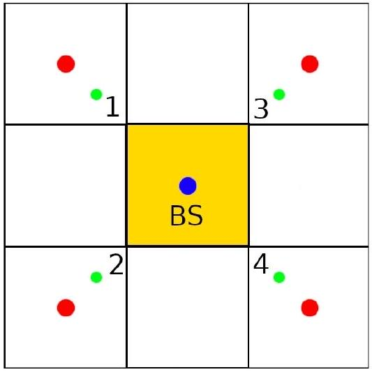
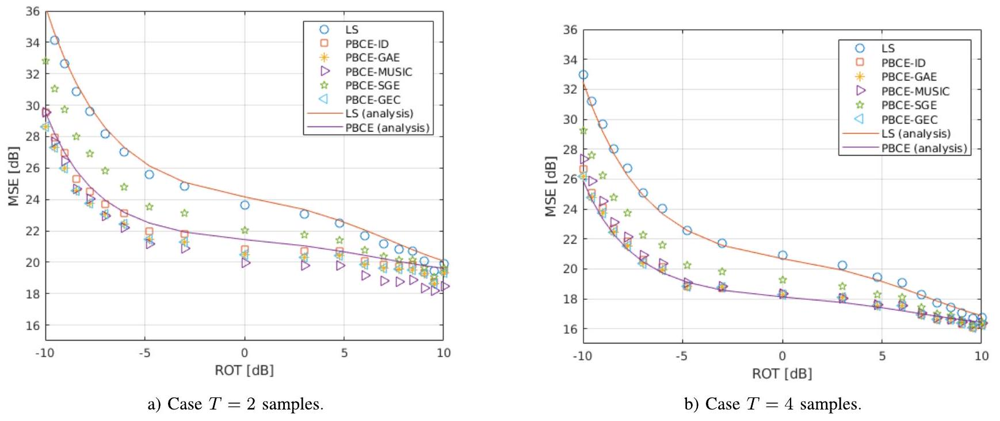
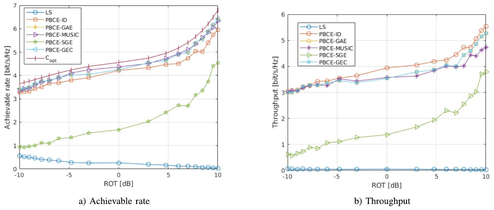
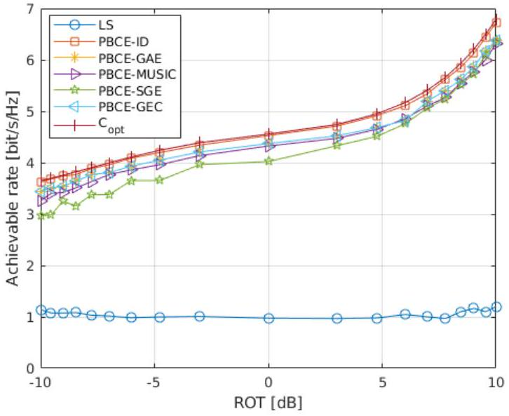
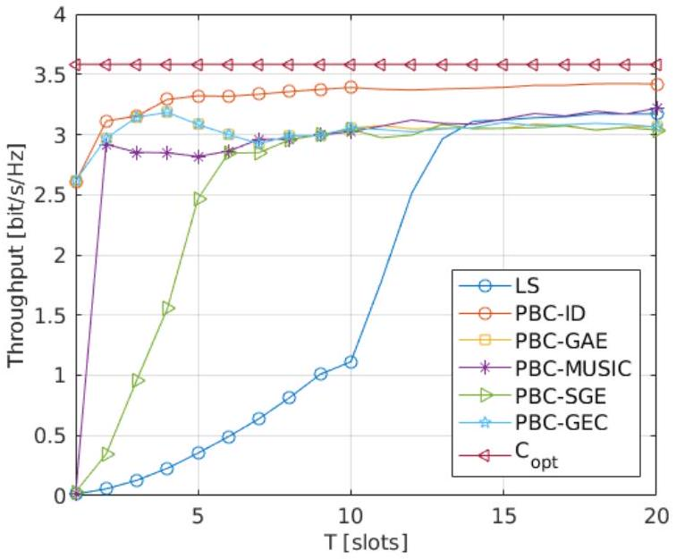
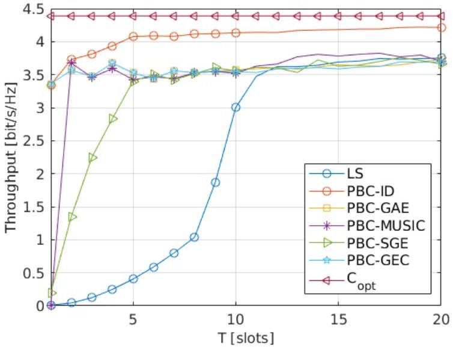
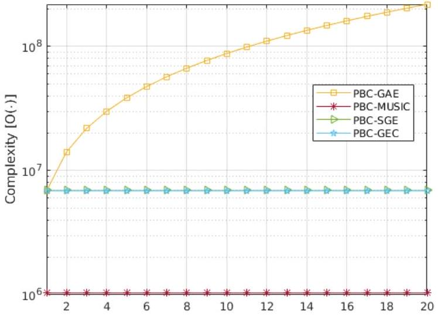

# Estimation of Interference Correlation in mmWave Cellular Systems 

Stefano Tomasin ${ }^{\text {(i) }}$, Senior Member, IEEE, Raphael Hasler, Antonia M. Tulino, Fellow, IEEE, and Matilde Sánchez-Fernández ${ }^{\text {® }}$, Senior Member, IEEE

#### Abstract

We consider a cellular network, where the uplink transmissions to a base station (BS) are interferenced by other devices, a condition that may occur, e.g., in cell-free networks or when using non-orthogonal multiple access (NOMA) techniques. Assuming that the BS treats this interference as additional noise, we focus on the problem of estimating the interference correlation matrix from received signal samples. We consider a BS equipped with multiple antennas and operating in the millimeter-wave (mmWave) bands and propose techniques exploiting the fact that channels comprise only a few reflections at these frequencies. This yields a specific structure of the interference correlation matrix that can be decomposed into three matrices, two rectangular depending on the angle of arrival (AoA) of the interference and the third square with smaller dimensions. We resort to gridless approaches to estimate the AoAs and then project the least square estimate of the interference correlation matrix into a subspace with a smaller dimension, thus reducing the estimation error. Moreover, we derive two simplified estimators, still based on the gridless angle estimation that turns out to be convenient when estimating the interference over a larger number of samples.

Index Terms-Angle of arrival, cell-free networks, interference estimation, non-orthogonal multiple access.

## I. Introduction

THE evolution of cellular networks is pushing towards NOMA schemes, wherein the wireless resource is not

Manuscript received 27 November 2022; revised 21 April 2023; accepted 25 June 2023. Date of publication 12 July 2023; date of current version 12 March 2024. This work was partially supported by the European Union under the Italian National Recovery and Resilience Plan (NRRP) of NextGenerationEU, partnership on Telecommunications of the Future (PE00000001-program RESTART), and by MIUR under the project FRAC-TAL: A Fundamental Non-Asymptotic Framework for Practical Active Learning (Project number: E59C20001020005). This work has been partly funded by the Spanish Government through project "Towards a sustaInable and REliable 3D wireless NEtwork" (IRENE-EARTH, PID2020-115323RB-C33/Agencia Estatal de Investigación/10.13039/501100011033) (Ministerio de Ciencia e Innovacion/Agencia Estatal de Investigación/European Regional Development Fund, European Union). The associate editor coordinating the review of this article and approving it for publication was X. Cheng. (Corresponding author: Stefano Tomasin.)

Stefano Tomasin is with the Department of Information Engineering, University of Padua, 35131 Padua, Italy, and also with the Consorzio Nazionale Interuniversitario per le Telecomunicazioni (CNIT), 43124 Parma, Italy (e-mail: stefano.tomasin@unipd.it).
Raphael Hasler was with the University of Padua, 35122 Padua, Italy. He is now with MRK Group Italia, 38068 Rovereto, Italy (e-mail: raphael.hasler@studenti.unipd.it).
Antonia M. Tulino is with the Dipartimento di Ingegneria Elettrica e delle Tecnologie dell'Informazione (DIETI), Università degli Studi di Napoli Federico II, 80133 Naples, Italy, and also with the Electrical and Computer Engineering Department, New York University Tandon School of Engineering, New York, NY 11201 USA (e-mail: antoniamaria.tulino@unina.it).
Matilde Sánchez-Fernández is with the Signal Theory and Communications Department, Universidad Carlos III de Madrid, 28911 Leganés, Spain (e-mail: mati@tsc.uc3m.es).
Color versions of one or more figures in this article are available at https://doi.org/10.1109/TWC.2023.3291917.
Digital Object Identifier 10.1109/TWC.2023.3291917 exclusively assigned to a user (as in orthogonal multiple access) but is shared among several devices that interfere. Such an approach may be applied either within each cell (in what is more specifically NOMA, [1]) or among different cells, e.g., in dynamic time-division duplexing (TDD) networks [2] and is particularly attractive in systems with partial or distributed coordination, such as in device-to-device (D2D) communications [3] or cell-free networks [4]. In all these cases, the interference among devices becomes challenging and is addressed by several techniques that can be classified according to the underlying interference model: when interference is seen as an additional data signal with a suitable structure (e.g., with known modulation and coding parameters) successive interference cancellation (SIC) or multiuser decoding solutions are applied; when interference is seen as additional noise, it is handled by suitable signal processing at the transmitter or the receiver, e.g., by beamforming and combining signals over multiple antennas in multiple-input multiple-output (MIMO) systems. The first approach, which is preferable under strong interference coming from a few users, requires the estimation of the interference channels, and yields intensive computations. The latter approach is preferable when several low-power interferers are present, as they cannot be demodulated without errors; this approach requires the estimation of the statistics of the interference and entails fewer computations. However, interference can always be treated as additional noise, even under strong interference, thus our approach has a very wide application. This is particularly true when either strong interferers cannot be decoded, e.g., because the receiver either does not know the used modulation or coding or does not have enough computational capabilities. In all these cases, the estimation of the interference correlation matrix turns out to be very useful.

We focus on the latter scenario, where interference is treated as additional noise, and consider the problem of estimating its correlation matrix when the receiver is equipped with multiple antennas. The estimation of the interference statistics is not only useful for the design of beamformers but also to improve the channel estimation [5], estimate the phase noise and frequency offset [6], and perform link adaptation [7]. Note however that we aim at estimating the correlation matrix of the interference averaging over the signal transmitted by the interferers, but assuming their channel as time-invariant: this makes our problem significantly different from the covariance matrix estimation of the channel, where the average is taken with respect to the channel fading (see for example [8]).

Several works in the literature have addressed the estimation of the noise variance, under the assumption of independent identically distributed noise samples on each receive antenna.

Among other works, we mention [9], where the noise variance estimation is considered in the context of massive MIMO assuming uncorrelated noise at the antennas and under practical impairments such as pilot contamination. Although a different noise power is assumed at each antenna, noise samples at different antennas are still considered uncorrelated. In this paper, we instead focus on the case wherein interference is correlated among the various antennas. In this respect, in the literature we can find exponential models for the correlation of the noise among antennas, see [10] and references therein. These models neither exemplify any particular propagation scenario nor are suited to capture the underlying composite interference signals. In fact, they are typically proposed as the simplest analytical model that can be easily adapted to empirically derived covariances [11]. Nevertheless, exponential correlation modeling has some drawbacks: on one hand, the fitting may not be straightforward given that they are not linear functions, on the other, they may miss relevant components, e.g., at high frequencies. In [12] and [13] the training sequence for channel estimation in MIMO systems with colored noise is designed, but no specific solution is proposed for the estimation of the noise correlation matrix. In [14] a generic covariance matrix of the interference is considered, and the problem of its joint estimation with the channel is addressed and solved by a low-rank approximation of the channel. However, no particular structure of the interference correlation matrix is assumed. The estimation of colored interference is considered in [2] and a least square (LS) technique is proposed. The noise correlation matrix estimation is included in the estimation of the channel correlation in [15], and a modified version of the LS estimator is derived, taking into account the channel statistics.

However, to our knowledge, there are no specific solutions for interference correlation matrix estimation when operating at mmWave or Terahertz (THz) bands. Indeed, at those frequencies, the channels exhibit only a few propagation paths, due to the strong attenuation incurred by radio signals. This feature has been extensively exploited to obtain accurate channel estimators [16]. Still, it remains not used for the estimation of the interference correlation matrix in systems operating at mmWave or THz bands. Note that, although the presence of few paths could make the beamforming to the interfering users more accurate, the strong attenuations combined to more flexible architectures (including D2D, cell-free, and dynamic-TDD communications) may make the detection and cancellation of all interfering users more problematic. Thus, also with mmWaves the estimation of the interference correlation matrix is still relevant.

In this paper, we propose three techniques to estimate the interference correlation matrix in mmWave or THz systems with different complexity and performance. All solutions exploit the structure of the interference channels, and the objective is to obtain more accurate estimations using fewer samples than those needed by the LS approach. In particular, we consider a receiver equipped with a linear array of antennas and first observe that the interference correlation matrix can be decomposed into the product of three matrices, where the two external depend only on the AoAs of the interference signals. At the same time, the internal one represents the correlation among the interference signals. The internal matrix has a much lower rank than the interference correlation matrix since it only provides the correlation of signals with the (few) different AoAs. Then, we propose a procedure by which we estimate a) the AoAs, b) the internal correlation matrix, and c) the interference matrix. Lastly, we reconstruct the interference correlation matrix.

In particular, for the AoA estimation, we adopt a gridless angle estimation (GAE) approach [17], where the estimation is described as a gridless identification of several multidimensional frequency vectors, each corresponding to a different AoA. Although this estimator shows an improvement over the LS estimator already when using a few samples for each antenna, it becomes infeasible when applied to several samples. Therefore, we introduce two alternative approaches, still based on GAE: the subspace gridless estimation (SGE) and the gridless estimation and clustering (GEC). SGE first estimates the subspace of the LS correlation estimate and then applies the GAE method on the subspace basis vectors, with a complexity that does not increase with the number of observations. GEC instead performs a separate GAE estimation on each new interference observation and then fuses the estimates by clustering the estimated AoAs. In this case, the complexity increases with the number of observations, since a larger number of points must be clustered; however, the resulting complexity is still less than that of the original GAE technique. For comparison purposes, we also consider the multiple signal classification (MUSIC) algorithm for the AoA estimation.

The rest of the paper is organized as follows. Section II introduces the considered interference scenario, the mmWave channel model with few reflections, and the LS estimate of the interference correlation matrix. Section III describes the proposed projection-based correlation estimate and the procedure that first estimates the AoAs and then provides a more accurate estimate of the interference correlation matrix. The channel interference matrix estimators based on GAE techniques are described in Section IV. The proposed approaches for the interference correlation estimate are then compared with the LS estimate in a typical cellular communication scenario in Section V before the main conclusions are outlined in Section VI.

Notation: Matrices and vectors are denoted in boldface, with uppercase and lowercase letters, respectively. $\boldsymbol{A}^{T}$ and $\boldsymbol{A}^{\mathrm{H}}$ denote the transpose and Hermitian operators on matrix $\boldsymbol{A}$, respectively. $\boldsymbol{A} \succcurlyeq 0$ indicates that matrix $\boldsymbol{A}$ is semidefinite positive. $\boldsymbol{I}_{L}$ is the identity matrix of size $L \times L . \boldsymbol{B}=\operatorname{diag}\{\boldsymbol{b}\}$ is a diagonal matrix having on the diagonal elements of vector $\boldsymbol{b}$. $\operatorname{atan} 2(\boldsymbol{p})$ is the 2-argument arc-tangent of point $\boldsymbol{p}=[x, y]$. $\boldsymbol{A}^{\dagger}$ denotes the More-Penrose pseudoinverse of matrix $\boldsymbol{A}$.

## II. System Model

In a communication system, we consider one BS with $N$ antennas (denoted main BS) receiving signals in uplink from several served user equipments (UEs). In the surroundings, a set of users transmit to their own serving BSs and interfere at the main BS. In this system, we set $L$ as the total number
of interferers to the main BS, each interferer is equipped with $N_{I}$ antennas, and interferers transmit statistically independent signals. We consider one BS (denoted main BS) of a cellular communication system receiving signals in uplink from several served UEs through its $N$ antennas. This scenario fits cellular systems dynamic TDD networks (where interferes are in other cells) and cell-free networks.

Let us indicate with $J^{(\ell)}(t) \in \mathbb{C}^{N_{I} \times 1}, \ell=1, \ldots, L$, the column vector of symbols transmitted by interferer $\ell$ at symbol time $t$. Assuming time-invariant narrowband channels, the matrices of the channels from the $L$ interferers to the main BS are $\boldsymbol{G}(\ell) \in \mathbb{C}^{N \times N_{I}}, \ell=1, \ldots, L$. We consider here that only a few interferers are present, i.e., $L$ is a small number. Due to the specific propagation conditions in mmWave, such as severe large-scale fading and blockage, we consider here that only a few interferers are present, i.e., $L$ is a small number. The baseband equivalent interference and noise signal received at sample time $t$ by the main BS can then be written as the $N$-size column vector

$$
\begin{equation*}
\boldsymbol{N}(t)=\boldsymbol{Y}(t)+\boldsymbol{Z}(t)=\sum_{\ell=1}^{L} \boldsymbol{G}(\ell) \boldsymbol{J}^{(\ell)}(t)+\boldsymbol{Z}(t), \tag{1}
\end{equation*}
$$

where $\boldsymbol{Z}(t)$ is the vector of additive white Gaussian noise (AWGN), with independent entries having zero mean and variance $\sigma^{2}$, which is supposed to be known at the main BS.

We assume that $\boldsymbol{J}^{(\ell)}(t)$ and $\boldsymbol{Z}(t)$ are independent complex Gaussian vectors with zero mean. The cross-correlation matrices of vectors $\boldsymbol{J}^{(\ell)}(t)$ and $\boldsymbol{Z}(t)$ are $\boldsymbol{R}_{J}=\mathbb{E}\left[\boldsymbol{J}^{(\ell)}(t) \boldsymbol{J}^{(\ell) H}(t)\right]$, and $\boldsymbol{R}_{Z}=\mathbb{E}\left[\boldsymbol{Z}(t) \boldsymbol{Z}^{\mathrm{H}}(t)\right]=\sigma^{2} \boldsymbol{I}_{N}$, respectively. Note that the cross-correlation matrix of $\boldsymbol{J}^{(\ell)}(t)$, in general, is not an identity matrix as each interferer may use a transmit beamforming to convey one data stream with its multiple antennas. The cross-correlation of $\boldsymbol{N}(t)$ is therefore

$$
\begin{align*}
\boldsymbol{R}= & \mathbb{E}\left[\boldsymbol{N}(t) \boldsymbol{N}^{\mathrm{H}}(t)\right] \\
= & \mathbb{E}\left[\left(\sum_{\ell=1}^{L} \boldsymbol{G}(\ell) \boldsymbol{J}^{(\ell)}(t)+\boldsymbol{Z}(t)\right)\right. \\
& \left.\times\left(\sum_{\ell=1}^{L} \boldsymbol{G}(\ell) \boldsymbol{J}^{(\ell)}(t)+\boldsymbol{Z}(t)\right)^{\mathrm{H}}\right] \\
= & \sum_{\ell=1}^{L} \boldsymbol{G}(\ell) \boldsymbol{R}_{J} \boldsymbol{G}^{\mathrm{H}}(\ell)+\sigma^{2} \boldsymbol{I}_{N} . \tag{2}
\end{align*}
$$

In this paper, we aim at estimating matrix $\boldsymbol{R}$ from $T$ samples of the interference and noise signal, i.e., from $\boldsymbol{N}(t)$, $t=1, \ldots, T$. The main BS can obtain such samples for example in correspondence of pilot signals transmitted by the UE canceling the received signals (and also some other strong interference signals). The estimated interference correlation matrix $\hat{\boldsymbol{R}}$ will then be used to process the forthcoming received signals containing uplink data and mitigate the effects of interference. As mentioned in the introduction, we consider a scenario wherein the interference is treated as additional noise, as an example in the presence of several low-power interferes whose signals cannot be properly detected and canceled.

## A. Channel Model

All devices are equipped with linear antenna arrays. Signals transmitted by interferer $\ell$, with $\ell=1, \ldots, L$, propagate through $N_{g}$ scatterers and we indicate with $\alpha_{i, \ell}^{(\mathrm{Tx})}$ and $\alpha_{i, \ell}^{(\mathrm{Rx})}$ the angle of departure (AoD) and AoA of the $i$-reflection, for $i=0, \ldots, N_{g}-1$. Let us also define the transmit and receive phase shifts as

$$
\begin{align*}
& \gamma_{i, \ell}=\frac{D_{\min }^{(\mathrm{Tx})}}{\lambda} \sin \alpha_{i, \ell}^{(\mathrm{Tx})}, \\
& \beta_{i, \ell}=\frac{D_{\min }^{(\mathrm{Rx})}}{\lambda} \sin \alpha_{i, \ell}^{(\mathrm{Rx})}, \tag{3}
\end{align*}
$$

where $D_{\text {min }}^{(\mathrm{Tx})}$ and $D_{\text {min }}^{(\mathrm{Rx})}$ are the distances between the elements in the transmit and receive linear antenna arrays, respectively, and $\lambda$ is the wavelength of the carrier signal. Defining the steering vector function

$$
\begin{equation*}
\boldsymbol{a}_{N}(\beta)=\left[1, e^{-2 \pi \mathrm{i} \beta}, \ldots, e^{-2 \pi \mathrm{i} \beta(N-1)}\right]^{\mathrm{T}}, \tag{4}
\end{equation*}
$$

with $\mathrm{i}=\sqrt{-1}$, we can write the interference channel matrices as

$$
\begin{equation*}
\boldsymbol{G}(\ell)=\sum_{i=0}^{N_{g}-1} v_{i, \ell} \boldsymbol{a}_{N}\left(\beta_{i, \ell}\right) \boldsymbol{a}_{N_{I}}^{\mathrm{H}}\left(\gamma_{i, \ell}\right), \tag{5}
\end{equation*}
$$

where $v_{i, \ell}$ is the complex gain of signal $i$ of the $\ell$ th interferer, with power given by the path-loss $\left(P_{i, \ell}\right)$. In mmWave, the attenuation is high, due to the high operating frequencies and only a few rays participate in the formation of the useful signal (typically $N_{g} \in\{1,2,3\}$ ). In the following, we assume that the BS knows the value of $N_{g}$, although solutions are available to estimate its value [18], [19]. Note that our model may easily include the presence of blockage, a typical phenomenon of mmWaves, by considering a higher path-loss $P_{i, \ell}$, [20], [21]. Moreover, we do not have any specific assumption on the distribution of the interferes that will affect in general the statistics of $v_{i, \ell}, \beta_{i, \ell}$, and $\gamma_{i, \ell}$.

## B. LS Interference Correlation Matrix Estimate

A basic estimate of the interference correlation matrix $\boldsymbol{R}$ from the $T$ samples is provided by the LS estimate (or sample covariance matrix)

$$
\begin{equation*}
\hat{\boldsymbol{R}}_{\mathrm{LS}}(T)=\frac{1}{T} \sum_{t=1}^{T} \boldsymbol{N}(t) \boldsymbol{N}^{\mathrm{H}}(t) . \tag{6}
\end{equation*}
$$

Although for $T \rightarrow \infty$ we have $\hat{\boldsymbol{R}}_{\mathrm{LS}} \rightarrow \boldsymbol{R}$, the convergence of this estimator alone is slow, thus we consider techniques having a faster convergence. We will also integrate the LS estimate into advanced solutions that, starting from a still rough estimate, are able to refine it significantly.

## III. Projection-Based Correlation Estimate

In this section, we propose an estimator of the interference correlation matrix that exploits the structure of the interference
channel given by (1). From (5), we immediately have

$$
\begin{align*}
\boldsymbol{Y}^{(\ell)}(t) & =\boldsymbol{G}(\ell) \boldsymbol{J}^{(\ell)}(t) \\
& =\sum_{i=0}^{N_{g}-1} \boldsymbol{a}_{N}\left(\beta_{i, \ell}\right) \underbrace{\left[v_{i, \ell} \boldsymbol{a}_{N_{I}}^{\mathrm{H}}\left(\gamma_{i, \ell}\right) \boldsymbol{J}^{(\ell)}(t)\right]}_{x_{i, \ell}(t)}, \tag{7}
\end{align*}
$$

where (for fixed $v_{i, \ell}$ ) $\left\{x_{i, \ell}(t)\right\}, i=0, \ldots, N_{g}-1$, are zeromean complex Gaussian variables (since $\boldsymbol{J}^{(\ell)}$ is assumed to be Gaussian) with cross-correlations

$$
\begin{align*}
& \mathbb{E}\left[x_{i, \ell}(t) x_{j, \ell}^{*}(t)\right] \\
& =v_{i, \ell} v_{j, \ell}^{*} \mathbb{E}\left[\boldsymbol{a}_{N_{I}}^{\mathrm{H}}\left(\gamma_{i, \ell}\right) \boldsymbol{J}^{(\ell)}(t) \boldsymbol{J}^{(\ell) H}(t) \boldsymbol{a}_{N_{I}}\left(\gamma_{j, \ell}\right)\right] \\
& \left.=v_{i, \ell} v_{j, \ell}^{*} \boldsymbol{a}_{N_{I}}^{\mathrm{T}}\left(\gamma_{i, \ell}\right) \boldsymbol{R}_{J} \boldsymbol{a}_{N_{I}} \gamma_{j, \ell}\right) . \tag{8}
\end{align*}
$$

Therefore, from (1) and (7) we have

$$
\begin{equation*}
\boldsymbol{Y}(t)=\sum_{i=0}^{N_{g}-1} \sum_{\ell=1}^{L} \boldsymbol{a}_{N}\left(\beta_{i, \ell}\right) x_{i, \ell}(t) . \tag{9}
\end{equation*}
$$

Note that we assume that both $L$ and $N_{g}$ are small numbers and in particular $N_{g} L \ll N$.

To obtain a more compact model, we collect the interference channels into the matrix $\boldsymbol{G}=[\boldsymbol{G}(1), \ldots, \boldsymbol{G}(L)]$ and analogously we collect the transmitted interference symbol vectors into the column vector $\boldsymbol{J}(t)=\left[\boldsymbol{J}^{(1) \mathrm{T}}(t), \ldots, \boldsymbol{J}^{(L) \mathrm{T}}(t)\right]^{T}$. Now, by defining

$$
\begin{align*}
\boldsymbol{x}(\ell, t) & =\left[x_{1, \ell}(t), x_{2, \ell}(t), \ldots, x_{N_{g}-1, \ell}(t)\right]^{T} \\
\boldsymbol{x}(t) & =\left[\boldsymbol{x}^{T}(1, t), \ldots, \boldsymbol{x}^{T}(L, t)\right]^{T} \tag{10}
\end{align*}
$$

we can rewrite the interference vector at sample time $t$ as

$$
\begin{equation*}
\boldsymbol{N}(t)=\boldsymbol{G} \boldsymbol{J}(t)+\boldsymbol{Z}(t)=\boldsymbol{A} \boldsymbol{x}(t)+\boldsymbol{Z}(t), \tag{11}
\end{equation*}
$$

with $\boldsymbol{A}=[\boldsymbol{A}(1), \ldots, \boldsymbol{A}(L)]$ and $\boldsymbol{A}(\ell)=$ $\left[\boldsymbol{a}_{N}\left(\beta_{0, \ell}\right), \ldots, \boldsymbol{a}_{N}\left(\beta_{N_{g}-1, \ell}\right)\right]$. From (11) we can write the interference vector as the sum of $L N_{g}$ correlated Gaussian sources, arriving at the BS with receive phase shifts $\beta_{i, \ell}$, for $i=0, \ldots, N_{g}-1$, and $\ell=1, \ldots, L$.

Thus, inserting (11) into (2), the interference correlation matrix can be written as

$$
\begin{equation*}
\boldsymbol{R}=\boldsymbol{A} \boldsymbol{R}_{\boldsymbol{x}} \boldsymbol{A}^{\mathrm{H}}+\sigma^{2} \boldsymbol{I}_{N}, \tag{12}
\end{equation*}
$$

where $\boldsymbol{R}_{\boldsymbol{x}}=\mathbb{E}\left[\boldsymbol{x}(t) \boldsymbol{x}^{\mathrm{H}}(t)\right]$ is block-diagonal with $L$ blocks, as we assumed that the signals transmitted by the $L$ interferers are independent; entries of block $\ell$ are given by (8). From (12), we observe that the interference correlation matrix (neglecting noise) has a particular structure, as it can be decomposed into the product of three matrices: the two external matrices depend only on the AoAs of the interference signals, while the inner matrix depends only on the correlation of the interference signals coming from the different angles.

As we consider a scenario with few paths and few interferers, the number of rows (columns) $N_{g} L$ of $\boldsymbol{R}_{\boldsymbol{x}}$ is much smaller than the number of rows (columns) $N$ of $\boldsymbol{R}$. Moreover, although matrix $\boldsymbol{A}$ may have a large number of rows $(N)$, it actually depends again on a small number of parameters. Therefore, we propose the projection-based correlation estimation (PBCE) technique that splits the correlation estimation into two sub-problems: a) the estimation of the receive phase shifts (from which an estimate of matrix $\boldsymbol{A}$ is obtained), and b) the estimate of the inner correlation matrix $\boldsymbol{R}_{\boldsymbol{x}}$.

In particular, PBCE works as follows. Once $T$ received vectors $\boldsymbol{N}(t), t=1, \ldots, T$, have been collected:

1) estimate the receive phase shifts as $\hat{\beta}_{i, \ell}, i=0, \ldots, N_{g}-$ $1, \ell=1, \ldots, L$, from $\boldsymbol{N}(t), t=1, \ldots, T$;
2) obtain the LS estimate of the interference correlation matrix $\hat{\boldsymbol{R}}_{\mathrm{LS}}(T)$ as in (6);
3) remove the noise contribution from the LS estimate of the correlation matrix to obtain an estimate of the interference correlation
$$
\begin{equation*}
\hat{\boldsymbol{R}}_{\mathrm{LS}}^{\prime}(T)=\hat{\boldsymbol{R}}_{\mathrm{LS}}(T)-\sigma^{2} \boldsymbol{I}_{N} ; \tag{13}
\end{equation*}
$$
4) project $\hat{\boldsymbol{R}}_{\mathrm{LS}}^{\prime}(T)$ into the subspace defined by $\hat{\boldsymbol{A}}(\ell)=\left[\boldsymbol{a}_{N}\left(\hat{\beta}_{0, \ell}\right), \ldots, \boldsymbol{a}_{N}\left(\hat{\beta}_{N_{g}-1, \ell}\right)\right]$ and $\hat{\boldsymbol{A}}=[\hat{\boldsymbol{A}}(1), \ldots, \hat{\boldsymbol{A}}(L)]$ to obtain an estimate of $\boldsymbol{R}_{\boldsymbol{x}}$ as
$$
\begin{equation*}
\hat{\boldsymbol{R}}_{\boldsymbol{x}}(T)=\hat{\boldsymbol{A}}^{\dagger} \hat{\boldsymbol{R}}_{\mathrm{LS}}^{\prime}(T)\left(\hat{\boldsymbol{A}}^{\dagger}\right)^{\mathrm{H}} ; \tag{14}
\end{equation*}
$$
5) obtain the new estimate of the interference correlation matrix as (see (12))
$$
\begin{equation*}
\hat{\boldsymbol{R}}_{\mathrm{PBCE}}(T)=\hat{\boldsymbol{A}} \hat{\boldsymbol{R}}_{\boldsymbol{x}}(T) \hat{\boldsymbol{A}}^{\mathrm{H}}+\sigma^{2} \boldsymbol{I}_{N} . \tag{15}
\end{equation*}
$$
This is the explanation of the various points:
Point 1) refers to the estimate of the phase shifts and will be detailed in the next Section IV, where several techniques will be considered.
Point 2) provides the starting estimate of the interference correlation matrix, from which the inner correlation matrix $\boldsymbol{R}_{x}$ will be estimated, given the estimate of the AoA (thus the estimate of $\boldsymbol{A}$ ) obtained in point 1).
Point 3) elaborates on (12), first removing the AWGN noise contribution from the LS estimate of the interference correlation matrix.
Point 4) is obtained by observing that the LS estimate of $\boldsymbol{x}(t)$ from $\boldsymbol{N}(t)$, given the estimate $\hat{\boldsymbol{A}}$, is obtained as (see (11))
$$
\begin{equation*}
\hat{\boldsymbol{x}}_{\mathrm{LS}}(t)=\hat{\boldsymbol{A}}^{\dagger} \boldsymbol{N}(t) . \tag{16}
\end{equation*}
$$
Assuming that the angle estimates are correct $(\hat{\boldsymbol{A}}=\boldsymbol{A})$, the correlation matrix of $\hat{\boldsymbol{x}}_{\mathrm{LS}}(t)$ is
$$
\begin{equation*}
\mathbb{E}\left[\hat{\boldsymbol{x}}_{\mathrm{LS}}(t) \boldsymbol{x}_{\mathrm{LS}}^{\mathrm{H}}(t)\right]=\boldsymbol{A}^{\dagger} \boldsymbol{R} \boldsymbol{A}^{\dagger H}=\boldsymbol{R}_{\boldsymbol{x}}+\sigma^{2} \boldsymbol{A}^{\dagger} \boldsymbol{A}^{\dagger H}, \tag{17}
\end{equation*}
$$
and its LS estimate is
$$
\begin{align*}
\frac{1}{T} \sum_{t=1}^{T} \hat{\boldsymbol{x}}_{\mathrm{LS}}(t) \hat{\boldsymbol{x}}_{\mathrm{LS}}^{\mathrm{H}}(t) & =\frac{1}{T} \sum_{t=1}^{T} \boldsymbol{A}^{\dagger} \boldsymbol{N}(t) \boldsymbol{N}^{\mathrm{H}}(t) \boldsymbol{A}^{\dagger H} \\
& =\boldsymbol{A}^{\dagger} \hat{\boldsymbol{R}}_{\mathrm{LS}}(T) \boldsymbol{A}^{\dagger H} \tag{18}
\end{align*}
$$
Then, considering (18) as an estimate of (17) and removing the contribution of noise, we obtain the estimate (14) for $\boldsymbol{R}_{\boldsymbol{x}}$.
Lastly, point 5) follows from (12), and the estimated matrices replace the true matrices. The resulting PBCE estimate of $\boldsymbol{R}$ can also be written as
$$
\begin{align*}
\hat{\boldsymbol{R}}_{\mathrm{PBCE}}(T)= & \hat{\boldsymbol{A}}\left[\hat{\boldsymbol{A}}^{\dagger} \hat{\boldsymbol{R}}_{\mathrm{LS}}(T) \hat{\boldsymbol{A}}^{\dagger H}-\sigma^{2} \hat{\boldsymbol{A}}^{\dagger} \hat{\boldsymbol{A}}^{\dagger H}\right] \hat{\boldsymbol{A}}^{\mathrm{H}} \\
& +\sigma^{2} \boldsymbol{I}_{N} \tag{19}
\end{align*}
$$

## A. MSE for Correct Phase Shift Estimates

We now compute the mean square error (MSE) of the interference correlation matrix estimate under the hypothesis of correct receive phase-shift estimates and compare it with that obtained with the LS estimate. The MSE is defined as

$$
\begin{equation*}
\Gamma=\frac{1}{N^{2}} \sum_{m, n} \mathbb{E}\left[\left|\hat{\boldsymbol{R}}_{n, m}-\boldsymbol{R}_{n, m}\right|^{2}\right] . \tag{20}
\end{equation*}
$$

First, note that both the LS and the PBCE estimates (under correct angle estimation) are unbiased, i.e., $\mathbb{E}\left[\hat{\boldsymbol{R}}_{\mathrm{LS}}\right]=$ $\mathbb{E}\left[\hat{\boldsymbol{R}}_{\text {PBCE }}\right]=\boldsymbol{R}$. Then, for the LS estimate we have

$$
\begin{equation*}
\Gamma_{\mathrm{LS}}(T)=\frac{1}{N^{2}} \sum_{m, n} \mathbb{E}\left[\left|\frac{1}{T} \sum_{t=1}^{T}\left[\boldsymbol{N}(t) \boldsymbol{N}^{\mathrm{H}}(t)\right]_{n, m}-[\boldsymbol{R}]_{n, m}\right|^{2}\right] . \tag{21}
\end{equation*}
$$

Now, considering that $\left[\boldsymbol{N}(t) \boldsymbol{N}^{\mathrm{H}}(t)\right]_{n, m}$ are zero-mean and independent in $t$, we have

$$
\begin{equation*}
\Gamma_{\mathrm{LS}}(T)=\frac{1}{N^{2}} \sum_{m, n} \mathbb{E}\left[\left|\left[\boldsymbol{N}(t) \boldsymbol{N}^{\mathrm{H}}(t)\right]_{n, m}-[\boldsymbol{R}]_{n, m}\right|^{2}\right] \tag{22}
\end{equation*}
$$

and from the results of the Appendix, we have

$$
\begin{align*}
\Gamma_{\mathrm{LS}}(T) & =\frac{1}{T N^{2}} \sum_{m, n}[\boldsymbol{R}]_{n, n}[\boldsymbol{R}]_{m, m} \\
& =\frac{1}{T N^{2}} \operatorname{trace}^{2}(\boldsymbol{R}) \tag{23}
\end{align*}
$$

For the PBCE, from (19) and assuming $\hat{\boldsymbol{A}}=\boldsymbol{A}$, we have

$$
\begin{align*}
\Gamma_{\mathrm{PBCE}}(T) & =\frac{1}{N^{2}} \sum_{m, n} \mathbb{E}\left[\left|\left[\boldsymbol{R}_{\mathrm{PBCE}}\right]_{n, m}-[\boldsymbol{R}]_{n, m}\right|^{2}\right] \\
& =\frac{1}{N^{2}} \sum_{m, n} \mathbb{E}\left[\left\lvert\, \frac{1}{T} \sum_{t=1}^{T}\left[\boldsymbol { A } \left[\boldsymbol{A}^{\dagger} \boldsymbol{N}(t) \boldsymbol{N}^{\mathrm{H}}(t) \boldsymbol{A}^{\dagger H}\right.\right.\right.\right. \\
& \left.\left.\left.-\sigma^{2} \boldsymbol{A}^{\dagger} \boldsymbol{A}^{\dagger H}\right] \boldsymbol{A}^{\mathrm{H}}+\sigma^{2} \boldsymbol{I}_{N}\right]_{n, m}-\left.[\boldsymbol{R}]_{n, m}\right|^{2}\right] . \tag{24}
\end{align*}
$$

Since each term of the summation is zero-mean and independent also in this case, we have

$$
\begin{gather*}
\Gamma_{\mathrm{PBCE}}(T)=\frac{1}{T N^{2}} \sum_{m, n} \mathbb{E}\left[\mid\left[\boldsymbol { A } \left(\boldsymbol{A}^{\dagger} \boldsymbol{N}(t) \boldsymbol{N}^{\mathrm{H}}(t) \boldsymbol{A}^{\dagger H}-\right.\right.\right. \\
\left.\left.\left.\sigma^{2} \boldsymbol{A}^{\dagger} \boldsymbol{A}^{\dagger H}\right) \boldsymbol{A}^{\mathrm{H}}+\sigma^{2} \boldsymbol{I}_{N}\right]_{n, m}-\left.[\boldsymbol{R}]_{n, m}\right|^{2}\right] \\
=\frac{1}{T N^{2}} \sum_{m, n} \mathbb{E}\left[\mid\left[\boldsymbol{A} \boldsymbol{A}^{\dagger} \boldsymbol{N}(t) \boldsymbol{N}^{\mathrm{H}}(t) \boldsymbol{A}^{\dagger H} \boldsymbol{A}^{\mathrm{H}}\right]_{n, m}-\right. \\
\left.\left.\left[\sigma^{2} \boldsymbol{A} \boldsymbol{A}^{\dagger} \boldsymbol{A}^{\dagger H} \boldsymbol{A}^{\mathrm{H}}-\sigma^{2} \boldsymbol{I}_{N}+\boldsymbol{R}\right]_{n, m}\right|^{2}\right] \tag{25}
\end{gather*}
$$

and again from the results of the Appendix, we have

$$
\begin{align*}
& \Gamma_{\mathrm{PBCE}}(T) \\
& =\frac{1}{T N^{2}} \sum_{m, n}\left[\boldsymbol{A} \boldsymbol{A}^{\dagger} \boldsymbol{R} \boldsymbol{A}^{\dagger H} \boldsymbol{A}^{\mathrm{H}}\right]_{n, n}\left[\boldsymbol{A} \boldsymbol{A}^{\dagger} \boldsymbol{R} \boldsymbol{A}^{\dagger H} \boldsymbol{A}^{\mathrm{H}}\right]_{m, m} \\
& =\frac{1}{T N^{2}} \operatorname{trace}^{2}\left[\boldsymbol{A} \boldsymbol{A}^{\dagger} \boldsymbol{R} \boldsymbol{A}^{\dagger H} \boldsymbol{A}^{\mathrm{H}}\right] \tag{26}
\end{align*}
$$

Since $\boldsymbol{A}^{\dagger} \boldsymbol{A}=\boldsymbol{I}_{L N_{g}}$ and using (12), we have

$$
\begin{equation*}
\Gamma_{\mathrm{PBCE}}(T)=\frac{1}{T N^{2}} \operatorname{trace}^{2}\left[\boldsymbol{R}-\sigma^{2}\left(\boldsymbol{I}_{N}-\boldsymbol{A} \boldsymbol{A}^{\dagger} \boldsymbol{R} \boldsymbol{A}^{\dagger H} \boldsymbol{A}^{\mathrm{H}}\right)\right] . \tag{27}
\end{equation*}
$$

## IV. Receive Phase-Shift Estimation

For the estimation of the receive phase shifts $\hat{\beta}_{i, \ell}, i=$ $0, \ldots, N_{g}-1, \ell=1, \ldots, L$, we exploit the assumptions that interferers' channels have only a few paths and there are only a few interferers. This yields a sparse Fourier transform of the correlation matrix, i.e., its sparse representation in the angular domain. We consider three solutions, based on the gridless approach of [17], which has been proven to provide accurate estimates even from a single or a few samples (small $T$ ). Still, as $T$ grows, its complexity becomes prohibitive, and we propose also two simplified approaches. In particular, first, we propose the gridless angle estimation (GAE) based on [17] and [22]; in the second approach, denoted as subspace gridless estimation (SGE), the receive phase shifts are estimated from the LS-estimated interference correlation matrix; lastly, in the third approach, denoted gridless estimation and clustering (GEC), GAE is performed on windows of samples and the estimated phase shifts are clustered.

## A. Gridless Angle Estimation

First, we consider a solution where the AoAs are not forced to be on a grid but can take continuous values, in what is called a gridless estimation. In particular, we resort to the approach of [17] and [22], which leverages the equivalence between the computation of the $\ell_{0}$ atomic norm (AN) and a rank minimization problem restricted to the set of positive semidefinite canonical multi-level Toeplitz matrices.

In the GAE algorithm, the receive phase shifts are estimated by imposing a sparsity ( $\ell_{0}$ norm) on the estimated vectors $\boldsymbol{Y}(t), t=1, \ldots, T$. First, we recall that the $\ell_{0}$ AN of vectors $\{\hat{\boldsymbol{Y}}(t)\}$ in the atomic set $\mathcal{E}=\left\{\boldsymbol{a}_{N}(\beta), \beta \in[0,2 \pi)\right\}$, is defined as

$$
\begin{align*}
& \|\{\hat{\boldsymbol{Y}}(t)\}\|_{\mathcal{E}, 0} \\
& \quad=\inf _{\left\{\zeta_{p}\right\},\left\{q_{p}\right\}}\left\{P: \hat{\boldsymbol{Y}}(t)=\sum_{p=1}^{P} q_{p}(t) \boldsymbol{a}_{N}\left(\zeta_{p}\right), \forall t\right\} \tag{28}
\end{align*}
$$

Note that this definition is consistent with (9) when $\left\{\zeta_{p}\right\}$ are the estimated receive phase shifts. Then, we aim at minimizing the MSE between $\boldsymbol{N}(t)$ and $\hat{\boldsymbol{Y}}(t)$, under the sparsity constraint on $\hat{\boldsymbol{Y}}(t)$, with $t=1, \ldots, T$, i.e.,

$$
\begin{equation*}
\min _{\{\hat{\boldsymbol{Y}}(t)\}} \frac{1-\eta}{T} \sum_{t=1}^{T}\|\boldsymbol{N}(t)-\hat{\boldsymbol{Y}}(t)\|_{2}^{2}+\eta\|\{\hat{\boldsymbol{Y}}(t)\}\|_{\mathcal{E}, 0} \tag{29}
\end{equation*}
$$

where $\eta \in(0,1)$ is a parameter ruling the sparsity of the obtained solution. The solution of (29) provides $\hat{\boldsymbol{Y}}(t), t=$ $1, \ldots, T$, which in turn provide the estimated receive phase shifts $\hat{\beta}_{i, \ell}, i=0, \ldots, N_{g}-1, \ell=1, \ldots, L$, through (28).

Now, the function (29) is non-convex, making its minimization hard. Therefore, we consider its $l_{1}$-AN relaxation to obtain a simpler problem. Let $\mathcal{T}_{\mathrm{N}}$ be the set of positive semidefinite canonical 1-Level Toeplitz matrices with dimension $N$
(see [17] for its definition and properties). The relaxation of (29) leads to the following problem [17]

$$
\begin{equation*}
\min _{\tau,\{\boldsymbol{q}(t)\}, \boldsymbol{Q} \in \mathcal{T}_{\mathrm{N}}} \frac{1-\eta}{T} \sum_{t=1}^{T}\|\boldsymbol{N}(t)-\hat{\boldsymbol{Y}}(t)\|_{2}^{2}+\frac{\eta}{2}[\tau+\operatorname{trace}(\boldsymbol{Q})] \tag{30a}
\end{equation*}
$$

$$
\text { s.t. }\left[\begin{array}{cc}
\boldsymbol{Q} & \hat{\boldsymbol{Y}}(t)  \tag{30b}\\
\hat{\boldsymbol{Y}}^{\mathrm{H}}(t) & \tau
\end{array}\right] \succcurlyeq 0, \quad t=1, \ldots, T \text {. }
$$

This is a convex problem that can be solved with standard methods. The new estimates of the receive phase shifts $\hat{\beta}_{i, \ell}$, $i=0, \ldots, N_{g}-1, \ell=1, \ldots, L$, are then obtained by the Vandermonde decomposition of matrix $\boldsymbol{Q}$, as from the [17, Algorithm 1] (see also [22, Lemma 1]).

1) Complexity Analysis: As shown in [17] and [23], solving (30) requires

$$
\begin{equation*}
\mathcal{N}(N, T, \epsilon)=\mathcal{O}\left(T\left(N^{3}+T N^{2}+T^{2}\right) \sqrt{N} \log (1 / \epsilon)\right), \tag{31}
\end{equation*}
$$

arithmetic operations, where $\epsilon$ is the accuracy parameter. We note that as $T$ grows, the number of constraints in (30) also grows linearly with $T$, and the complexity of solving the optimization problem grows as $\mathcal{O}\left(T^{3}\right)$, as shown in [17]. Hence, we now consider two simplified solutions that are adequate when the number of samples grows large.

## B. Subspace Gridless Estimation

The second solution is based on the estimation of the receive phase shifts from the LS estimate of the interference matrix, rather than on samples $\boldsymbol{N}(t), t=1, \ldots, T$. This approach holds when the number of interfering signals is smaller than the number of BS antennas, i.e.,

$$
\begin{equation*}
S=L N_{g}<N . \tag{32}
\end{equation*}
$$

First, we observe that we can remove the contribution of the noise by subtracting the noise correlation as in (13), obtaining $\hat{\boldsymbol{R}}_{\mathrm{LS}}^{\prime}(T)=\hat{\boldsymbol{R}}_{\mathrm{LS}}(T)-\sigma^{2} \boldsymbol{I}_{N}$. Then, we can improve the LS estimate by imposing the Hermitian symmetry, obtaining

$$
\begin{equation*}
\hat{\boldsymbol{R}}_{\mathrm{LS}}^{\prime}(T)=\frac{1}{2}\left[\hat{\boldsymbol{R}}_{\mathrm{LS}}^{\prime}(T)+\hat{\boldsymbol{R}}_{\mathrm{LS}}^{\prime H}(T)\right] . \tag{33}
\end{equation*}
$$

Now, from (12), we observe that the columns of the true interference-only correlation matrix

$$
\begin{equation*}
\boldsymbol{R}^{\prime}=\boldsymbol{R}-\sigma \boldsymbol{I}_{N} \tag{34}
\end{equation*}
$$

lay in a sub-space of size $S$. Therefore, we can decompose the LS estimate of the interference-only correlation by singular value decomposition (SVD) as

$$
\begin{equation*}
\hat{\boldsymbol{R}}_{\mathrm{LS}}^{\prime}(T)=\boldsymbol{V} \boldsymbol{\Lambda} \boldsymbol{V}^{\mathrm{H}}, \tag{35}
\end{equation*}
$$

where $\boldsymbol{V}$ is unitary and $\boldsymbol{\Lambda}$ is diagonal with real non-negative entries $\lambda_{1} \geq \ldots \geq \lambda_{N}$, denoted as singular values.

To partially remove the estimation error, we define the tall $N \times S$ sub-matrix $\boldsymbol{\Lambda}^{\prime}$ of $\boldsymbol{\Lambda}$ containing the $S$ largest singular values, i.e., $\left[\boldsymbol{\Lambda}^{\prime}\right]_{s, s}=\lambda_{s}$, while all other entries of $\boldsymbol{\Lambda}^{\prime}$ are zero, and compute the new correlation estimate

$$
\begin{equation*}
\hat{\boldsymbol{R}}_{\mathrm{LS}}^{\prime \prime}(T)=\boldsymbol{V} \mathbf{\Lambda}^{\prime} \boldsymbol{V}^{\mathrm{H}} . \tag{36}
\end{equation*}
$$

Until now we have reduced the estimation error in the LS estimate by exploiting the properties of the SVD of the interference correlation matrix. Now, by comparing (36) with (12), we note that in the columns of $\boldsymbol{V}$ we have the steering vectors with the receive phase shifts. Thus, the SGE algorithm exploits this property. To this end, we first define the square root matrix of $\hat{\boldsymbol{R}}_{\mathrm{LS}}^{\prime \prime}(T)$ as

$$
\begin{equation*}
\boldsymbol{S}=\boldsymbol{V} \operatorname{diag}\left\{\sqrt{\lambda_{1}}, \ldots, \sqrt{\lambda_{S}}\right\}, \tag{37}
\end{equation*}
$$

and then we apply the GAE method on the columns of $\boldsymbol{S}$. In particular, we solve (30) with $T=S$ and $\boldsymbol{N}(t)$ replaced by the columns of $\boldsymbol{S}$.

1) Complexity Analysis: The number of operations required by this approach is

$$
\begin{equation*}
\mathcal{N}(N, S, \epsilon)=\mathcal{O}\left(N^{3}+S\left(N^{3}+S N^{2}+S^{2}\right) \sqrt{N} \log (1 / \epsilon)\right), \tag{38}
\end{equation*}
$$

where, with respect to (31) we added also the operations required by the SVD $\left(N^{3}\right)$. Note that, in this case, regardless of the value of $T$, the number of constraints is always $S$, thus limiting the computational complexity of this solution.

## C. Gridless Estimation and Clustering

We propose also the GEC algorithm, wherein GAE is performed on windows of $T_{0}$ samples, and the receive phase shifts are estimated on several windows. They are then suitably clustered and the new receive phase shift estimates are the cluster heads. The obtained solution is denoted as GEC.

In detail, let us first define the subset of observations obtained on window $n$ of $T_{0}$ samples as

$$
\begin{equation*}
\mathcal{N}(n)=\left\{\boldsymbol{N}(t), t=n T_{0}+1, \ldots, n T_{0}+T_{0}\right\} . \tag{39}
\end{equation*}
$$

Then, the GEC algorithm works as follows. At time $n T_{0}$, for $n \geq 1$ :

1) apply the GAE on $\mathcal{N}(n)$ to obtain the estimated $L N_{g}$ receive phase shifts $\left\{\hat{\beta}_{1,1}(n), \ldots, \hat{\beta}_{N_{g}-1, L}(n)\right\}$;
2) cluster the $n$ previously estimated receive phase shifts $\left\{\hat{\beta}_{1,1}(1), \ldots, \hat{\beta}_{N_{g}-1, L}(n)\right\}$ into $S$ clusters, as detailed in the following;
3) obtain the estimate of the receive phase shifts as the centroids of the $S$ clusters.

We now detail the clustering procedure and the computation of the centroids. First, note that the k-means algorithm [21] cannot be immediately applied on the estimated receive phase shifts, since it does not ensure that the centroids are phase shifts in the interval $[0,2 \pi)$. Therefore, we first convert each estimated receive phase shift $\hat{\beta}_{i, \ell}(n)$ into the two-dimensional vector

$$
\begin{equation*}
\hat{\boldsymbol{\beta}}_{i, \ell}(n)=\left[\cos \left(2 \pi \hat{\beta}_{i, \ell}(n)\right), \sin \left(2 \pi \hat{\beta}_{i, \ell}(n)\right)\right] . \tag{40}
\end{equation*}
$$

Hence, the set of all vectors at time $n T_{0}$ is

$$
\begin{gather*}
\overline{\mathcal{B}}=\left\{\hat{\boldsymbol{\beta}}_{0,1}(1), \ldots, \hat{\boldsymbol{\beta}}_{N_{g}-1, L}(1), \ldots, \hat{\boldsymbol{\beta}}_{0,1}(n),\right. \\
\left.\ldots, \hat{\boldsymbol{\beta}}_{N_{g}-1, L}(n)\right\} . \tag{41}
\end{gather*}
$$

The $S$ clusters are sets $\mathcal{B}_{1}, \ldots, \mathcal{B}_{S}$, with $\left|\mathcal{B}_{s}\right|=n / S$ : these sets constitute a partition of $\overline{\mathcal{B}}$, i.e., $\bigcup_{s} \mathcal{B}_{s}=\overline{\mathcal{B}}$ and

Fig. 1. Interference environment with the main BS (blue dot), neighborhood cells (white squares) with their BSs (red dots), and interferers (green dots).

$\mathcal{B}_{s_{1}} \cap \mathcal{B}_{s_{2}}$ for $s_{1} \neq s_{2}$. We use the MSE metric for clustering and finding the cluster head

$$
\begin{equation*}
\boldsymbol{\beta}_{s}=\operatorname{argmin}_{\boldsymbol{\zeta}} \sum_{\boldsymbol{\beta} \in \mathcal{B}_{s}}\|\boldsymbol{\zeta}-\boldsymbol{\beta}\|_{2}^{2}=\sum_{\boldsymbol{\beta} \in \mathcal{B}_{s}} \boldsymbol{\beta} \tag{42}
\end{equation*}
$$

Lastly, we convert $\boldsymbol{\beta}_{s}$ into the estimated phase shift as

$$
\begin{equation*}
\beta_{s}=\operatorname{atan} 2\left(\boldsymbol{\beta}_{s}\right) . \tag{43}
\end{equation*}
$$

1) Complexity Analysis: To obtain equal-size clusters of observations, we can resort for example to the algorithm of [24], having complexity $\mathcal{O}\left(T^{1.7}\right)$, thus the number of operations required by this approach is

$$
\begin{equation*}
\mathcal{N}(N, T, \epsilon)=\mathcal{O}\left(T^{1.7}+T_{0}\left(N^{3}+T_{0} N^{2}+T_{0}^{2}\right) \sqrt{N} \log (1 / \epsilon)\right) . \tag{44}
\end{equation*}
$$

## D. MUSIC Angle Estimation

For comparison purposes, we consider the MUSIC algorithm [25] to estimate the receive phase shift. This algorithm is based on the SVD of the LS estimate; as for SGE, we consider the LS-estimated interference-only correlation matrix $\hat{\boldsymbol{R}}_{\mathrm{LS}}^{\prime}(T)$ and its SVD (35). Then, the receive phase shifts $\left\{\beta_{i, \ell}\right\}$ are estimated by finding the $L N_{g}$ values of $\theta$ corresponding to the largest peaks of the frequency estimation function

$$
\begin{equation*}
P_{\mathrm{MU}}(\theta)=\frac{1}{\boldsymbol{a}_{N}^{\mathrm{H}}(\theta) \boldsymbol{V} \boldsymbol{V}^{\mathrm{H}} \boldsymbol{a}_{N}(\theta)} . \tag{45}
\end{equation*}
$$

Note that the peak is searched in a continuous space; however, in practice, $\theta$ is sampled in a discrete space over which the maxima are searched, thus a grid approach is obtained.

1) Complexity Analysis: The complexity of MUSIC then depends on the number of points of the grid $N_{\mathrm{G}}$, and can be written as [26]

$$
\begin{equation*}
\mathcal{O}\left(N^{2}\left(L N_{g}+T+N_{\mathrm{G}}\right)\right) . \tag{46}
\end{equation*}
$$

## V. Numerical Results

We assess now the performance of the proposed interference correlation matrix in the scenario of Fig. 1, where the main BS (blue point) is at the center of its square cell (in yellow), and the cell is surrounded by 4 neighboring cells (in white), in which $L=4$ interferers (green points) communicate with their own secondary BSs (red points). The interferers are placed along the segments between the main and the secondary BSs, which define the average AoA for channels $\boldsymbol{G}(\ell)$. For simulation purposes, we draw ray amplitudes $v_{i, \ell}$ from a complex Gaussian distribution with zero mean and unitary variance, i.e., $P_{i, \ell}=1$, modeling interferers in no-line-of-sight (nLOS) condition with respect to the main BS. Note that such a scenario is the worst-case for interference estimation since all channel paths are weak and thus particularly challenging to be estimated.

The main BS is equipped with $N=32$ antennas, and the channel is modeled as in Section II-A, with $N_{g}=3$ rays. AoAs $\left\{\alpha_{i, \ell}^{(\mathrm{Rx})}\right\}$ are uniformly distributed with mean given by the angle between the transmitting interferer and the main BS and support size $\frac{\pi}{6}$, which corresponds to a cell with 12 sectors (a higher-order sectorization, see [27]), while AoDs $\left\{\alpha_{i, \ell}^{(\mathrm{Tx})}\right\}$ are uniformly distributed in the interval $[0, \pi]$. The antenna spacings are $D_{\text {min }}^{(\mathrm{Tx})}=D_{\text {min }}^{(\mathrm{Rx})}=\frac{\lambda}{2}$, for a carrier frequency $f_{c}=28 \mathrm{GHz}$.

The performance will be shown as a function of the ROT, defined as the ratio between the interference power and the noise power, i.e.,

$$
\begin{equation*}
\mathrm{ROT}=\frac{\frac{1}{N} \operatorname{trace} \boldsymbol{R}-\sigma^{2}}{\sigma^{2}}=\frac{\frac{1}{N} \operatorname{trace} \boldsymbol{R}}{\sigma^{2}}-1 . \tag{47}
\end{equation*}
$$

In particular, in the following we vary the noise power $\sigma^{2}$ while leaving unchanged the interference power. Therefore, from (47), we note by increasing the noise power we decrease the ROT.

We focus on the case of single-antenna users and interferes $\left(N_{I}=1\right)$ and the received vector signal at sample $t$ (including also the data signal, not only noise and interference) is

$$
\begin{equation*}
\boldsymbol{r}(t)=\boldsymbol{h} s(t)+\boldsymbol{N}(t), \tag{48}
\end{equation*}
$$

with $\boldsymbol{h}$ the column channel vector between the transmitter in the main cell and the BS and $s(t)$ the transmitted useful data symbol at time $t$, assumed to be Gaussian zero-mean with variance $\sigma_{x}^{2}$. We assume here that the BS perfectly knows $\boldsymbol{h}$.

We assume that the BS requests from the transmitter a data rate $R$ to be used for uplink transmission. Since the BS does not have a perfect estimate of the interference correlation matrix, its estimate $\hat{C}$ of the achievable rate in the uplink channel is affected by errors. Thus, the BS will transmit at rate $R=\delta \hat{C}$, with $\delta \in[0,1]$, suitably chosen, as detailed in the following. Note that even with this choice, outages may occur, when $R>C$, and $C$ is the true achievable rate of the uplink channel.

## A. Performance Metrics

Performance has been compared in terms of a) MSE of the estimate of the interference correlation matrix, b) achievable data rate, and c) effective throughput (taking into account outages).

1) MSE: The MSE of the estimate of the interference correlation matrix is defined in (20).

Fig. 2. MSE vs raise-over-thermal (ROT) for $T=2$ and $T=4$ samples and various interference correlation matrix estimators.

2) Achievable Rate: To define the achievable rate and the throughput, we first revise the operations performed at the BS upon reception of a message. We recall that we treat the interference as additional noise, but we explicitly exploit the knowledge of its correlation matrix, estimated with the techniques presented in this paper. Thus, the BS first whitens the interference on $\boldsymbol{r}(t)$. This is achieved by decomposing the estimated interference correlation matrix $\hat{\boldsymbol{R}}$ by computing its SVD $\hat{\boldsymbol{R}}=\boldsymbol{U} \boldsymbol{\Lambda} \boldsymbol{U}^{\mathrm{H}}$ and then whitening the signal to obtain

$$
\begin{equation*}
\boldsymbol{r}^{\prime}(t)=\boldsymbol{\Lambda}^{-1 / 2} \boldsymbol{U}^{\mathrm{H}} \boldsymbol{r}(t)=\boldsymbol{g} s(t)+\boldsymbol{N}^{\prime}(t), \tag{49}
\end{equation*}
$$

where

$$
\begin{equation*}
\boldsymbol{g}=\boldsymbol{\Lambda}^{-1 / 2} \boldsymbol{U}^{\mathrm{H}} \boldsymbol{h} \tag{50}
\end{equation*}
$$

is the equivalent channel and $\boldsymbol{N}^{\prime}(t)$ is the noise term (that includes the noise-like interference). Note that if the estimation of the interference correlation matrix is perfect, i.e., $\hat{\boldsymbol{R}}=\boldsymbol{R}$, then $\boldsymbol{N}^{\prime}(t)$ has an identity correlation matrix. Otherwise, it is still colored with correlation matrix

$$
\begin{equation*}
\boldsymbol{R}_{\boldsymbol{N}^{\prime}}=\boldsymbol{\Lambda}^{-1 / 2} \boldsymbol{U}^{\mathrm{H}} \boldsymbol{R} \boldsymbol{U} \boldsymbol{\Lambda}^{-1 / 2} . \tag{51}
\end{equation*}
$$

However, the BS is not aware of the residual correlation and cannot exploit it to compute the achievable data rate. Assuming for the sake of simplicity a single user transmitting in the uplink to the main BS (i.e., a resource block is assigned to a single user), the BS then applies a maximal ratio combiner (MRC) to obtain

$$
\begin{equation*}
\boldsymbol{r}^{\prime \prime}(t)=\boldsymbol{g}^{\mathrm{H}} \boldsymbol{r}^{\prime}(t)=\boldsymbol{g}^{\mathrm{H}} \boldsymbol{g} s(t)+\boldsymbol{g}^{\mathrm{H}} \boldsymbol{N}^{\prime}(t), \tag{52}
\end{equation*}
$$

where now the correlation of the noise becomes $\boldsymbol{g}^{\mathrm{H}} \boldsymbol{R}_{\boldsymbol{N}^{\prime}} \boldsymbol{g}$. Hence, and the true achievable data rate at the BS is

$$
\begin{equation*}
C=\log _{2}\left(1+\frac{\left(\boldsymbol{g}^{\mathrm{H}} \boldsymbol{g}\right)^{2} \sigma_{x}^{2}}{\boldsymbol{g}^{\mathrm{H}} \boldsymbol{R}_{\boldsymbol{N}^{\prime}} \boldsymbol{g}}\right) . \tag{53}
\end{equation*}
$$

3) Throughput: The throughput takes into account outages in the uplink transmission. The estimated achievable rate at the BS is

$$
\begin{equation*}
\hat{C}=\log _{2}\left(1+\boldsymbol{g}^{\mathrm{H}} \boldsymbol{g} \sigma_{x}^{2}\right) . \tag{54}
\end{equation*}
$$

When $\hat{\boldsymbol{R}}=\boldsymbol{R}, \hat{C}=C$ and this is also the spectral efficiency of the system, denoted as $C_{\text {opt }}$ : it provides an upper bound to the achievable rate $\hat{C}$. The throughput is then defined as

$$
\rho= \begin{cases}0, & \delta \hat{C}>C  \tag{55}\\ \delta \hat{C}, & \text { otherwise }\end{cases}
$$

We choose $\delta$ to maximize $\mathbb{E}[\rho]$ : this is obtained by numerical methods.

## B. Compared Solutions

We compare the following techniques for the interference correlation matrix:

- LS: the LS estimate of Section II-B;
- PBCE-GAE: PBCE using the GAE algorithm of Section IV-A for the estimate of the receive phase shifts;
- PBCE-SGE: PBCE using the SGE algorithm of Section IV-B for the estimate of the receive phase shifts;
- PBCE-GEC: PBCE using the GEC algorithm of Section IV-C for the estimate of the receive phase shifts;
- PBCE-MUSIC: PBCE using the MUSIC algorithm of Section IV-D for the estimate of the receive phase shifts;
- PBCE-ideal (ID): PBCE with the perfect estimate of the receive phase shifts.

We have considered $T_{0}=1$ and $N_{\mathrm{G}}=10^{3}$.

## C. Performance Results

First, we compare the performance in terms of MSE of the interference correlation matrix estimate.

Fig. 2 shows the interference correlation matrix MSE (20) as a function of the ROT for the considered estimators and

Fig. 3. Achievable rate (a) and throughput (b) vs ROT using $T=2$ samples and various interference correlation matrix estimators.

two values of the number of observed samples, namely $T=2$ and 4 . Note that we consider a very small number of samples to better assess the performance of the estimators based on the AoAs. In the following, we will also consider larger values of $T$. We first observe that as the noise increases, the ROT decreases, and the advantage of the proposed techniques becomes more evident since they distinguish noise from interference better than the LS technique. When comparing the various PBCE algorithms, we note that the PBCE-SGE provides only a partial improvement with respect to the LS estimator, while other approaches further reduce the MSE and achieve similar performance. Fig. 2 shows also the MSE obtained with the analysis of Section III-A, which well matches the simulation results.

We now consider both the achievable rate and the throughput as performance metrics.

Fig. 3 shows both the achievable rate and the throughput as a function of the ROT for $T=2$ samples and various correlation estimation methods. We observe that the LS estimate for such a small value of $T$ provides a very low achievable rate, much lower than that achieved when using PBCE techniques for the interference correlation matrix estimation. Indeed, all PBCE methods achieve a rate close to the capacity $C_{\text {opt }}$, all with similar performance, except for the PBCE-SGE method, showing a higher sensitivity to the interference and yielding an achievable rate close to LS for high ROT values. Lastly, note that all PBCE techniques exhibit an achievable rate reduction as the ROT increases, since the overall interference increases. For the LS technique, the estimation is very bad and the slight increase of the rate with the ROT is due to the fact that interference is structured and the whitening becomes a bit more effective. When comparing Fig. 2 and Fig. 3, we conclude that the MSE of the correlation matrix estimate is not indicative of the data rate performance, as the correlation matrix is used for whitening (see (50) and (53)) and the impact of correlation matrix estimation errors is not linear on the data rates.

Fig. 4. Achievable rate vs ROT with $T=5$ samples and various interference correlation matrix estimators.

Fig. 4 shows the achievable rate as a function of the ROT, when $T=5$ samples, for various correlation estimation methods. The trend is similar to that of Fig. 3, with the PBCE solutions getting closer to the upper bound, and the PBCE-SGE approach significantly increasing the achievable rate and aligning with the other techniques. Even the LS approach yields a higher achievable rate but is still considerably reduced with respect to that of the PBCE techniques. The LS method is still significantly affected by the estimation error, providing a very low achievable rate: indeed, the estimation error is so dominant that it turns out to be almost insensitive to the ROT.

Lastly, Figs. 5 and 6 show the throughput as a function of the number of samples $T$, for $R O T=-10$ and 0 dB, respectively. As expected, a larger number of samples used for the estimation provides higher throughput. However, the PBCE approaches show a much faster increase of the throughput with the number of samples than the LS approach, which is a significant advantage of the proposed solutions. Indeed, the LS approach suffers from the increased interference and

Fig. 5. Throughput vs $T$ with $R O T=-10 \mathrm{~dB}$ and various interference correlation matrix estimators.

Fig. 6. Throughput vs $T$ with $R O T=0 \mathrm{~dB}$ and various interference correlation matrix estimators.

requires more samples to achieve values close to the optimal when the ROT increases, and even when using more than 10 samples, the throughput improvement is very slow. Note also that for high values of ROT, the PBCE method based on GEC outperforms PBCE-MUSIC providing a $10 \%$ increase in the throughput.

In summary, we note that the proposed GEC methods outperform both the LS and the MUSIC techniques, at least at certain values of ROT. Moreover, GEC offer a faster convergence than MUSIC.

## D. Complexity Comparison

We have also compared the complexity of the various receive phase-shift estimation algorithms, as shown in Fig. 7 that reports the asymptotic $(\mathcal{O}(\cdot))$ number of operations required as a function of $T$, with all other parameters set as in the other performance figures. We note that PBCE-GAE has the highest complexity, which also grows fast with $T$, while both PBCE-SGE and PBCE-GEC have a complexity independent of $T$, as indeed it is related to $T_{0}$ and $S$, which are here kept constant. The MUSIC algorithm exhibits the lowest complexity, as expected. From the figure we first appreciate the

Fig. 7. Complexity comparison among the techniques.

reduction of complexity achieved by PBCE-SGE and PBCE-GEC with respect to PBCE-GAE. Then, taking into account the performance (in terms of throughput) achieved by the proposed PBCE techniques, we note that this advantage over MUSIC comes at the cost of higher complexity.

## VI. Conclusion

In this paper, we have proposed three techniques for the estimation of the interference correlation matrix in a cellular system. The approaches are based on the estimation of the AoAs of interference signals for channels with few rays. The investigation of several techniques for the estimation of the receive phase shift and their performance comparison in a simulated environment has shown that the GAE algorithm is very effective and that the sub-optimal (and less complex) solution GEC is also well-performing, especially when more symbols are available for the interference correlation estimate. A future study related to our proposed estimators may be devoted to the design of interference correlation matrix estimators when hybrid analog-digital receive structures are employed: in this case, the constraints on the number of radio-frequency chains and thus the accessible signals call for specific solutions that exploit both the geometry of the receive antennas and their grouping.

## Appendix

Let $x$ and $y$ be zero-mean jointly circularly symmetric complex Gaussian variables, with powers $\sigma_{x}^{2}$ and $\sigma_{y}^{2}$, crosscorrelation $\mathbb{E}\left[x y^{*}\right]=\xi \sigma_{x} \sigma_{y}$, and $\xi=\xi_{R}+j \xi_{I}$. We now aim at computing the variance of the random variable $x y^{*}$.

Variable $y$ can be written as a function of $x$ as

$$
\begin{equation*}
y=\xi^{*} \frac{\sigma_{y}}{\sigma_{x}} x+\sqrt{\sigma_{y}^{2}-\left|\xi \sigma_{y}\right|^{2}} w, \tag{56}
\end{equation*}
$$

with $w$ zero-mean unitary-variance circularly symmetric complex Gaussian variable, independent of $x$.

Then the variance of the random variable $x y^{*}$ is

$$
\begin{align*}
\mathbb{E}\left[\left|x y^{*}-\xi \sigma_{x} \sigma_{y}\right|^{2}\right]= & \mathbb{E}\left[\left|x y^{*}\right|^{2}\right)+\left|\xi \sigma_{x} \sigma_{y}\right|^{2}+ \\
& -2 \mathbb{E}\left(\Re\left\{x y^{*} \xi^{*} \sigma_{x} \sigma_{y}\right\}\right] . \tag{57}
\end{align*}
$$

Since we have

$$
\begin{align*}
\mathbb{E}\left[\left|x y^{*}\right|^{2}\right] & =\mathbb{E}\left[|x|^{4}\right]|\xi|^{2} \frac{\sigma_{y}^{2}}{\sigma_{x}^{2}}+\left(\sigma_{y}^{2}-\left|\xi \sigma_{y}\right|^{2}\right) \sigma_{x}^{2} \\
& =2 \sigma_{x}^{4}|\xi|^{2} \frac{\sigma_{y}^{2}}{\sigma_{x}^{2}}+\left(\sigma_{y}^{2}-\left|\xi \sigma_{y}\right|^{2}\right) \sigma_{x}^{2},  \tag{58}\\
\mathbb{E}\left[\Re\left\{x y^{*} \xi^{*} \sigma_{x} \sigma_{y}\right\}\right] & =\sigma_{x} \sigma_{y}\left[\xi_{R} \Re\left\{x y^{*}\right\}-\xi_{I} \Im\left\{x y^{*}\right\}\right] \\
& =\sigma_{x}^{2} \sigma_{y}^{2}|\xi|^{2}, \tag{59}
\end{align*}
$$

we obtain

$$
\begin{align*}
\mathbb{E}\left[\left|x y^{*}-\xi \sigma_{x} \sigma_{y}\right|^{2}\right]= & 2|\xi|^{2} \sigma_{x}^{2} \sigma_{y}^{2} \\
& +\sigma_{x}^{2} \sigma_{y}^{2}\left(1-|\xi|^{2}\right)-2 \sigma_{x}^{2} \sigma_{y}^{2}|\xi|^{2} \\
& +|\xi|^{2} \sigma_{x}^{2} \sigma_{y}^{2}=\sigma_{x}^{2} \sigma_{y}^{2} \tag{60}
\end{align*}
$$

## References

[1] Y. Yuan et al., "NOMA for next-generation massive IoT: Performance potential and technology directions," IEEE Commun. Mag., vol. 59, no. 7, pp. 115-121, Jul. 2021.
[2] H. Kim, J. Kim, and D. Hong, "Dynamic TDD systems for 5G and beyond: A survey of cross-link interference mitigation," IEEE Commun. Surveys Tuts., vol. 22, no. 4, pp. 2315-2348, 4th Quart., 2020.
[3] L. Tlebaldiyeva, G. Nauryzbayev, S. Arzykulov, and A. M. Eltawil, "Performance of NOMA-based mmWave D2D networks under practical system conditions," IEEE Access, vol. 9, pp. 160958-160974, 2021.
[4] H. A. Ammar, R. Adve, S. Shahbazpanahi, G. Boudreau, and K. V. Srinivas, "User-centric cell-free massive MIMO networks: A survey of opportunities, challenges and solutions," IEEE Commun. Surveys Tuts., vol. 24, no. 1, pp. 611-652, 1st Quart., 2022.
[5] H. Yin, D. Gesbert, M. Filippou, and Y. Liu, "A coordinated approach to channel estimation in large-scale multiple-antenna systems," IEEE J. Sel. Areas Commun., vol. 31, no. 2, pp. 264-273, Feb. 2013.
[6] D. Dexu Lin, R. A. Pacheco, T. Joon Lim, and D. Hatzinakos, "Joint estimation of channel response, frequency offset, and phase noise in OFDM," IEEE Trans. Signal Process., vol. 54, no. 9, pp. 3542-3554, Sep. 2006.
[7] B. Classon, A. Nimbalker, S. Sesia, and I. Toufik, Link Adaptation Channel Coding. Hoboken, NJ, USA: Wiley, 2011, ch. 10, pp. 215-248, doi: 10.1002/9780470978504.ch10.
[8] D. Neumann, M. Joham, and W. Utschick, "Covariance matrix estimation in massive MIMO," IEEE Signal Process. Lett., vol. 25, no. 6, pp. 863-867, Jun. 2018.
[9] J. Iscar, I. Güvenç, S. Dikmese, and N. Rupasinghe, "Efficient noise variance estimation under pilot contamination for massive MIMO systems," IEEE Trans. Veh. Technol., vol. 67, no. 4, pp. 2982-2996, Apr. 2018.
[10] M. L. Ammari, P. Fortier, and M. El Khaled, "Channel and noise covariance matrix estimation for MIMO systems with optimal training design," in Proc. IEEE 80th Veh. Technol. Conf. (VTC-Fall), Sep. 2014, pp. 1-5.
[11] T. Schubert, J. Korte, J. M. Brockmann, and W.-D. Schuh, "A generic approach to covariance function estimation using ARMAmodels," Mathematics, vol. 8, no. 4, p. 591, Apr. 2020, doi: 10.3390/math8040591.
[12] Y. Liu, T. F. Wong, and W. W. Hager, "Training signal design for estimation of correlated MIMO channels with colored interference," IEEE Trans. Signal Process., vol. 55, no. 4, pp. 1486-1497, Apr. 2007.
[13] M. Biguesh, S. Gazor, and M. H. Shariat, "Optimal training sequence for MIMO wireless systems in colored environments," IEEE Trans. Signal Process., vol. 57, no. 8, pp. 3144-3153, Aug. 2009.
[14] G. Soatti, A. Murtada, M. Nicoli, J. Gambini, and U. Spagnolini, "Lowrank channel and interference estimation in mm-wave massive antenna arrays," in Proc. 26th Eur. Signal Process. Conf. (EUSIPCO), Sep. 2018, pp. 922-926.
[15] F. A. Dietrich, T. Ivanov, and W. Utschick, "Estimation of channel and noise correlations for MIMO channel estimation," in Proc. Int. ITG Workshop Smart Antennas, Ulm, Germany, 2006, pp. 1-7.
[16] K. Hassan, M. Masarra, M. Zwingelstein, and I. Dayoub, "Channel estimation techniques for millimeter-wave communication systems: Achievements and challenges," IEEE Open J. Commun. Soc., vol. 1, pp. 1336-1363, 2020.
[17] A. V. Delgado, M. Sánchez-Fernández, L. Venturino, and A. Tulino, "Super-resolution in automotive pulse radars," IEEE J. Sel. Topics Signal Process., vol. 15, no. 4, pp. 913-926, Jun. 2021.
[18] H. Krim and J. H. Cozzens, "A data-based enumeration technique for fully correlated signals," IEEE Trans. Signal Process., vol. 42, no. 7, pp. 1662-1668, Jul. 1994.
[19] A. Di, "Multiple source location-A matrix decomposition approach," IEEE Trans. Acoust., Speech, Signal Process., vol. ASSP-33, no. 5, pp. 1086-1091, Oct. 1985.
[20] T. Bai, V. Desai, and R. W. Heath, "Millimeter wave cellular channel models for system evaluation," in Proc. Int. Conf. Comput., Netw. Commun. (ICNC), Feb. 2014, pp. 178-182.
[21] N. Benvenuto, G. Cherubini, and S. Tomasin, Algorithms for Communications Systems and Their Applications. Hoboken, NJ, USA: Wiley, 2021.
[22] M. Sánchez-Fernández, V. Jamali, J. Llorca, and A. M. Tulino, "Gridless multidimensional angle-of-arrival estimation for arbitrary 3D antenna arrays," IEEE Trans. Wireless Commun., vol. 20, no. 7, pp. 4748-4764, Jul. 2021.
[23] K. Krishnan and T. Terlaky, Interior Point and Semidefinite Approaches in Combinatorial Optimization. Boston, MA, USA: Springer, 2005, pp. 101-157.
[24] W. Tang, Y. Yang, L. Zeng, and Y. Zhan, "Optimizing MSE for clustering with balanced size constraints," Symmetry, vol. 11, no. 3, p. 338, Mar. 2019. [Online]. Available: https://www.mdpi.com/2073-8994/11/3/338
[25] R. Schmidt, "Multiple emitter location and signal parameter estimation," IEEE Trans. Antennas Propag., vol. AP-34, no. 3, pp. 276-280, Mar. 1986.
[26] F. Yan, M. Jin, and X. Qiao, "Low-complexity DOA estimation based on compressed MUSIC and its performance analysis," IEEE Trans. Signal Process., vol. 61, no. 8, pp. 1915-1930, Apr. 2013.
[27] R. Joyce, D. Morris, S. Brown, D. Vyas, and L. Zhang, "Higher order horizontal sectorization gains for 6, 9, 12 and 15 sectored cell sites in a 3GPP/HSPA+ network," IEEE Trans. Veh. Technol., vol. 65, no. 5, pp. 3440-3449, May 2016.

Stefano Tomasin (Senior Member, IEEE) received the Ph.D. degree from the University of Padua, Italy, in 2003. During his studies, he did internships at IBM Research, Switzerland, and Philips Research, The Netherlands. He joined the University of Padua, where he was an Assistant Professor from 2005 to 2015 and an Associate Professor from 2016 to 2022, and has been a Full Professor since 2022. He was a Visiting Faculty at Qualcomm, San Diego, CA, USA, in 2004; Polytechnic University, Brooklyn, NY, USA, in 2007; and the Mathematical and Algorithmic Sciences Laboratory, Huawei, Paris, France, in 2015. His current research interests include physical layer security, security of global navigation satellite systems, signal processing for wireless communications, synchronization, and scheduling of communication resources. He has been a member of EURASIP since 2011. He is or has been an Editor of the IEEE Transactions on Vehicular Technology from 2011 to 2016, the IEEE Transactions on Signal Processing from 2017 to 2020, the EURASIP Journal on Wireless Communications and Networking since 2011, and the IEEE Transactions on Information Forensics and Security since 2020. Also, he serves as the Deputy Editor-in-Chief for the IEEE Transactions on Information Forensics and Security since January 2023.

Raphael Hasler received the B.Sc. degree in telecommunication engineering from the Polytechnic University of Milan, Italy, in 2018, and the M.Sc. degree in ICT for Internet and multimedia from the University of Padua, Italy, in 2022. He graduated with a thesis entitled Statistics Estimation of Interference in mmWave Channels. In 2022, he became the Winner of a Research Grant at the Department of Information Engineering (DEI), University of Padua. His research was focused on the estimation of the interference correlation matrix.

Antonia M. Tulino (Fellow, IEEE) received the Ph.D. degree in electrical engineering from the Seconda Università degli Studi di Napoli, Italy, in 1999. She held research positions at the Center for Wireless Communications, Finland; Princeton University, USA; and the Università degli Studi del Sannio, Italy. From 2002 to 2016, she has been an Associate Professor with the Università degli Studi di Napoli Federico II, where she has been a Full Professor since 2017. Since 2002, she has been collaborating with Nokia Bell Labs. Starting from October 2019, she was a Research Professor with the Department of Electrical and Computer Engineering, NYU Tandon School of Engineering, New York, NY, USA. In September 2020, she was appointed as the Teaching Director of the 5G Academy jointly organized by the Università degli Studi di Napoli Federico II in collaboration with Capgemini, Nokia, and TIM. In 2013, she was elevated to IEEE Fellow. She has received several paper awards and among the others the 2009 Stephen O. Rice Prize in the Field of Communications Theory for the Best Paper Published in the IEEE Transactions on Communications in 2008. She was a recipient of the UC3M-Santander Chair of Excellence from 2018 to 2019. From 2011 to 2013, she was a member of the Editorial Board of the IEEE Transactions on Information Theory. She was selected by the National Academy of Engineering for the Frontiers of Engineering Program in 2013. Since 2019, she has been the Chair of the Information Theory Society Fellows Committee.

Matilde Sánchez-Fernández (Senior Member, IEEE) received the M.Sc. degree in telecommunications engineering and the Ph.D. degree from the Universidad Politécnica de Madrid, Madrid, Spain, in 1996 and 2001, respectively. In 2000, she joined the Universidad Carlos III de Madrid, Madrid, where she has been an Associate Professor since 2009 teaching several undergraduate and graduate courses (M.Sc. and Ph.D.) related to communication theory and digital communications. Previously, she was a Telecommunication Engineer with Telefónica. She performed several research stays at the Information and Telecommunication Technology Center, The University of Kansas, Lawrence, in 1998; Bell Laboratories, Crawford Hill, NJ, USA, from 2003 to 2006 and in 2015; the Centre Tecnologic de Telecomunicacions de Catalunya, Barcelona, Spain, in 2007; and Princeton University, Princeton, NJ, USA, in 2011. Her current research interests are signal processing for wireless communications, multiple-input multiple-output techniques, channel modeling in wireless communications and game theory, and machine learning techniques applied to communications. In these fields, she has (co)authored more than 50 contributions to international journals and conferences.

Open Access funding provided by 'Università degli Studi di Padova' within the CRUI CARE Agreement

