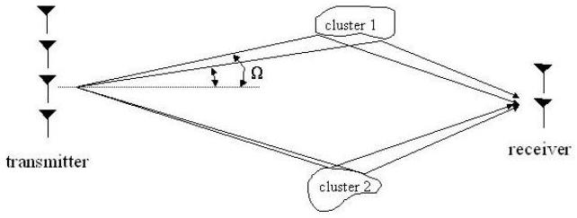
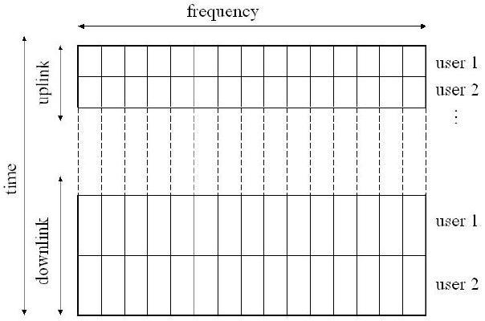
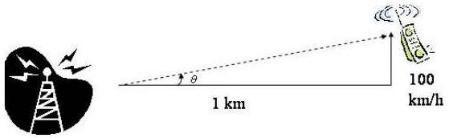
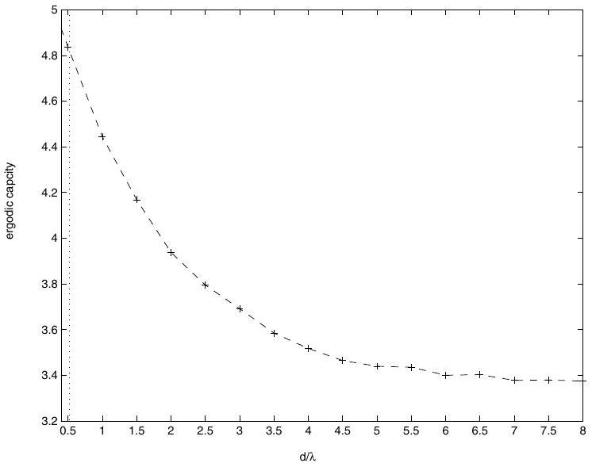
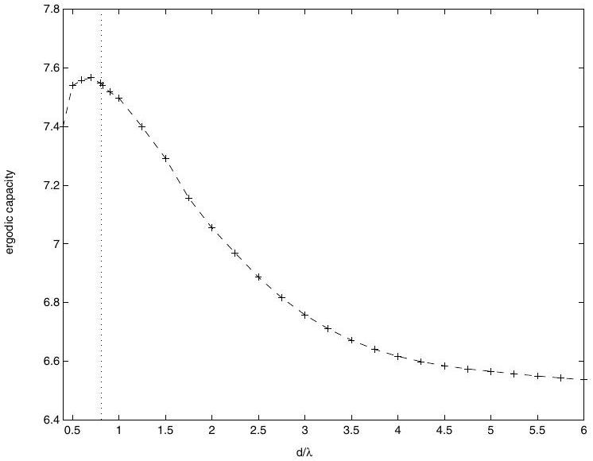

# Space-Time Communication for OFDM with Implicit Channel Feedback 

G.Barriac and U. Madhow School of Electrical and Computer Engineering University of California, Santa Barbara Santa Barbara, CA 93106 Email: madhow@ece.ucsb.edu

#### Abstract

We consider space-time communication over a typical cellular "downlink" based on Orthogonal Frequency Division Multiplexing (OFDM), in which the base station may have several antenna elements, while the mobile has 1 or 2 antenna elements. A summary of our findings is as follows: (a) Implicit channel feedback regarding the covariance matrix for the downlink space-time channel can be obtained, without any power or bandwidth overhead, by suitably averaging uplink channel measurements across frequency. Since this approach relies on statistical reciprocity, it applies to both Time Division Duplex (TDD) and Frequency Division Duplex (FDD) systems. The covariance feedback can be used to obtain better performance on the downlink, at lower encoding and decoding complexity, compared to standard space-time coding (which does not employ channel feedback). (b) The conventional design without channel feedback is to space the transmit antennas far enough apart so as to ensure uncorrelated responses. However, when implicit feedback is available, much better performance is obtained with significantly smaller antenna spacing, optimized such that the number of dominant eigenmodes of the channel matches the number of receive antenna elements.

## I. Introduction

Much of the literature on space-time communication deals with narrowband communication over a rich scattering environment typical of indoor channels. In contrast, the focus of this paper is on wideband communication over outdoor channels, which have higher delay spreads but much narrower spatial spreads. As shown in Figure 1, we consider a base station (BS) with multiple antennas and mobiles with one or two antennas. We will show that, under our assumptions, it is possible to design transceivers that yield better performance at lower complexity than conventional space-time coding and Multi-Input Multi-Output (MIMO) strategies. Our focus is on optimizing the downlink from BS to mobile, which is the bottleneck for many asymmetric applications, such as data downloads or audio/video delivery.

The key ideas underlying our results are as follows:
(i) For small spatial spreads, knowledge of the channel covariance matrix significantly increases the capacity [5], [6], [3],

[^0]
Fig. 1. System setup: the base station has multiple antennas, the mobile two or less

[4], since the channel response at different transmit elements is correlated (unless the antenna spacings are very large).
(ii) Covariance feedback is robust and "free" in a wideband system. As long as a mobile sends to the base station over multiple frequencies which are sufficiently spaced apart, information regarding the covariance can be obtained from uplink measurements without additional overhead. Furthermore, the covariance matrix varies very slowly, even if the channel itself exhibits fast fading.
(iii) The conventional prescription of spacing transmit antennas far enough apart to produce uncorrelated responses (intended for systems using standard space-time codes) no longer applies when covariance feedback is available. With such feedback, if the receiver has a single antenna, capacity is maximized when the antenna spacing is such that there is a single dominant eigenmode. Similarly, if the receiver has two antennas, and the SNR is not very low, capacity is maximized when the antenna spacing is such that there are two dominant eigenmodes. For the class of channels under consideration, reducing the antenna spacing concentrates the channel energy in fewer eigenmodes, hence capacity is maximized by reducing the spacing until most of the energy lies in the appropriate number of eigenmodes. This optimized capacity is much larger than the maximum capacity attainable when there is no channel feedback.

## II. System Model

The system considered is as in Figure 1. The BS is assumed to be far away from the mobile, and at high enough altitude
that there is little to no local scattering around it. Thus, both uplink and downlink signals for a given mobile are restricted to a fairly narrow spatial cone, from the viewpoint of the BS antenna array. In contrast, the mobile is assumed to be in a rich scattering environment so that each of its antennas sees uncorrelated channel responses. As in the classic Saleh-Valenzuela model [7], the channel response is decomposed into clusters. Experimental measurements of outdoor channels [9] indicate that the number of clusters is small, usually one or two, and that the power delay profile (PDP) and power angle profile (PAP) for each cluster as seen by the BS can be modeled as exponential and Laplacian, respectively. We restrict our attention to one cluster channels, since results for multi-cluster channels are similar.

Now, consider an OFDM system with $N_{T}$ transmit antennas, $N_{R}$ receive antennas, and $N$ frequency bins $\left(N_{R} \leq 2\right)$. One OFDM symbol consists of $N$ symbol vectors $\mathbf{s}_{i, i=1 \ldots N}$ of length $N_{T}$, each transmitted at a different frequency. Assuming negligible ICI, we can write

$$
\begin{equation*}
\hat{\mathbf{s}}_{i}=\mathbf{H}_{i} \mathbf{s}_{i}+\mathbf{n}_{i} \tag{1}
\end{equation*}
$$

where $\hat{\mathbf{s}}_{i}$ is the received data vector for the $i$ th tone, $\mathbf{H}_{i}$ is the $N_{R}$ x $N_{T}$ channel frequency response at the $i t h$ tone, and $\mathbf{n}_{i}$ is additive white Gaussian noise satisfying $E\left[\mathbf{n}_{i} \mathbf{n}_{j}^{H}\right]=$ $\sigma_{n}^{2} \mathbf{I}_{N_{R}} \delta(i-j)$.

It follows from our earlier work [1] that the rows of the channel matrix, denoted $\mathbf{H}_{i}(l,:)$, for all frequencies are well-modeled as independent identically distributed zero-mean proper complex Gaussian random vectors:

$$
\begin{equation*}
\mathbf{H}_{i}(l,:) \sim C N(0, \mathbf{C}) \forall l, i \tag{2}
\end{equation*}
$$

where

$$
\begin{equation*}
\mathbf{C}=E\left[\mathbf{a}(\Omega) \mathbf{a}(\Omega)^{H}\right] \tag{3}
\end{equation*}
$$

and $\mathbf{a}(\Omega)$ is the BS array response corresponding to angle of arrival/departure $\Omega$. For a linear array (our running example here), we have

$$
\begin{equation*}
\mathbf{a}(\Omega)=\left[a_{1} \ldots a_{l} . . a_{N_{T}}\right]^{T} \quad a_{l}(\Omega)=e^{j(l-1) 2 \pi \frac{d}{\lambda} \sin (\Omega)} \tag{4}
\end{equation*}
$$

where $d$ is the antenna array spacing, and $\lambda$ the carrier wavelength. The expectation in (3) is taken over $\Omega$, with $\Omega$ distributed according to the PAP.

Once the covariance matrix is known, the capacity of the OFDM system can be written as

$$
\begin{equation*}
C=\max _{Q: \operatorname{trace}(Q)=P} E\left[\frac{1}{N} \sum_{i=1}^{N} \log \left[\operatorname{det}\left(\mathbf{I}_{N_{R}}+\frac{1}{\sigma_{n}^{2}} \mathbf{H}_{i} \mathbf{Q} \mathbf{H}_{i}^{H}\right)\right]\right] \tag{5}
\end{equation*}
$$

$P$ is the power constraint, $\mathbf{s}_{i} \sim C N(0, \mathbf{Q})$, and we are assuming the distribution of the $\mathbf{s}_{i}$ is the same for all $i$. The optimal $\mathbf{Q}$ [4], [5] is given by

$$
\begin{equation*}
\mathbf{Q}_{0}=\mathbf{U}_{C} \Lambda_{0} \mathbf{U}_{C}^{H} \tag{6}
\end{equation*}
$$

where $\mathbf{U}_{C}$ is the unitary eigenvector matrix of C.i.e.;

$$
\begin{equation*}
\mathbf{C}=\mathbf{U}_{C} \boldsymbol{\Lambda}_{C} \mathbf{U}_{C}^{H} \tag{7}
\end{equation*}
$$

The optimal transmit strategy is thus to send along the eigenmodes of the channel covariance matrix $\mathbf{C}$.

## III. Implicit Covariance Feedback

In this section we show how information about the channel covariance, C, can be obtained from uplink measurements for both FDD and TDD systems. We assume for simplicity that the mobiles have only one antenna.

For the large delay spreads typical of outdoor environments, the coherence bandwidth is small, and the correlation between the channel responses at different frequencies dies out quickly with their separation. Thus, by measuring the channel over a rich enough set of frequencies on the uplink, the base station can accurately estimate $\mathbf{C}$. We term this concept statistical reciprocity, to distinguish it from deterministic reciprocity, which states that the channel response at a given frequency and time is the same in both directions.

The BS estimates the covariance matrix for a particular user as follows:

$$
\begin{equation*}
\hat{\mathbf{C}}_{k}=\frac{1}{\left|J_{k}\right|} \sum_{i \in J_{k}} \hat{\mathbf{H}}_{i}^{H} \hat{\mathbf{H}}_{i} \tag{8}
\end{equation*}
$$

where $J_{k}$ is the set of subcarriers the $k$ th mobile uses on its uplink, and $\hat{\mathbf{H}}_{i}$ is the base station's estimate of $\mathbf{H}_{i}$ obtained from the $k t h$ user's uplink measurement at frequency $f_{i}$.

There are two key issues regarding the efficacy of estimating the covariance matrix $\mathbf{C}$ in this way.
(i) The covariance must vary slowly enough such that when the base station sends to user $k$, the estimate $\hat{\mathbf{C}}_{k}$ is still valid. (ii) there must be enough subcarriers in $J_{k}$ for $\hat{\mathbf{C}}_{k}$ to well approximate $\mathbf{C}_{k}$.

Both these conditions are met for a wide variety of resource sharing models. For illustrative purposes we focus on two extreme examples. The first is a TDD system with TDMA on the uplink and TDM on the downlink. This particular setup requires the longest time for which feedback from the mobiles needs to remain accurate. The second example is an FDD system with FDM on the uplink and TDM on the downlink-a scenario which allows each user a limited amount of uplink frequency bins and therefore tests the limits of condition (ii).

In both examples we consider an OFDM system with 1024 subcarriers spaced 25 KHz apart. The PAP is initially $L\left(0^{\circ}, 5^{\circ}\right)$ ( $L\left(M^{o}, \alpha^{o}\right)$ denotes a Laplacian distribution with mean $M$ and variance $2 \alpha^{2}$ ) and the PDP is exponential with an rms value of $.5 \mu s$. SNR is set to 10 dB. The BS has 6 antennas, with a typical antenna spacing of $d / \lambda=.5$. At this spacing, beamforming is the optimal transmit strategy for the given PAP.

## A. Example 1: TDD system

A TDD system with TDMA/TDM on the uplink/downlink is shown in figure 2. Each user sends to the base station using the entire frequency band for a certain amount of time, and subsequently the base station takes turns sending to the mobiles over whole band. For such a system, $J_{k}$ in (8) equals the entire set of frequency bins for all $k$. If the bandwidth is large, $\hat{\mathbf{C}}_{k}$ is clearly a good approximation for $\mathbf{C}_{k}$, but the question remains as to whether this covariance will remain valid until the BS is ready to reply to that mobile on the

Fig. 2. A TDD system with TDMA on the uplink and TDM on the downlink

downlink. The longest a user will have to wait until it hears back from the BS is approximately the number of users in the system multiplied by the time the BS sends to each user. For a rate of 20Mbps and 10 packet payloads of 10,000 bits each, the time the BS sends to each mobile is approximately 5msec. If there are 10 users, this means the total delay is around 50 ms. However, even if the channel is fast fading, the covariance need not change much in this length of time, since it depends only on the power-angle profile, which in general is slowly varying. It is shown in [2] that for a mobile 500 m from the base station traveling less than 1000 km/h, and a BS station with 8 antennas spaced half a wavelength apart, the channel statistics can be considered stationary for around 100 ms. Thus, the PAP, and hence the covariance would also be stationary for that length of time.

Fig. 3. For a mobile 1 km away moving directly up at 100 km/h, $\theta$ changes .08° in 50 ms

We now consider how variations (we can assume these are small) in the PAP would affect system performance. For a mobile moving away from the BS at 100 km/h as pictured in Figure 3, the angle $\theta$ will change approximately $.08^{\circ}$ in 50 ms. If the center angle of the PAP changes a corresponding amount, we would like to know how this impacts performance results. Table I gives the outage and ergodic capacities of a wideband system when the actual PAP differs for the PAP used to estimate the covariance. It is assumed that the power angle profile remains Laplacian, and that only the mean and/or angular spread change with time. The first row shows the capacity (both ergodic and outage) when there is no feedback and the transmitter employs a full blown space-time code (the optimal transmit strategy when no feedback is available). The second row shows the capacity when the BS has perfect covariance feedback information and beamforms in the direction of the covariance's dominant eigenmode (beamforming is the optimal strategy in this scenario for the given parameters). The

| Actual PAP | Feedback PAP | $C_{e} b / s H z$ | $C_{o} b / s H z$ |
| :--- | :--- | :--- | :--- |
| $\Omega \sim L\left(0.0^{\circ}, 5^{\circ}\right)$ | no feedback | 3.12 | 2.70 |
| $\Omega \sim L\left(0.0^{\circ}, 5^{\circ}\right)$ | $\Omega \sim L\left(0.0^{\circ}, 5^{\circ}\right)$ | 4.83 | 4.13 |
| $\Omega \sim L\left(0.6^{\circ}, 5^{\circ}\right)$ | $\Omega \sim L\left(0.0^{\circ}, 5^{\circ}\right)$ | 4.83 | 4.14 |
| $\Omega \sim L\left(2.9^{\circ}, 5^{\circ}\right)$ | $\Omega \sim L\left(0.0^{\circ}, 5^{\circ}\right)$ | 4.76 | 4.09 |
| $\Omega \sim L\left(0.0^{\circ}, 9^{\circ}\right)$ | $\Omega \sim L\left(0.0^{\circ}, 5^{\circ}\right)$ | 4.83 | 4.13 |
| $\Omega \sim L\left(0.0^{\circ}, 1^{\circ}\right)$ | $\Omega \sim L\left(0.0^{\circ}, 5^{\circ}\right)$ | 4.82 | 4.13 |
| $\Omega \sim L\left(2.9^{\circ}, 9^{\circ}\right)$ | $\Omega \sim L\left(0.0^{\circ}, 5^{\circ}\right)$ | 4.77 | 4.10 |
| $\Omega \sim L\left(2.9^{\circ}, 1^{\circ}\right)$ | $\Omega \sim L\left(0.0^{\circ}, 5^{\circ}\right)$ | 4.76 | 4.08 |

TABLE I
TDD system: Ergodic capacity and 1\% outage capacity.

following rows display the resulting capacity when the BS beamforms using imperfect covariance information. It can be seen that even if the base station uses covariance information obtained from a Laplacian whose mean has since shifted $2.9^{o}$, and whose variance has doubled, deleterious effects on performance are minimal. Even in this case, where the changes in the PAP are much larger than one might expect, both the outage and ergodic capacity are much higher than the corresponding capacities when no feedback is available.

## B. Example 2: FDD system

We next consider a FDD system that uses FDM on the uplink and TDM on the downlink. Since the mobiles send using only part of the frequency spectrum, it is possible that the BS may not be able to get a good estimate of the channel covariance matrix. Table II shows how the mobile's uplink bandwidth affects performance. Simulation parameters are the same as in the last example. We assume that the mobile transmits using only a fixed set of frequency bins which are equally spaced through the spectrum so as to minimize the correlations between the channel responses. Half of the available spectrum (spaced every other frequency bin) is reserved for the downlink. The BS forms $\hat{\mathbf{C}}_{k}$ from the feedback information in one OFDM uplink symbol and beamforms in the direction of the dominant eigenmode. The statistics of C are kept stationary for simplicity.

As can be seen in Table II, multiplexing mobiles onto different subcarriers causes a negligible decrease in capacity. For instance, the difference between one mobile using the 500 subcarriers on the uplink, and 50 mobiles sharing this spectrum is merely a 1\% loss in outage capacity. Thus, the system can support at least 50 users without incurring any performance degradation.

Using FDD instead of TDD reduces the time delay between the uplink and downlink of a particular user, and therefore may be more desirable if the speed at which the channel statistics vary is of concern. It is clear that covariance feedback information from the mobile can be successfully exploited in both cases, and that the system design can be tailored for specific scenarios.

## IV. Optimizing the Antenna Spacing

When there is no feedback, capacity is maximized by spacing the BS antenna elements far enough apart so that

| \# subcarriers on user's uplink | $C_{e} b / s H z$ | $C_{o} b / s H z$ |
| :--- | :--- | :--- |
| no feedback | 3.12 | 2.70 |
| 500 | 4.80 | 4.12 |
| 100 | 4.80 | 4.12 |
| 50 | 4.80 | 4.12 |
| 20 | 4.79 | 4.09 |
| 10 | 4.78 | 4.08 |

TABLE II
FDD system: Ergodic capacity and 1\% outage capacity.

they see uncorrelated channel responses. However, when the BS can obtain knowledge of the channel covariance, the optimal antenna spacing can be much smaller. In this section, we focus on finding the antenna spacing that maximizes the ergodic capacity of a single frequency bin, given that accurate covariance feedback is available. (This also maximizes the ergodic capacity of the wideband channel, since the covariance statistics are frequency-invariant.) We consider two situations, the first being when the mobile has one antenna and the second being when the mobile has two antennas. We find that when the mobile has only a single antenna element, the best BS antenna spacing is such that beamforming is the optimal transmit strategy. Similarly, when the mobile has two antennas, the best spacing is such that beamforming along two directions is optimal.

## A. Case 1: Mobile has one antenna

The ergodic capacity when the transmitter has no knowledge of the channel is [1]

$$
\begin{equation*}
C=E\left[\log \left(1+\frac{1}{\sigma_{n}^{2}} \frac{P}{N_{T}} \sum_{i=1}^{N_{T}} x_{i}\right)\right] \tag{9}
\end{equation*}
$$

where the $x_{i}$ are independent exponential random variables with means $\lambda_{i}$, and the $\lambda_{i}$ are the eigenvalues of the channel covariance matrix $\mathbf{C}$ (the diagonal elements of $\boldsymbol{\Lambda}_{C}$ in equation 7). When the transmitter knows the channel covariance, the capacity becomes [3]

$$
\begin{equation*}
C=\max _{p_{i}: \sum_{i=1}^{N_{T}} p_{i}=P} E\left[\log \left(1+\frac{1}{\sigma_{n}^{2}} \sum_{i=1}^{N_{T}} p_{i} \lambda_{i} w_{i}\right)\right] \tag{10}
\end{equation*}
$$

where the $p_{i}$ are the powers that the transmitter sends along the corresponding channel eigenmodes and the $w_{i}$ are iid exponentials with mean 1 . (Recall that sending in the direction of channel eigenmodes is optimal for covariance feedback.)

Changing the antenna spacing changes the channel eigenvalues $\lambda_{i}$ in (10), and hence the capacity. In order to find the optimal spacing, we would first like to understand how the eigenvalue distribution affects performance. To this end, we consider the following thought experiment. Supposing we have complete control over the $\lambda_{i}$, what distribution maximizes capacity? For $N_{T}=2$ and $N_{T}=3$, it can be shown numerically that having a single eigenvalue with all the channel energy is optimal. For larger values of $N_{T}$, numerical optimizations become complex, so we simplify the problem by constraining the channel to have $K$ equal eigenvalues, where $K$ ranges from 1 to $N_{T}$ (of course, $\sum_{i} \lambda_{i}=N_{T}$ ). In this case, we can show that capacity is maximized when $K=1$. We thus conjecture that even for realistic scenarios, the optimal antenna spacing is such that one channel eigenmode is dominant.

To check the latter supposition, we consider optimizing the antenna spacing for our running example of a BS with 6 antennas transmitting to a mobile whose PAP is $L\left(0,5^{\circ}\right)$. The SNR, $P / \sigma_{n}^{2}$, is set to 10dB. As the antenna spacing changes, so does $\boldsymbol{\Lambda}_{C}$, and hence the optimal values of $p_{i}$, which can be solved for numerically. Figure 4 shows how the ergodic capacity changes for different values of $d / \lambda$ (the antenna spacing over the wavelegth). At $d / \lambda=8$, all channel eigenvalues are equal and hence the capacity at this point corresponds to the maximum capacity attainable when there is no feedback. As $d / \lambda$ decreases, the channel energy becomes concentrated in fewer eigenmodes, until only one eigenmode is dominant. Below $d / \lambda=.5$, beamforming is optimal. (See [3] for the necessary and sufficient conditions for the optimality of beamforming.) We do not consider values of $d / \lambda$ smaller than .4 because at very close spacing, the different antennas can no longer be treated as separate elements due to electro-magnetic coupling.

It is evident that beamforming with the BS antennas spaced at . $4 \lambda$ is superior to using a full blown space time code with $d / \lambda=8$, giving a gain of over 1.5 bits/sHz. Not only is capacity increased by using a smaller spacing, but complexity is decreased dramatically by using beamforming instead of space time codes.

Fig. 4. Ergodic capacity vs. $d / \lambda$ when $N_{T}=6, N_{R}=1$, and $\Omega \sim$ $L\left(0^{\circ}, 5^{\circ}\right)$. To the left of the dotted line, beamforming is optimal.

## B. Case 2: Mobile has two antennas

When the mobile has two antenna elements, the ergodic capacity can be written as [4]

$$
\begin{equation*}
C=\max _{p_{i}: \sum_{i=1}^{N_{T}} p_{i}=P} E\left[\log \left|\mathbf{I}_{2}+\frac{1}{\sigma_{n}^{2}} \sum_{i=1}^{N_{T}} \mathbf{z}_{i} \mathbf{z}_{i}^{H} p_{i} \lambda_{i}\right|\right] \tag{11}
\end{equation*}
$$

where the $\mathbf{z}_{i}$ are independent $2 \times 1$ vectors whose elements are iid $C N(0,1)$.

We now return to the thought experiment where we can control the eigenvalues of the channel. Denoting $p_{i} \lambda_{i}$ by $\gamma_{i}$, we can find (numerically) the optimal values of the $\gamma_{i}$ subject to the constraints $\sum_{i=1}^{N_{T}} \lambda_{i}=N_{T}$ and $\sum_{i=1}^{N_{T}} p_{i}=P$. The capacity evaluated at these optimal values is an upper bound for the attainable capacity. For a system with 2 transmit antennas, (and 2 receive antennas), $P=10$, and $\sigma_{n}^{2}=1$ : $\gamma_{1, \text { opt }}=\gamma_{2, \text { opt }}=P / 2$. If the channel eigenvalues are equal and power is evenly distributed between the eigenmodes, such values for $\gamma_{i}$ are, in fact, obtained. Hence, in this instance, a spacing large enough to ensure uncorrelated responses is necessary for optimal performace.

When there are 3 transmit antennas and 2 receive antennas, (keeping $P=10$ and $\sigma_{n}^{2}=1$ ): $\gamma_{1, \text { opt }}=\gamma_{2, \text { opt }}=\frac{3}{2} \frac{P}{2}$, and $\gamma_{3, \text { opt }}=0$. This would only occur if $\lambda_{1}=\lambda_{2}=\frac{3}{2}$ and $\lambda_{3}=0$, which is not a realistic eigenvalue distribution. However, this result indicates that in the best possible (albeit unrealistic) scenario, capacity is achieved by transmitting in only 2 of the available 3 eigenmodes. For larger values of $N_{T}$, numerical methods become prohibitively complex. However, we can show analytically that for the simplified system previously considered, with $K\left\{K: 1 . . N_{T}\right\}$ equi-powered channel eigenmodes, having two equal eigenmodes is optimal unless the the SNR is very low. It is thus reasonable to suppose that realistic schemes with only two dominant eigenmodes may have the best performance.

We once again consider our running example with $N_{T}=6$ and the PAP~ $L\left(0,5^{\circ}\right)$, but with $N_{R}$ now equal to 2 . For different values of $d$, the optimal powers $p_{i}$ are calculated numerically by approximating derivatives by differentials and using the projected gradient descent algorithm. Values for the ergodic capacity are plotted vs. $d / \lambda$ in figure 5. Below $d / \lambda=$ .82, sending along 2 eigenmodes is optimal. As expected, the maximum capacity occurs when 2 eigenmodes are dominant. Beamforming along these eigenmodes creates a 2 × 2 virtual MIMO system.

Fig. 5. Ergodic capacity vs. $d / \lambda$ when $N_{T}=6, N_{R}=2$, and $\Omega \sim L\left(0^{\circ}, 5^{\circ}\right)$. To the left of the dotted line, "2 directional beamforming" is optimal.

## V. Conclusions

For wideband wireless channels, statistical reciprocity provides a powerful means of generating robust channel feedback with no overhead. Using such feedback on a cellular downlink, we can simultaneously improve performance, reduce encoder/decoder complexity, and reduce the required antenna spacing at the base station. For a downlink in which $N_{R}=1$ or $N_{R}=2$, our results indicate that the base station antenna spacing should be optimized so as to create $N_{R}$ dominant eigenmodes. We have shown recently that this result holds for larger $N_{R}$ as well, as long as $N_{R} \ll N_{T}$ and the SNR is moderate. ${ }^{1}$ Beamforming along these eigenmodes creates an $N_{R} \times N_{R}$ virtual MIMO system, allowing the use of any of a number of strategies to achieve different points along the diversity-multiplexing tradeoff curve[8]. We end with some notes regarding implementation complexity:
(a) For the base station, creation of the virtual MIMO system using $N_{R}$ beamformers can be done in the time domain, after OFDM encoding for an $N_{R} \times N_{R}$ MIMO system. This is because the $N_{R}$ sets of beamforming weights are the same across all subcarriers.
(b) For the mobile, the decoding complexity equals that for an $N_{R} \times N_{R}$ MIMO system, regardless of the number $N_{T}$ of base station antenna elements. Thus, $N_{T}$ can be scaled up (leading to larger beamforming gains) with no impact on the complexity at the mobile receiver.

## References

[1] G. Barriac, U. Madhow, "Characterizing Outage Capacity for SpaceTime Communication over Wideband Wireless Channels" Asilomar Conference on Signals, Systems, and Computers, Monterey, CA, 2002.
[2] M. Nicoli, O. Simeone, U. Spagnolini, "Multislot Estimation if FastVarying Spacr-Time Channels in TD-CDMA Systems" IEEE Communications Letters, vol.6, no.9, p.376-378. Sep. 2002.
[3] S. Jafar, A. Goldsmith, "On Optimality of Beamforming for Multiple Antenna Systems with Imperfect Feedback" IEEE International Symposium on Information Theory, Washington, DC, 2001.
[4] S. Jafar, S. Vishwanath, A. Goldsmith, "Channel Capacity and Beamforming for Multiple Transmit and Receive Antennas with Covariance Feedback" IEEE International Conference on Communications, Helsinki, Finland, 2001.
[5] E. Visotsky, U. Madhow, "Space-Time Transmit Precoding with Imperfect Feedback" IEEE Trans. Information Theory, vol. 47, no. 6, pp. 2632-2639, Sept. 2001.
[6] E. Visotsky, U. Madhow, "Space-time transmit strategies and channel feedback generation for wireless fading channels," Proc. 34th Asilomar Conf. Signals, Systems and Computers (Asilomar 2000), Pacific Grove, CA, Oct. 2000.
[7] A. Saleh, R. Valenzuela, "A Statistical Model For Indoor Multipath Propagation", IEEE J. Select. Areas Commun., vol. 5, pp. 128-137, Feb. 1987.
[8] L. Zheng, D. Tse, "Diversity and Multiplexing: A Fundamental Tradeoff in Multiple Antenna Channels", to appear in IEEE Transactions on Information Theory.
[9] K. I. Pedersen, P. E. Mogensen, B. H. Fleury, "Dual-Polarized Model of Outdoor Propagation Environments for Adaptive Antennas," IEEE 49th Vehicular Technology Conference, vol. 2, pp. 990-5, May 1995.
[^1]
[^0]:    ${ }^{0}$ This work was supported by Motorola, with matching funds from the University of California Cooperative Research Program under the Communications Research (CoRe) program, and by the National Science Foundation under grants EIA-0080134 and ITR02-20118.

[^1]:    ${ }^{1}$ At very low SNR, pure beamforming (one eigenmode) is optimal, and at very high SNR, the optimal number of eigenmodes is slightly larger than $N_{R}$.

