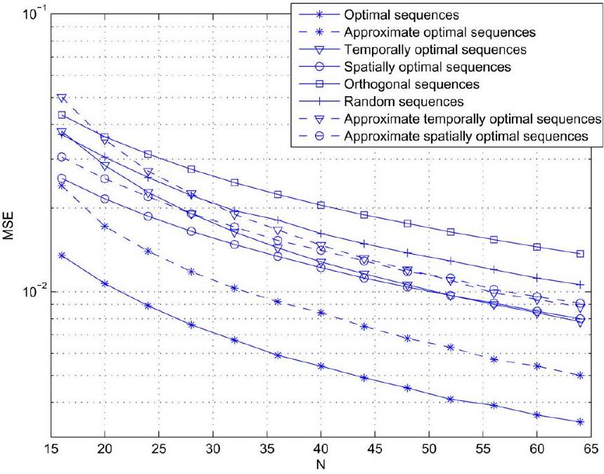
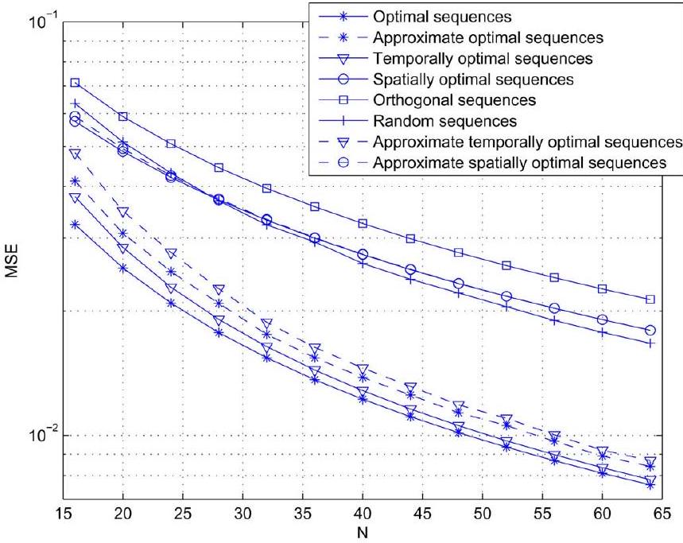
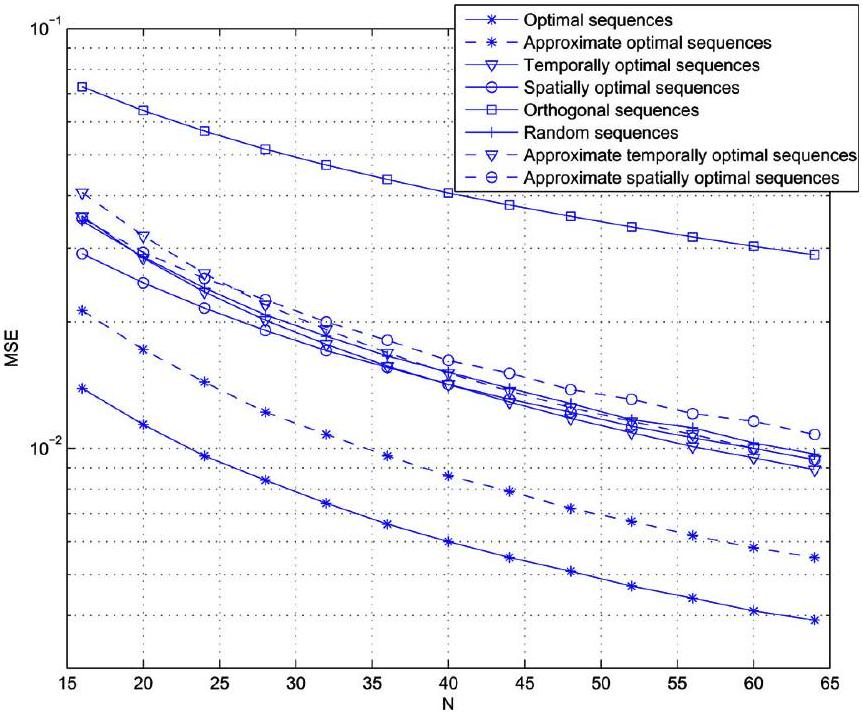
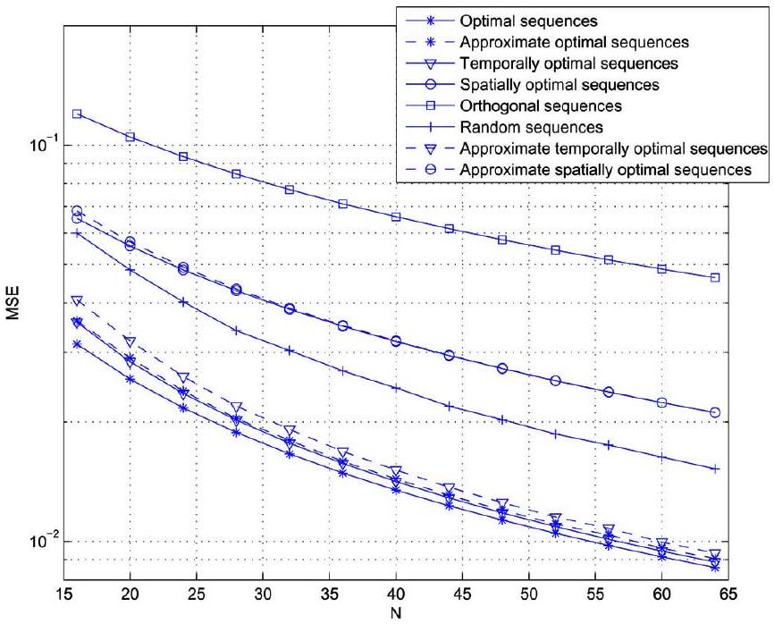
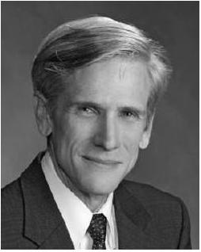

# Training Signal Design for Estimation of Correlated MIMO Channels With Colored Interference 

Yong Liu, Tan F. Wong, and William W. Hager

#### Abstract

In this paper, we study the problem of estimating correlated multiple-input multiple-output (MIMO) channels in the presence of colored interference. The linear minimum mean square error (MMSE) channel estimator is derived and the optimal training sequences are designed based on the MSE of channel estimation. We propose an algorithm to estimate the long-term channel statistics needed for the construction of the optimal training sequences. We also design an efficient scheme to feed back the required information to the transmitter where we can approximately construct the optimal sequences. Numerical results show that the optimal training sequences provide substantial performance gain for channel estimation when compared with other training sequences.

Index Terms-Channel estimation, mean square error (MMSE), multiple-input multiple-output (MIMO) system, optimal training sequence.

## I. Introduction

MANY multiple antenna communication systems are designed to perform coherent detection that requires channel state information (CSI) in the demodulation process. For practical wireless communication systems, it is common that the channel parameters are estimated by sending known training symbols to the receiver. The performance of this training-based channel estimation scheme depends on the design of training signals, which has been extensively investigated in the literature [1]-[9].

It is well known that imperfect knowledge of the channel has a detrimental effect on the achievable rate that it can sustain [10]. Training sequences can be designed based on information theoretic metrics such as the ergodic capacity and outage capacity of a multiple-input multiple-output (MIMO) channel [1]-[3]. The mean square error (MSE) is another commonly used performance measure for channel estimation. Many works [4]-[9] have been carried out to investigate the training sequence design problem based on MSE for MIMO fading channels. In [5], the authors study the problem of training sequence design for multiple-antenna systems over flat fading

[^0]MIMO channels in the presence of colored interference. The MIMO channels are assumed to be spatially white, i.e., there is no correlation among the transmit and receive antennas. The optimal training sequences are designed to minimize the channel estimation MSE under a total transmit power constraint. The optimal training sequence design result implies that we should intentionally assign transmit power to the subspace with less interference. In [6], the problem of transmit signal design is investigated for the estimation of spatial correlated MIMO Rayleigh flat fading channels. The optimal training signal is designed to optimize two criteria: the minimization of the channel estimation MSE and the maximization of the conditional mutual information (CMI) between the channel and the received signal. The authors adopt the virtual channel representation model [11] for MIMO correlated channels. It is shown that the optimal training signal should be transmitted along the strong directions in which more scatters are present. The power transmitted along these directions is determined by the water-filling solutions based on the minimum MSE and maximum CMI criteria.

In the present paper, we investigate the problem of estimating correlated MIMO channels with colored interference. We adopt the correlated MIMO channel model from [12], [13] which expresses the channel matrix as a product of the receive correlation matrix, a white "channel" matrix with identically and independent distributed (i.i.d.) entries, and the transmit correlation matrix. This model implies that transmit and receive correlation can be separated. This fact has been verified by field measurements. The colored interference model used here is more suitable than the white noise model when jamming signals and/or co-channel interference (CCI) are present in the wireless communication system. We consider an interference limited wireless communication system, i.e., we ignore the thermal noise which is insignificant compared to the interference. Then we show that the covariance matrix of the interference has a Kronecker product form which implies that the temporal and spatial correlations of the interference are separable. The channel estimation MSE is used as a performance metric for the design of training sequences. The optimization problem formulated here minimizes the channel estimation MSE under a power constraint. This is a generalization of the two previous optimization problems which are encountered widely in the signal processing area [5], [8], [9], [14].

In [7], the authors encounter essentially the same optimization problem in a different form. According to previous optimization results for the special case in [8], the authors choose to optimize the training sequence matrix in a particular set of matrices which have the same solution structure and eigenvector ordering as our solution. Here we rigorously prove that this
particular solution structure and eigenvector ordering are optimal for arbitrary matrices under the power constraint. The optimal training sequence design assigns more power to the transmission direction constructed by the eigendirection with larger channel gains and the interference subspace with less interference. In order to implement the channel estimator and construct the optimal training sequences, we propose an algorithm to estimate long-term channel statistics and design an efficient feedback scheme so that we can approximately construct the optimal sequences at the transmitter. Numerical results show that with the optimal training sequences, the channel estimation MSE can be reduced substantially when compared with the use of other training sequences.

## II. System Model

We consider a single user link with multiple interferers. The desired user has $n_{t}$ transmit antennas and $n_{r}$ receive antennas. We assume that there are $M_{I}$ interfering signals and the $i$ th interferer has $n_{i}$ transmit antennas. The MIMO channel is assumed to be quasi-static (block fading) in that it varies slowly enough to be considered invariant over a block. However, the channel changes to independent values from block to block. We assume that the users employ a frame-based transmission protocol which comprises training and payload data. The received baseband signals at the receive antennas during the training period are given in matrix form by

$$
\begin{equation*}
\mathbf{Y}=\mathbf{H S}^{T}+\underbrace{\sum_{i=1}^{M_{I}} \mathbf{H}_{i} \mathbf{S}_{i}^{T}}_{\mathbf{E}} \tag{1}
\end{equation*}
$$

where $T$ denotes the transpose of a matrix. The $n_{r} \times n_{t}$ matrix $\mathbf{H}$ and the $n_{r} \times n_{i}$ matrix $\mathbf{H}_{i}$ are the channel gain matrices from the transmitter and the $i$ th interferer to the receiver, respectively. S is the $N \times n_{t}$ training symbol matrix known to the receiver for estimating the channel gain matrix H of the desired user during the training period. $N$ is the number of training symbols from each transmit antenna and $N$ is usually much larger than $n_{t} . \mathbf{S}_{i}$ is the $N \times n_{i}$ interference symbol matrix from the $i$ th interferer. We assume that the elements in $\mathbf{S}_{i}$ are identically distributed zero-mean complex random variables, correlated across both space and time. The interference processes are assumed to be wide-sense stationary in time. We consider an interference limited wireless communication system. Hence, we ignore the effect of the thermal noise [15].

We adopt the correlated MIMO channel model [12], [13] which models the channel gain matrix $\mathbf{H}$ as $\mathbf{H}=$ $\mathbf{R}_{r}^{1 / 2} \mathbf{H}_{w} \mathbf{R}_{t}^{1 / 2}$, where $\mathbf{R}_{t}$ models the correlation between the transmit antennas and $\mathbf{R}_{r}$ models the correlation between the receive antennas, respectively. We assume that both $\mathbf{R}_{r}$ and $\mathbf{R}_{t}$ are of full rank. The notation $(\cdot)^{1 / 2}$ stands for the Hermitian square root of a matrix. $\mathbf{H}_{w}$ is a matrix whose elements are independent and identical distributed zero-mean circular-symmetric complex Gaussian random variables with unit variance. Let $\mathbf{h}_{w}=\operatorname{vec}\left(\mathbf{H}_{w}\right)$, where $\operatorname{vec}(\mathbf{X})$ is the vector obtained by stacking the columns of X on top of each other, then we have $\mathbf{h}=\operatorname{vec}(\mathbf{H})=\left(\mathbf{R}_{t}^{1 / 2} \otimes \mathbf{R}_{r}^{1 / 2}\right) \mathbf{h}_{w}$, with $\mathbf{h} \sim \mathcal{C} \mathcal{N}\left(0, \mathbf{R}_{t} \otimes \mathbf{R}_{r}\right)$ where $\mathcal{C} \mathcal{N}$ denotes complex Gaussian distribution, ⊗ denotes the Kronecker product, and ~ means "distributed as." Similarly, the channel gain matrix from the $i$ th interferer to the receiver is $\mathbf{H}_{i}=\mathbf{R}_{r}^{1 / 2} \mathbf{H}_{w i} \mathbf{R}_{t i}^{1 / 2}$ and $\mathbf{h}_{i}=\operatorname{vec}\left(\mathbf{H}_{i}\right)=\left(\mathbf{R}_{t i}^{1 / 2} \otimes \mathbf{R}_{r}^{1 / 2}\right) \mathbf{h}_{w i}$. Using the vec operator, we can write the received signal in (1) in vector form as

$$
\begin{equation*}
\mathbf{y}=\operatorname{vec}(\mathbf{Y})=\left(\mathbf{S} \otimes \mathbf{I}_{n_{r}}\right) \mathbf{h}+\mathbf{e} \tag{2}
\end{equation*}
$$

where $\mathbf{I}_{n_{r}}$ denotes the $n_{r} \times n_{r}$ identity matrix and $\mathbf{e}=\operatorname{vec}(\mathbf{E})$.
To derive the linear MMSE channel estimator, we need the following lemma.

Lemma 2.1: $\mathrm{E}(\mathbf{e})=0$ and the covariance matrix of $\mathbf{e}$ is

$$
\mathrm{E}\left(\mathbf{e} \mathbf{e}^{H}\right)=\sum_{i=1}^{M_{I}} \mathbf{Q}_{N i} \otimes \mathbf{R}_{r}=\mathbf{Q}_{N} \otimes \mathbf{R}_{r}
$$

where

$$
\begin{gathered}
\mathbf{Q}_{N i}=\left[\begin{array}{ccc}
\sum_{k=1}^{n_{i}} R_{k, k}^{i}(0) & \ldots & \sum_{k=1}^{n_{i}} R_{k, k}^{i}(N-1) \\
\vdots & \ddots & \vdots \\
\sum_{k=1}^{n_{i}} R_{k, k}^{i}(N-1) & \ldots & \sum_{k=1}^{n_{i}} R_{k, k}^{i}(0)
\end{array}\right] \\
\mathbf{Q}_{N}=\sum_{i=1}^{M_{I}} \mathbf{Q}_{N i} \\
\hat{\mathbf{S}}_{i}=\mathbf{S}_{i} \mathbf{R}_{t i}^{1 / 2}
\end{gathered}
$$

which is called the transformed interference symbol matrix;

$$
R_{k, k}^{i}(\tau)=E\left[\left[\hat{\mathbf{S}}_{i}\right]_{m, k}\left[\hat{\mathbf{S}}_{i}\right]_{m+\tau, k}\right]
$$

represents the correlation between $\left[\hat{\mathbf{S}}_{i}\right]_{m, k}$ and $\left[\hat{\mathbf{S}}_{i}\right]_{m+\tau, k}$, and $H$ denotes the conjugate transpose of a matrix.

Proof: See Appendix A. $\square$

We note that $\mathbf{Q}_{N}$ captures the temporal correlation of the interference and $\mathbf{R}_{r}$ represents the spatial correlation. The covariance matrix of the interference has the Kronecker product form which implies that the temporal and spatial correlations of the interference are separable.

Since (2) is a linear model, based on the Bayesian GaussMarkov Theorem [16], the linear minimum mean square error estimator (LMMSE) for h is given as

$$
\begin{aligned}
\hat{\mathbf{h}}= & {\left[\left(\mathbf{S}^{H} \otimes \mathbf{I}_{n_{r}}\right)\left(\mathbf{Q}_{N} \otimes \mathbf{R}_{r}\right)^{-1}\left(\mathbf{S} \otimes \mathbf{I}_{n_{r}}\right)+\left(\mathbf{R}_{t} \otimes \mathbf{R}_{r}\right)^{-1}\right]^{-1} } \\
& \times\left(\mathbf{S}^{H} \otimes \mathbf{I}_{n_{r}}\right)\left(\mathbf{Q}_{N} \otimes \mathbf{R}_{r}\right)^{-1} \mathbf{y} \\
= & {\left[\left(\mathbf{S}^{H} \mathbf{Q}_{N}^{-1} \mathbf{S}+\mathbf{R}_{t}^{-1}\right)^{-1} \mathbf{S}^{H} \mathbf{Q}_{N}^{-1} \otimes \mathbf{I}_{n_{r}}\right] \mathbf{y} }
\end{aligned}
$$

Using the equality $\operatorname{vec}(\mathbf{A Y B})=\left(\mathbf{B}^{T} \otimes \mathbf{A}\right) \operatorname{vec}(\mathbf{Y})$, we can rewrite the channel estimator in the more compact matrix form as

$$
\hat{\mathbf{H}}=\mathbf{Y}\left[\left(\mathbf{S}^{H} \mathbf{Q}_{N}^{-1} \mathbf{S}+\mathbf{R}_{t}^{-1}\right)^{-1} \mathbf{S}^{H} \mathbf{Q}_{N}^{-1}\right]^{T} .
$$

Hence, the channel estimator does not depend on the receive channel correlation matrix $\mathbf{R}_{r}$.

The performance of the channel estimator is measured by the estimation error $\epsilon=\mathbf{h}-\hat{\mathbf{h}}$ whose mean is zero and whose covariance matrix is

$$
\begin{aligned}
\mathbf{C}_{\epsilon} & =E\left[(\mathbf{h}-\hat{\mathbf{h}})(\mathbf{h}-\hat{\mathbf{h}})^{H}\right] \\
& =\left[\left(\mathbf{S}^{H} \otimes \mathbf{I}_{n_{r}}\right)\left(\mathbf{Q}_{N} \otimes \mathbf{R}_{r}\right)^{-1}\left(\mathbf{S} \otimes \mathbf{I}_{n_{r}}\right)+\left(\mathbf{R}_{t} \otimes \mathbf{R}_{r}\right)^{-1}\right]^{-1} \\
& =\left(\mathbf{S}^{H} \mathbf{Q}_{N}^{-1} \mathbf{S}+\mathbf{R}_{t}^{-1}\right)^{-1} \otimes \mathbf{R}_{r} .
\end{aligned}
$$

The diagonal elements of the error covariance matrix $\mathbf{C}_{\epsilon}$ yields the minimum Bayesian MSE and their sum is usually referred to as the total MSE. The total MSE is a commonly used performance measure for MIMO channel estimation. By using the fact that $\operatorname{tr}(\mathbf{A} \otimes \mathbf{B})=\operatorname{tr} \mathbf{A} \operatorname{tr} \mathbf{B}$ where tr denotes the trace of a matrix, we have

$$
\begin{aligned}
\operatorname{tr}\left(\mathbf{C}_{\epsilon}\right) & =\operatorname{tr}\left(\left(\mathbf{S}^{H} \mathbf{Q}_{N}^{-1} \mathbf{S}+\mathbf{R}_{t}^{-1}\right)^{-1} \otimes \mathbf{R}_{r}\right) \\
& =\operatorname{tr}\left(\left(\mathbf{S}^{H} \mathbf{Q}_{N}^{-1} \mathbf{S}+\mathbf{R}_{t}^{-1}\right)^{-1}\right) \operatorname{tr}\left(\mathbf{R}_{r}\right) .
\end{aligned}
$$

Thus, the minimization of the total MSE over training sequences does not depend on the receive channel correlation matrix. Only the temporal interference correlation matrix $\mathbf{Q}_{N}$ and the transmit correlation matrix $\mathbf{R}_{t}$ need to be considered in obtaining the optimal training sequences.

## III. Optimal Training Sequence Design

In the section, we investigate the problem of designing optimal training sequence for the channel estimation approach considered in the previous section. With the total MSE as the performance measure, the optimization of training sequences can be formulated as follows:

$$
\begin{align*}
\min _{\mathbf{S}} & \operatorname{tr}\left(\mathbf{S}^{H} \mathbf{Q}_{N}^{-1} \mathbf{S}+\mathbf{R}_{t}^{-1}\right)^{-1} \\
\text { subject to } & \operatorname{tr}\left\{\mathbf{S}^{H} \mathbf{S}\right\} \leq P \tag{3}
\end{align*}
$$

where $\operatorname{tr}\left\{\mathbf{S}^{H} \mathbf{S}\right\} \leq P$ specifies the power constraint.
Some special cases of this optimization problem (with either $\mathbf{Q}_{N}$ or $\mathbf{R}_{t}$ equal to the identity matrix) have been encountered in joint linear transmitter-receiver design [8], [14], [17] and training sequence design for channel estimation in MIMO systems [5], [9]. The solution in the special case $\mathbf{R}_{t}=\mathbf{I}$, found for example in [5] and [14], can be expressed in terms of the eigenvalues and eigenvectors of $\mathbf{Q}_{N}$ and a Lagrange multiplier associated with the power constraint. Similarly, the solution in the special case $\mathbf{Q}_{N}=\mathbf{I}$, found for example in [6], [8] and [9], can be expressed in terms of the eigenvalues and eigenvectors of $\mathbf{R}_{t}$ and a Lagrange multiplier associated with the power constraint. The optimization of the MSE problem introduced here is more difficult. We will show that (3) has a solution that can be expressed as $\mathbf{S}=\mathbf{U} \boldsymbol{\Sigma} \mathbf{V}^{H}$ where U and V are unitary matrices of eigenvectors for $\mathbf{Q}_{N}$ and $\mathbf{R}_{t}$, respectively, and $\boldsymbol{\Sigma}$ is diagonal. Solving (3) involves computing diagonalizations of $\mathbf{Q}_{N}$ and $\mathbf{R}_{t}$, and finding an ordering for the columns of U and V.

The optimal training sequences should be designed according to the following theorem which summarizes the solution to the optimization problem (3).

Theorem 3.1: Suppose that $\mathbf{Q}_{N}$ and $\mathbf{R}_{t}$ are Hermitian positive definite matrices, and let $\mathbf{U} \boldsymbol{\Lambda} \mathbf{U}^{H}$ and $\mathbf{V} \boldsymbol{\Delta} \mathbf{V}^{H}$ be the associated diagonalizations where the columns of U and V are orthonormal eigenvectors, the corresponding eigenvalues $\left\{\lambda_{i}\right\}$ of $\mathbf{Q}_{N}$ are arranged in an increasing order, and the corresponding eigenvalues $\left\{\delta_{i}\right\}$ of $\mathbf{R}_{t}$ are arranged in a decreasing order. Then the optimal solution of (3) is given by

$$
\begin{equation*}
\mathbf{S}_{*}=\mathbf{U} \boldsymbol{\Sigma} \mathbf{V}^{H} \tag{4}
\end{equation*}
$$

where $\boldsymbol{\Sigma}$ specifies the power allocation, which is a diagonal matrix with diagonal elements given by

$$
\begin{equation*}
\sigma_{i}=\max \left\{\sqrt{\frac{\lambda_{i}}{\mu}}-\frac{\lambda_{i}}{\delta_{i}}, 0\right\}^{1 / 2} \quad \text { for } 1 \leq i \leq M \triangleq \min \left\{n_{t}, N\right\} \tag{5}
\end{equation*}
$$

with the parameter $\mu$ chosen so that $\sum_{i=1}^{M} \sigma_{i}^{2}=P$.
Proof: See Appendix B. $\square$

With the optimal training sequences, the channel estimator simplifies to $\mathbf{H}=\mathbf{Y} \mathbf{U}_{M}^{*} \boldsymbol{\Gamma} \mathbf{V}_{M}^{T}$, where $\boldsymbol{\Gamma}=\operatorname{diag}\left\{\gamma_{1}, \ldots, \gamma_{M}\right\}$ with $\gamma_{i}=\sigma_{i} \delta_{i} / \sigma_{i}^{2} \delta_{i}+\lambda_{i}$, the columns of $\mathbf{U}_{M}$ are the eigenvectors of $\mathbf{Q}_{N}$ corresponding to its $M$ smallest eigenvalues, and the columns of $\mathbf{V}_{M}$ are the eigenvectors of $\mathbf{R}_{t}$ corresponding to its $M$ largest eigenvalues.

The design of the optimal training sequences summarized in the above theorem has a clear physical interpretation. Each eigenvector of the transmit correlation matrix $\mathbf{R}_{t}$ represents a transmit direction and the associated eigenvalue indicates the channel gain in that direction. More power should be assigned to the signals transmitted along the directions with larger channel gains. On the other hand, each eigenvector of the interference temporal correlation matrix $\mathbf{Q}_{N}$ represents an interference subspace and the corresponding eigenvalue indicates the amount of interference in that subspace. Hence, we should choose the subspaces with the least amount of interference for transmission. The power assignment is determined by the water-filling argument under a finite power constraint.

To facilitate the understanding of the water-filling interpretation [18] for the power assignment, we can rewrite the optimal power assignment solution in an alternative way as

$$
\tilde{\sigma}_{i}=\max \left\{\tilde{\mu}-\frac{\sqrt{\lambda_{i}}}{\delta_{i}}, 0\right\}^{1 / 2} \quad \text { for } 1 \leq i \leq M
$$

with $\tilde{\mu}=1 / \sqrt{\mu}, \tilde{\sigma}_{i}=\sigma_{i} / \lambda_{i}^{1 / 4}$, and $\tilde{\mu}$ chosen so that $\sum_{i=1}^{M} \sqrt{\lambda_{i}} / \tilde{\sigma}_{i}^{2}=P$, where $\tilde{\mu}$ represents the water level, $\left\{\sqrt{\lambda_{i}} / \delta_{i}\right\}$ specifies the depth profile which can be visualized as the surface over which the water is poured, and the volume of each subchannel is weighted by $\sqrt{\lambda_{i}}$ for the calculation of the total water volume.

A simple algorithm, which terminates in at most $N$ steps, can be used to calculate the optimal power assignment solution.

Input: set of pairs $\left\{\left(\lambda_{i}, \delta_{i}\right)\right\}$ and the power constraint $P$.
Output: the water level $\tilde{\mu}$ and $\left\{\tilde{\sigma}_{i}\right\}$.

1) Choose $\tilde{\mu}$ as the maximum of $\left\{\sqrt{\lambda_{i}} / \delta_{i}\right\}$ and set $L_{\text {new }}=M+1$.
2) Set $L_{\text {old }}=L_{\text {new }}$. Let $I$ be the set of indices with $\tilde{\mu}-\left(\sqrt{\lambda_{i}} / \delta_{i}\right) \geq 0$ and $L_{\text {new }}$ be the cardinal number of the set $I$. Compute $\tilde{\mu}=\left(P+\sum_{i \in I}\left(\lambda_{i} / \delta_{i}\right)\right) / \sum_{i \in I} \sqrt{\lambda_{i}}$.
3) If $L_{\text {new }}<L_{\text {old }}$, go to step 2.
4) Compute $\tilde{\sigma}_{i}=\max \left\{\tilde{\mu}-\left(\sqrt{\lambda_{i}} / \delta_{i}\right), 0\right\}^{1 / 2}$, and output $\tilde{\mu}$ and $\left\{\tilde{\sigma}_{i}\right\}$.

## IV. Estimation of Channel Statistics and Feedback Design

To implement the channel estimator and construct the optimal training sequences, we need knowledge of the transmit antenna correlation matrix $\mathbf{R}_{t}$ and the interference covariance matrix $\mathbf{Q}_{N}$ at both the receiver and transmitter. Since these two matrices are long-term channel characteristics, they can be estimated by using the observed training signals at the receiver and then fed back to the transmitter for the construction of the optimal training sequences. In this section, we propose an algorithm to estimate these long-term channel characteristics and design an efficient feedback scheme so that we can approximately construct the optimal training sequences at the transmitter.

Let us assume that the training signal matrix $\mathbf{S}$ is sent over a sequence of $K$ packets. During the transmission of each packet, the channel is assumed to be invariant. Then the received training signals for the $n$th packet are given as

$$
\begin{aligned}
\mathbf{y}(n) & =\left(\mathbf{S} \otimes \mathbf{I}_{n_{r}}\right) \mathbf{h}(n)+\mathbf{e}(n) \\
& =\left(\mathbf{S R}_{t}^{1 / 2} \otimes \mathbf{R}_{r}^{1 / 2}\right) \mathbf{h}_{w}(n)+\mathbf{e}(n)
\end{aligned}
$$

We note that the correlation matrix of the received signal also has the Kronecker product form:

$$
\begin{aligned}
\mathbf{R}= & E\left[\mathbf{y}(n) \mathbf{y}(n)^{H}\right] \\
= & \left(\mathbf{S R}_{t}^{1 / 2} \otimes \mathbf{R}_{r}^{1 / 2}\right) E\left(\mathbf{h}_{w}(n) \mathbf{h}_{w}(n)^{H}\right) \\
& \times\left(\mathbf{R}_{t}^{1 / 2} \mathbf{S}^{H} \otimes \mathbf{R}_{r}^{1 / 2}\right)+E\left(\mathbf{e}(n) \mathbf{e}(n)^{H}\right) \\
= & \mathbf{R}_{q} \otimes \mathbf{R}_{r}
\end{aligned}
$$

where $\mathbf{R}_{q}=\mathbf{S R}_{t} \mathbf{S}^{H}+\mathbf{Q}_{N}$. We calculate the sample average correlation matrix of the received signal from the previous $K$ packets:

$$
\hat{\mathbf{R}}=\frac{1}{K} \sum_{n=1}^{K} \mathbf{y}(n) \mathbf{y}(n)^{H} .
$$

If $\mathbf{e}(n)$ is Gaussian, $\hat{\mathbf{R}}$ is a sufficient statistic for the estimation of the correlation matrix R.

If $\mathbf{R}=\mathbf{R}_{q} \otimes \mathbf{R}_{r}$, then $\mathbf{R}=\alpha \mathbf{R}_{q} \otimes(1 / \alpha) \mathbf{R}_{r}$ for any $\alpha \neq 0$. Hence, $\mathbf{R}_{q}$ and $\mathbf{R}_{r}$ can not be uniquely identified from observing $\mathbf{y}(n)$. Fortunately, the channel estimator and the design of optimal sequences are invariant to scaling of the estimates of $\mathbf{R}_{t}$ and $\mathbf{Q}_{N}$ because

$$
\begin{aligned}
\hat{\mathbf{H}}^{\prime}(n)= & \mathbf{Y}(n)\left[\left(\mathbf{S}^{H}\left(\alpha \mathbf{Q}_{N}\right)^{-1} \mathbf{S}+\left(\alpha \mathbf{R}_{t}\right)^{-1}\right)^{-1}\right. \\
& \left.\times \mathbf{S}^{H}\left(\alpha \mathbf{Q}_{N}\right)^{-1}\right]^{T} \\
= & \hat{\mathbf{H}}(n)
\end{aligned}
$$

and

$$
\begin{aligned}
\operatorname{tr}\left(\left(\mathbf{S}^{H}\left(\alpha \mathbf{Q}_{N}\right)^{-1} \mathbf{S}+\left(\alpha \mathbf{R}_{t}\right)^{-1}\right)^{-1}\right. & \\
& =\alpha \operatorname{tr}\left(\left(\mathbf{S}^{H} \mathbf{Q}_{N}^{-1} \mathbf{S}+\mathbf{R}_{t}^{-1}\right)^{-1}\right) .
\end{aligned}
$$

For the estimation of $\mathbf{R}_{q}$ and $\mathbf{R}_{r}$, we need to impose an additional constraint on $\mathbf{R}_{r}$. Here we force $\operatorname{tr}\left(\mathbf{R}_{r}\right)=n_{r}$. Then an iterative flip-flop algorithm [19]-[21] can be used to estimate $\mathbf{R}_{q}$ and $\mathbf{R}_{r}$. If the received interference signal $\mathbf{e}(n)$ is Gaussian distributed, the flip-flop algorithm, when converges, provides the maximum likelihood estimates (MLEs) of $\mathbf{R}_{q}$ and $\mathbf{R}_{r}$ [19]. When $\mathbf{e}(n)$ is not Gaussian, the algorithm gives the estimates of $\mathbf{R}_{q}$ and $\mathbf{R}_{r}$ in the least square sense. For fixed $\widehat{\mathbf{R}}_{r}(j-1)$, the MLE of $\mathbf{R}_{q}$ is obtained as

$$
\begin{equation*}
\widehat{\mathbf{R}}_{q}(j)=\frac{1}{n_{r}} \sum_{u=1}^{n_{r}} \sum_{v=1}^{n_{r}} \sigma_{u v}^{r}\left\{\frac{1}{K} \sum_{n=1}^{K} \mathbf{Y}_{u}^{T}(n) \mathbf{Y}_{v}^{*}(n)\right\} \tag{6}
\end{equation*}
$$

where $\sigma_{u v}^{r}$ is the $(u, v)$ th element of $\widehat{\mathbf{R}}_{r}^{-1}(j-1)$ and $\mathbf{Y}_{u}(n)$ is the $u$ th row vector of the received signal matrix $\mathbf{Y}(n)$. Similarly, for fixed $\widehat{\mathbf{R}}_{q}(j)$, the MLE of $\mathbf{R}_{r}$ is obtained as

$$
\begin{equation*}
\widehat{\mathbf{R}}_{r}(j)=\frac{1}{N} \sum_{u=1}^{N} \sum_{v=1}^{N} \sigma_{u v}^{q}\left\{\frac{1}{K} \sum_{n=1}^{K} \mathbf{W}_{u}(n) \mathbf{W}_{v}^{H}(n)\right\} \tag{7}
\end{equation*}
$$

where $\sigma_{u v}^{q}$ is the $(u, v)$ th element of $\widehat{\mathbf{R}}_{q}^{-1}(j)$ and $\mathbf{W}_{u}(n)$ is the $u$ th column vector of the received signal $\mathbf{Y}(n)$. Then to get uniquely identifiable $\mathbf{R}_{q}$ and $\mathbf{R}_{r}$, we need to scale $\widehat{\mathbf{R}}_{r}(j)$ to make $\operatorname{tr}\left(\widehat{\mathbf{R}}_{r}(j)\right)=n_{r}$. We note that the terms inside the braces in (6) and (7) can be computed before the running of the iterative estimation algorithm to reduce computational complexity. To start the iterative algorithm, an initial value of either $\widehat{\mathbf{R}}_{q}$ or $\widehat{\mathbf{R}}_{r}$ should be assigned. A natural choice is to initially make $\widehat{\mathbf{R}}_{r}(0)=\mathbf{I}_{n_{r}}$. Then the iterative algorithm alternates between the calculations of $\widehat{\mathbf{R}}_{q}$ and $\widehat{\mathbf{R}}_{r}$ until convergence. While it is difficult to analytically prove that the algorithm converges to the MLE, extensive data experiments in statistics [19] show that it always converges to the MLE for situations of practical sample sizes. The convergence in our case is also verified by the numerical results in Section V.

Next we need to estimate $\mathbf{R}_{t}$ and $\mathbf{Q}_{N}$ based on $\widehat{\mathbf{R}}_{q}$. Before doing so, let $\mathcal{R}$ denote the range space of a matrix, $\mathcal{R}^{\perp}$ denote the orthogonal complementary subspace of the range of a matrix, and consider the following lemma:

Lemma 4.1: Let $\mathcal{L}$ be the linear map defined by $\mathcal{L}\left(\mathbf{R}_{t}, \mathbf{Q}_{N}\right)=\mathbf{S R}_{t} \mathbf{S}^{H}+\mathbf{Q}_{N}$ where $\mathbf{R}_{t}$ and $\mathbf{Q}_{N}$ are Hermitian positive semidefinite matrices and $\mathbf{S}$ is of full rank. Let $\mathbb{D}$ be defined by $\mathbb{D}=\left\{\left(\mathbf{R}_{t}, \mathbf{Q}_{N}\right): \mathcal{R}\left(\mathbf{Q}_{N}\right) \subset \mathcal{R}^{\perp}(\mathbf{S})\right\}$. Then $\mathcal{L}: \mathbb{D} \rightarrow \mathbb{C}^{N \times N}$ is one-to-one. Moreover, given any $\left(\mathbf{R}_{t}, \mathbf{Q}_{N}\right)$ and $\mathbf{R}_{q}=\mathcal{L}\left(\mathbf{R}_{t}, \mathbf{Q}_{N}\right)$, there exists $\left(\mathbf{R}_{t}^{\prime}, \mathbf{Q}_{N}^{\prime}\right) \neq\left(\mathbf{R}_{t}, \mathbf{Q}_{N}\right)$ such that $\mathcal{L}\left(\mathbf{R}_{t}^{\prime}, \mathbf{Q}_{N}^{\prime}\right)=\mathbf{R}_{q}$.

Proof: See Appendix C. $\square$

Based on the above lemma, we see that estimating $\mathbf{Q}_{N}$ and $\mathbf{R}_{t}$ simultaneously from $\widehat{\mathbf{R}}_{q}$ is not possible. We can only uniquely determine $\mathbf{Q}_{N}$ up to $\mathcal{R}^{\perp}(\mathbf{S})$ from $\mathbf{R}_{q}$. Fortunately, this is not much a limitation when $N$ is large as shown in

Lemma 4.2. Let $\left|\mathbf{Q}_{N}\right|_{w}$ be the weak norm of $\mathbf{Q}_{N}$ which is defined by $\left|\mathbf{Q}_{N}\right|_{w}=\sqrt{\operatorname{tr}\left(\mathbf{Q}_{N}^{H} \mathbf{Q}_{N}\right) / N}$.

Lemma 4.2: With the assumption that $\mathbf{Q}_{N}$ is an absolutely summable Hermitian Toeplitz matrix, the difference between the two sequences of matrices $\mathbf{Q}_{N}$ and $\mathbf{P}_{\mathbf{S}}^{\perp} \mathbf{Q}_{N} \mathbf{P}_{\mathbf{S}}^{\perp}$ approaches zero in weak norm as $N$ increases, i.e., $\lim _{N \rightarrow \infty}\left|\mathbf{Q}_{N}-\mathbf{P}_{\mathbf{S}}^{\perp} \mathbf{Q}_{N} \mathbf{P}_{\mathbf{S}}^{\perp}\right|_{w}=0$.

Proof: See Appendix D. $\square$

Since $\mathbf{P}_{\frac{1}{\mathbf{S}}}^{\perp} \mathbf{R}_{q} \mathbf{P}_{\mathbf{S}}^{\perp}=\mathbf{P}_{\mathbf{S}}^{\perp} \mathbf{Q}_{N} \mathbf{P}_{\mathbf{S}}^{\perp}$, we can estimate $\mathbf{P}_{\mathbf{S}}^{\perp} \mathbf{Q}_{N} \mathbf{P}_{\mathbf{S}}^{\perp}$ from $\mathbf{P}_{\mathbf{S}}^{\perp} \mathbf{R}_{q} \mathbf{P}_{\mathbf{S}}^{\perp}$. For notational simplicity, let A denote $\mathbf{P}_{\mathbf{S}}^{\perp} \widehat{\mathbf{R}}_{q} \mathbf{P}_{\mathbf{S}}^{\perp}$. Since the interference signals are wide-sense stationary in time, $\mathbf{Q}_{N}$ has the form of a Toeplitz matrix which can be represented by a sequence $\left\{q_{k} ; k=0, \pm 1, \ldots \pm(N-1)\right\}$ with $\left[\mathbf{Q}_{N}\right]_{k, j}=q_{k-j}$. Then the $(i, j)$ th element of $\mathbf{P}_{\mathbf{S}}^{\perp} \mathbf{Q}_{N} \mathbf{P}_{\mathbf{S}}^{\perp}$ is given by $\sum_{l} \sum_{k} p_{i l} q_{l-k} p_{k j}$ with $p_{i j}$ denoting the $(i, j)$ th element of $\mathbf{P}_{\mathbf{S}}^{\perp}$. Equating the $(i, j)$ th element of $\mathbf{P}_{\mathbf{S}}^{\perp} \mathbf{Q}_{N} \mathbf{P}_{\mathbf{S}}^{\perp}$ with $a_{i j}$, we have a set of linear equations in $\left\{q_{k}\right\}$. Noticing the Hermitian nature of $\mathbf{P}_{\mathbf{S}}^{\perp} \mathbf{Q}_{N} \mathbf{P}_{\mathbf{S}}^{\perp}$ and A and separating the real and imaginary parts of $q_{k}$ and $a_{i j}$, we have $N^{2}$ linear equations with $2 N-1$ unknowns in $\mathbf{q}_{r}=\left[q_{0}, \operatorname{Re}\left(q_{1}\right), \operatorname{Im}\left(q_{1}\right), \ldots, \operatorname{Re}\left(q_{N-1}\right), \operatorname{Im}\left(q_{N-1}\right)\right]^{T}$. This set of linear equations can be solved by employing the least square approach. Then an estimate of $\mathbf{Q}_{N}$ which is denoted as $\widehat{\mathbf{Q}}_{N}$ can be constructed based on $\mathbf{q}_{r}$. Although this $\widehat{\mathbf{Q}}_{N}$ is only unique up to $\mathcal{R}^{\perp}(\mathbf{S})$, Lemma 4.2 tells us that this is not too severe a deficiency when $N$ is large. In addition, when $N$ is large, $\mathbf{Q}_{N}$ can be approximated by the circulant matrix [22] with fixed eigenvectors as

$$
\begin{equation*}
\tilde{\mathbf{Q}}_{N}=\mathbf{F}_{N} \Psi_{N} \mathbf{F}_{N}^{H} \tag{8}
\end{equation*}
$$

where $\mathbf{F}_{N}$ is the $N \times N$ FFT matrix and $\boldsymbol{\Psi}_{N}$ is a diagonal matrix containing eigenvalues $\left\{\psi_{i}\right\}$ of $\tilde{\mathbf{Q}}_{N}$. Note that we only require the $n_{t}$ smallest eigenvalues of $\mathbf{Q}_{N}$ and their corresponding eigenvectors in constructing the optimal training sequences. With the circulant matrix approximation (8), it is equivalent to estimating the $n_{t}$ smallest eigenvalues $\psi_{i}$ and identifying the corresponding columns of $\mathbf{F}_{N}$. If we arrange the eigenvalues $\left\{\psi_{i}\right\}$ of $\tilde{\mathbf{Q}}_{N}$ and the eigenvalues $\left\{\lambda_{i}\right\}$ of $\mathbf{Q}_{N}$ in increasing orders, we have [23] $\lim _{N \rightarrow \infty}\left|\psi_{i}-\lambda_{i}\right|=0$. Thus the $n_{t}$ smallest eigenvalues of $\widehat{\mathbf{Q}}_{N}$ can be used as the estimates of the $n_{t}$ smallest $\psi_{i}$ 's, and the corresponding columns of $\mathbf{F}_{N}$ are chosen as those closest (in terms of the Euclidean norm) to the eigenvectors associated with the $n_{t}$ smallest eigenvalues of $\widehat{\mathbf{Q}}_{N}$.

The estimates of the $n_{t}$ smallest $\psi_{i}$ 's and the $n_{t}$ indices of the chosen columns of $\mathbf{F}_{N}$ are then fed back to the transmitter for the optimal training sequence construction. We notice that it is bandwidth efficient to just feed back these indices of $\mathbf{F}_{N}$ instead of the whole eigenvectors of $\widehat{\mathbf{Q}}_{N}$ because the number of training symbols $N$ during the training period is usually large.

To derive an estimator of $\mathbf{R}_{t}$, we need to use Lemma 4.2 again. When $N$ is large, $\mathbf{R}_{q} \approx \mathbf{S R}_{t} \mathbf{S}^{H}+\mathbf{P}_{\mathbf{S}}^{\perp} \mathbf{Q}_{N} \mathbf{P}_{\mathbf{S}}^{\perp}$, and hence, $\mathbf{P}_{\mathbf{S}} \mathbf{R}_{q} \mathbf{P}_{\mathbf{S}} \approx \mathbf{P}_{\mathbf{S}} \mathbf{S R}_{t} \mathbf{S}^{H} \mathbf{P}_{\mathbf{S}}+\mathbf{P}_{\mathbf{S}} \mathbf{P}_{\mathbf{S}}^{\perp} \mathbf{Q}_{N} \mathbf{P}_{\mathbf{S}}^{\perp} \mathbf{P}_{\mathbf{S}}=$ $\mathbf{S R}_{t} \mathbf{S}^{H}$. Then with a full rank $\mathbf{S}$, we can estimate the transmit channel correlation matrix $\mathbf{R}_{t}$ using

$$
\widehat{\mathbf{R}}_{t}=\left(\mathbf{S}^{H} \mathbf{S}\right)^{-1} \mathbf{S}^{H} \widehat{\mathbf{R}}_{q} \mathbf{S}\left(\mathbf{S}^{H} \mathbf{S}\right)^{-1} .
$$

## V. Numerical Results

In this section, we present some numerical results to show the performance gain achieved by the optimal training sequences. We consider a MIMO system with three transmit antennas and three receive antennas. The antennas form uniform linear arrays at both the transmitter and receiver. For a small angle spread, the correlation coefficient between the $i$ th and the $j$ th transmit antenna [12] can be well approximated as

$$
\begin{aligned}
{\left[\mathbf{R}_{t}\right]_{i, j} } & \approx \frac{1}{2 \pi} \sigma_{t}^{2} \int_{0}^{2 \pi} \exp \left\{-j 2 \pi|i-j| \sin \Delta \frac{d_{t}}{\lambda} \sin \theta\right\} d \theta \\
& =\sigma_{t}^{2} J_{0}\left(2 \pi|i-j| \sin \Delta \frac{d_{t}}{\lambda}\right)
\end{aligned}
$$

where $J_{0}(x)$ is the zeroth-order Bessel function of the first kind, $\Delta$ is the angle spread, $d_{t}$ is the antenna spacing, $\lambda$ is the wavelength of the narrow-band signal and $\sigma_{t}^{2}$ is the power gain of the transmit antenna array. We set $d_{t}=0.5 \lambda$. In the simulations, we consider two channels with different transmit channel correlations: a high spatial correlation channel with $\Delta=5^{\circ}$ and a low spatial correlation channel with $\Delta=25^{\circ}$. The receive correlation matrix $\mathbf{R}_{r}$ is calculated similarly as the transmit correlation matrix with $\Delta=25^{\circ}$. We have assumed that the channel characteristics are estimated based on the observed training signals from 50 previous packets, i.e., $K=50$.

We consider two kinds of interference: CCI from other users in the same wireless system and jamming signals which are usually modeled by autoregressive (AR) random processes. We compare the channel estimation performance in terms of the total MSE for systems using different sets of training sequences. The following training sequence sets are considered for comparison: 1) the optimal training sequences described in Section III; 2) the approximate optimal training sequence constructed based on the channel and interference statistics obtained by using the proposed estimation algorithm in Section IV; 3) the temporally optimal training sequences for which the transmit channel correlation matrix is assumed to be an identity matrix and only temporal interference correlation is considered in designing the optimal training sequences (we also consider the approximate temporally optimal sequences which are constructed based on the channel statistics obtained by using the proposed algorithm); 4) the spatially optimal training sequences for which the interference is assumed to be temporally white and only transmit correlation is considered in designing the optimal training sequences (we also consider the approximate spatially optimal sequences which are constructed based on the channel statistics obtained by using the proposed algorithm); 5) binary orthogonal sequences which are generated by using the first $n_{t}$ columns of the Hadamard matrix; and 6) random sequences where the training symbols are i.i.d. binary random variables with zero mean and unit variance.

## A. CCI

In a cellular wireless communication system, CCI from other cells exists due to frequency reuse. Hence, the interfering signals have the same signal format as that of the desired user. We can
express the interfering signal transmitted from the $i$ th transmit antenna of the $m$ th interferer as

$$
s_{i}^{(m)}(t)=\sqrt{\frac{P_{m}}{n_{i} N}} \sum_{l=-\infty}^{\infty} b_{i, l}^{(m)} \psi\left(t-l T-\tau_{m}\right)
$$

where $P_{m}$ is the transmit power of the $m$ th interferer, and $\left\{b_{i, l}^{(m)}\right\}$ are data symbols transmitted from the $i$ th transmit antenna of the $m$ th interferer. The data symbols are assumed to be i.i.d. binary random variables with zero mean and unit variance. In addition, $\psi(t)$ is the symbol waveform and $T$ is the symbol duration. It is assumed that the receiver is synchronized to the desired user but not necessarily to the interfering signals and $\tau_{m}$ is the symbol timing difference between the $m$ th interferer and the desired user signal. Without loss of generality, we assume $0 \leq \tau_{m}<T$. The elements of the interference symbol matrix $\mathbf{S}_{i}$ are samples at the matched filter output at the receiver at time index $j T$. The $(j, i)$ th element of $\mathbf{S}_{i}$ is

$$
s_{j, i}^{(m)}=\sqrt{\frac{P_{m}}{n_{i} N}} \sum_{l=-\infty}^{\infty} b_{i, l}^{m} \hat{\psi}\left((j-l) T-\tau_{m}\right)
$$

where $\hat{\psi}(t)=\int_{-\infty}^{\infty} \psi(t-s) \psi^{*}(s) d s$ is the autocorrelation of the symbol waveform. For the CCI, the temporal interference correlation is due to the intersymbol interference in the sampled interfering signals.

In the simulations, it is assumed that there are two interfering signals with three transmit antennas in the system and the signal-to-interference ratio ( $\sigma_{t}^{2} P / \sum \sigma_{t, m}^{2} P_{m}$ with $\sigma_{t, m}^{2}$ represent the power gain of the transmit antenna array of the $m$ th interferer) is set to be 3 dB . The ISI-free symbol waveform with raised cosine spectrum [24] is chosen as the symbol waveform. For this case, we have

$$
\psi(t)=\operatorname{sinc}(\pi t / T) \frac{\cos (\pi \beta t / T)}{1-4 \beta^{2} t^{2} / T^{2}} .
$$

We set the roll-off factor $\beta=0.5, \tau_{1}=0.2 T$ and $\tau_{2}=0.5 T$.
In Figs. 1 and 2, we show the total channel estimation MSEs for the high spatial correlation channel and low spatial correlation channel, respectively. For both cases, the optimal sequences outperform the orthogonal sequences and random sequences significantly. For the high spatial correlation channel, the optimal sequences provide a substantial performance gain over both the spatially optimal sequences and the temporally optimal sequences. The approximate optimal sequences achieve most of the performance gain obtained by the optimal sequences. For the low spatial correlation channel, the temporally optimal sequences achieve an estimation performance similar to that achieved by the optimal sequences. These two optimal sequences provide significant performance gains over the spatially optimal sequences. In this case, the temporal correlation has a stronger impact on channel estimation than the spatial channel correlation due to the fact that the length of training sequences $N$ is much larger than the number of transmit antennas $n_{t}$. The MSE performance of the approximate optimal sequences is a little worse than that of the temporally optimal sequences because of the errors in estimating $\mathbf{Q}_{N}$ and $\mathbf{R}_{t}$. Note that the approximate temporally optimal sequences

Fig. 1. Comparison of total MSEs obtained using different training sequences. ISI-free symbol waveform and high spatial correlation channel.

Fig. 2. Comparison of total MSEs obtained using different training sequences. ISI-free symbol waveform and low spatial correlation channel.

give performance that is in turn slightly worse than that given by the approximate optimal sequences.

## B. Jamming Signals

We assume that there are two jammers, each with three transmit antennas, in the system. The jamming signals are modeled as first-order AR processes driven by temporally white Gaussian processes $\left\{u_{t, i}^{(m)}\right\}$, i.e.

$$
s_{t, i}^{(m)}=\alpha_{m} s_{t-1, i}^{(m)}+u_{t, i}^{(m)}
$$

where $s_{t, i}^{(m)}$ represents the jamming signal transmitted from the $i$ th transmit antenna of the $m$ th jammer at the $t$ th time index, $\alpha_{m}$ is the temporal correlation coefficient, and $u_{t, i}^{(m)}$ has zero mean with variance $\sigma_{u, m}^{2}$, which decides the transmit power of the $m$ th jammer. The signal-to-interference ratio is set to be 3 dB. We choose $\alpha_{1}=0.4$ and $\alpha_{2}=0.5$. In Figs. 3 and 4, we show

Fig. 3. Comparison of total MSEs obtained using different training sequences. AR jammers and high spatial correlation channel.

Fig. 4. Comparison of total MSEs obtained using different training sequences. AR jammers and low spatial correlation channel.

the total channel estimation MSEs for the high spatial correlation channel and low spatial correlation channel, respectively. For the AR jammers, similar conclusions on the estimation performance achieved by different training sequences can be made as in the case of CCI.

## Appendix

A. Proof of Lemma 2.1

Let $\mathbf{E}=\sum_{i=1}^{M_{I}} \mathbf{E}_{i}=\sum_{i=1}^{M_{I}} \mathbf{H}_{i} \mathbf{S}_{i}^{T}$ and $\mathbf{e}_{i}=\operatorname{vec}\left(\mathbf{E}_{i}\right)$. Since $\mathbf{h}_{w i} \sim \mathcal{C} \mathcal{N}\left(0, \mathbf{I}_{n_{r} n_{t}}\right), \mathrm{E}\left(\mathbf{e}_{i}\right)=0$. Then we have $\mathrm{E}(\mathbf{e})=0$. The received signal from the $i$ th interferer can be written as

$$
\mathbf{E}_{i}=\mathbf{H}_{i} \mathbf{S}_{i}^{T}=\mathbf{R}_{r}^{1 / 2} \mathbf{H}_{w i} \underbrace{\mathbf{R}_{t i}^{1 / 2} \mathbf{S}_{i}^{T}}_{\hat{\mathbf{S}}_{i}^{T}}=\mathbf{R}_{r}^{1 / 2} \mathbf{H}_{w i} \hat{\mathbf{S}}_{i}^{T} .
$$

Since $\mathbf{S}_{i}$ is wide-sense stationary in time, $\hat{\mathbf{S}}_{i}$ is also wide-sense stationary in time. Using the vec operator, we can rewrite the interfering signal from the $i$ th interferer as

$$
\mathbf{e}_{i}=\operatorname{vec}\left(\mathbf{E}_{i}\right)=\left(\mathbf{I}_{N} \otimes \mathbf{R}_{r}^{1 / 2}\right) \operatorname{vec}\left(\mathbf{H}_{w i} \hat{\mathbf{S}}_{i}^{T}\right) .
$$

The covariance matrix of $\mathbf{e}_{i}$ is given as

$$
\begin{aligned}
\mathrm{E}\left(\mathbf{e}_{i} \mathbf{e}_{i}^{H}\right)= & \mathrm{E}\left[\left(\mathbf{I}_{N} \otimes \mathbf{R}_{r}^{1 / 2}\right) \operatorname{vec}\left(\mathbf{H}_{w i} \hat{\mathbf{S}}_{i}^{T}\right)\right. \\
& \left.\quad \times \operatorname{vec}\left(\mathbf{H}_{w i} \hat{\mathbf{S}}_{i}^{T}\right)^{H}\left(\mathbf{I}_{N} \otimes \mathbf{R}_{r}^{1 / 2}\right)^{H}\right] \\
= & \left(\mathbf{I}_{N} \otimes \mathbf{R}_{r}^{1 / 2}\right) \mathrm{E}\left[\operatorname{vec}\left(\mathbf{H}_{w i} \hat{\mathbf{S}}_{i}^{T}\right) \operatorname{vec}\left(\mathbf{H}_{w i} \hat{\mathbf{S}}_{i}^{T}\right)^{H}\right] \\
& \times\left(\mathbf{I}_{N} \otimes \mathbf{R}_{r}^{1 / 2}\right) .
\end{aligned}
$$

Let $\mathbf{e}_{i}^{\prime}=\operatorname{vec}\left(\mathbf{H}_{w i} \hat{\mathbf{S}}_{i}^{T}\right)$, it is easy to see that the covariance matrix of $\mathbf{e}_{i}^{\prime}$ is

$$
\begin{aligned}
\mathrm{E} & {\left[\mathbf{e}_{i}^{\prime} \mathbf{e}_{i}^{\prime H}\right] } \\
& =\left[\begin{array}{ccc}
\sum_{k=1}^{n_{i}} R_{k, k}^{i}(0) \mathbf{I}_{r} & \ldots & \sum_{k=1}^{n_{i}} R_{k, k}^{i}(N-1) \mathbf{I}_{r} \\
\vdots & \ddots & \vdots \\
\sum_{k=1}^{n_{i}} R_{k, k}^{i}(N-1) \mathbf{I}_{r} & \ldots & \sum_{k=1}^{n_{i}} R_{k, k}^{i}(0) \mathbf{I}_{r}
\end{array}\right] \\
& =\mathbf{Q}_{N i} \otimes \mathbf{I}_{n_{r}} .
\end{aligned}
$$

Then we have

$$
\begin{aligned}
\mathrm{E}\left[\mathbf{e}_{i} \mathbf{e}_{i}^{H}\right] & =\left(\mathbf{I}_{N} \otimes \mathbf{R}_{r}^{1 / 2}\right)\left(\mathbf{Q}_{N i} \otimes \mathbf{I}_{n_{r}}\right)\left(\mathbf{I}_{N} \otimes \mathbf{R}_{r}^{1 / 2}\right) \\
& =\mathbf{Q}_{N i} \otimes \mathbf{R}_{r} .
\end{aligned}
$$

The covariance matrix of $\mathbf{e}$ is then given as

$$
\mathrm{E}\left[\mathrm{ee}^{H}\right]=\sum_{i=1}^{M_{I}} \mathrm{Q}_{N i} \otimes \mathbf{R}_{r}=\mathbf{Q}_{N} \otimes \mathbf{R}_{r}
$$

B. Solution of the Optimization Problem (3)

We solve the optimization problem by using the method introduced in [25]. First, we analyze the optimal structure of the solution by using the Lagrangian method, then find the optimal power allocation scheme, and finally determine the optimal ordering for the related eigenvector matrices.

1) Solution Structure: We begin by analyzing the structure of an optimal solution to (3). Let us define

$$
\begin{equation*}
\mathbf{T}=\mathbf{U}^{H} \mathbf{S V} . \tag{9}
\end{equation*}
$$

Substituting $\mathbf{S}=\mathbf{U T V}^{H}$ in (3) gives the following equivalent optimization problem:

$$
\begin{align*}
\min \operatorname{tr}\left(\mathbf{T}^{H} \boldsymbol{\Lambda}^{-1} \mathbf{T}+\boldsymbol{\Delta}^{-1}\right)^{-1} & \\
& \text { subject to } \operatorname{tr}\left(\mathbf{T}^{H} \mathbf{T}\right) \leq P, \quad \mathbf{T} \in \mathbb{C}^{N \times n_{t}} . \tag{10}
\end{align*}
$$

We now show that the solution to (10) has at most one nonzero in each row and column.

Theorem 5.1: There exists a solution of (10) of the form $\mathbf{T}=$ $\boldsymbol{\Pi}_{1} \boldsymbol{\Sigma} \boldsymbol{\Pi}_{2}$ where $\boldsymbol{\Pi}_{1}$ and $\boldsymbol{\Pi}_{2}$ are permutation matrices and $\sigma_{i j}=0$ for all $i \neq j$.

Proof: We argue that it suffices to prove the theorem under the following nondegeneracy assumption:

$$
\begin{equation*}
\delta_{i} \neq \delta_{j}>0 \text { and } \lambda_{i} \neq \lambda_{j}>0 \text { for all } i \neq j . \tag{11}
\end{equation*}
$$

Indeed, since the cost function of (10) is a continuous function of $\boldsymbol{\Delta}$ and $\boldsymbol{\Lambda}$, and since any $\lambda>\mathbf{0}$ and $\delta>\mathbf{0}$ can be approximated arbitrarily closely by vectors $\delta$ and $\lambda$ satisfying the nondegeneracy conditions (11), we conclude that the theorem holds for arbitrary $\lambda>\mathbf{0}$ and $\delta>\mathbf{0}$.

There exists an optimal solution of (10) since the feasible set is compact and the cost function is a continuous function of T. Since the eigenvalues of $\boldsymbol{\Delta}^{1 / 2} \mathbf{T}^{H} \boldsymbol{\Lambda}^{-1} \mathbf{T} \boldsymbol{\Delta}^{1 / 2}$ are nonnegative, the eigenvalues of $\left(\boldsymbol{\Delta}^{1 / 2} \mathbf{T}^{H} \boldsymbol{\Lambda}^{-1} \mathbf{T} \boldsymbol{\Delta}^{1 / 2}+\mathbf{I}\right)^{-1}$ are less than or equal to 1. Also, by [28, ch. 9, H.1.g], the trace of the product of two positive semidefinite Hermitian matrices is bounded by the dot product of the eigenvalues of the two matrices which are arranged in decreasing order. It follows that for any choice of T

$$
\begin{aligned}
\operatorname{tr}\left(\mathbf{T}^{H} \boldsymbol{\Lambda}^{-1} \mathbf{T}+\boldsymbol{\Delta}^{-1}\right)^{-1} & =\operatorname{tr} \boldsymbol{\Delta}\left(\boldsymbol{\Delta}^{\frac{1}{2}} \mathbf{T}^{H} \boldsymbol{\Lambda}^{-1} \mathbf{T} \boldsymbol{\Delta}^{\frac{1}{2}}+\mathbf{I}\right)^{-1} \\
& \leq \operatorname{tr}(\boldsymbol{\Delta})
\end{aligned}
$$

with equality when $\mathbf{T}=\mathbf{0}$. Hence, there exists a nonzero optimal solution of (10), which is denoted $\overline{\mathbf{T}}$. The first-order necessary condition for an optimal solution is the following: There exists a scalar $\gamma \geq 0$ such that

$$
\begin{equation*}
\frac{d}{d \mathbf{T}} \operatorname{tr}\left(\left(\mathbf{T}^{H} \mathbf{\Lambda}^{-1} \mathbf{T}+\Delta^{-1}\right)^{-1}+\gamma \mathbf{T}^{H} \mathbf{T}\right)_{\mathbf{T}=\overline{\mathbf{T}}}=\mathbf{0} . \tag{12}
\end{equation*}
$$

Let $\mathbf{M}=\overline{\mathbf{T}}^{H} \boldsymbol{\Lambda}^{-1} \overline{\mathbf{T}}+\boldsymbol{\Delta}^{-1}$. Since the derivative [26] of the invertible matrix M is given by $d \mathbf{M}^{-1} / d t=$ $-\mathbf{M}^{-1}(d \mathbf{M} / d t) \mathbf{M}^{-1}$ for every element $t$ of the matrix T, (12) is equivalent to

$$
\begin{aligned}
\operatorname{tr}\left(\gamma\left[\overline{\mathbf{T}}^{H} \delta \mathbf{T}+\delta \mathbf{T}^{H} \overline{\mathbf{T}}\right]-\right. & \\
& \left.\mathbf{M}^{-1}\left[\overline{\mathbf{T}}^{H} \mathbf{\Lambda}^{-1} \delta \mathbf{T}+\delta \mathbf{T}^{H} \mathbf{\Lambda}^{-1} \overline{\mathbf{T}}\right] \mathbf{M}^{-1}\right)=0
\end{aligned}
$$

for all matrices $\delta \mathbf{T} \in \mathbb{C}^{N \times n_{t}}$.
Let $\operatorname{Real}(z)$ denote the real part of $z \in \mathbb{C}$. Then we have $\operatorname{Real}\left[\operatorname{tr}\left(\gamma \overline{\mathbf{T}}^{H} \delta \mathbf{T}-\mathbf{M}^{-2} \overline{\mathbf{T}}^{H} \Lambda^{-1} \delta \mathbf{T}\right)\right]=0$. By taking $\delta \mathbf{T}$ either pure real or pure imaginary, we deduce that $\operatorname{tr}\left(\left[\gamma \overline{\mathbf{T}}^{H}-\right.\right.$ $\left.\left.\mathbf{M}^{-2} \overline{\mathbf{T}}^{H} \boldsymbol{\Lambda}^{-1}\right] \delta \mathbf{T}\right)=0$ for all $\delta \mathbf{T}$. By choosing $\delta \mathbf{T}$ to be completely zero except for a single nonzero entry, we conclude that

$$
\begin{equation*}
\gamma \overline{\mathbf{T}}^{H}-\mathbf{M}^{-2} \overline{\mathbf{T}}^{H} \mathbf{\Lambda}^{-1}=\mathbf{0} . \tag{13}
\end{equation*}
$$

If $\gamma=0$, then $\overline{\mathbf{T}}=\mathbf{0}$ since both $\boldsymbol{\Delta}$ and $\boldsymbol{\Lambda}$ are invertible. Hence, $\gamma>0$.

We multiply (13) on the right by $\overline{\mathbf{T}}$ to obtain

$$
\begin{equation*}
\gamma \overline{\mathbf{T}}^{H} \overline{\mathbf{T}}=\mathbf{M}^{-2} \overline{\mathbf{T}}^{H} \mathbf{\Lambda}^{-1} \overline{\mathbf{T}}=\left(\overline{\mathbf{T}}^{H} \mathbf{\Lambda}^{-1} \overline{\mathbf{T}}+\boldsymbol{\Delta}^{-1}\right)^{-2} \overline{\mathbf{T}}^{H} \mathbf{\Lambda}^{-1} \overline{\mathbf{T}} . \tag{14}
\end{equation*}
$$

Since $\overline{\mathbf{T}}^{H} \overline{\mathbf{T}}$ is Hermitian, we have

$$
\begin{aligned}
\left(\overline{\mathbf{T}}^{H} \boldsymbol{\Lambda}^{-1} \overline{\mathbf{T}}+\boldsymbol{\Delta}^{-1}\right)^{-2} \overline{\mathbf{T}}^{H} \boldsymbol{\Lambda}^{-1} \overline{\mathbf{T}} & \\
& =\overline{\mathbf{T}}^{H} \boldsymbol{\Lambda}^{-1} \overline{\mathbf{T}}\left(\overline{\mathbf{T}}^{H} \boldsymbol{\Lambda}^{-1} \overline{\mathbf{T}}+\boldsymbol{\Delta}^{-1}\right)^{-2} .
\end{aligned}
$$

We need the following lemma [27, p. 249] to proceed.
Lemma 5.1: If $\mathbf{A}$ and $\mathbf{B}$ are diagonalizable, they share the same eigenvector matrix if and only if $\mathbf{A B}=\mathbf{B A}$.

Let $\mathbf{A}=\overline{\mathbf{T}}^{H} \boldsymbol{\Lambda}^{-1} \overline{\mathbf{T}}$ and $\mathbf{B}=\boldsymbol{\Delta}^{-1}$. Then we have $(\mathbf{A}+$ $\mathbf{B})^{-2} \mathbf{A}=\mathbf{A}(\mathbf{A}+\mathbf{B})^{-2}$. According to Lemma 5.1, $\mathbf{A}$ and $(\mathbf{A}+\mathbf{B})^{-2}$ share the same eigenvector matrix. Since $\mathbf{A}+\mathbf{B}$ and $(\mathbf{A}+\mathbf{B})^{-2}$ have the same eigenvector matrix, $\mathbf{A}$ and $\mathbf{A}+$ B share the same eigenvector matrix. Then we have $\mathbf{A}(\mathbf{A}+$ $\mathbf{B})=(\mathbf{A}+\mathbf{B}) \mathbf{A}$. Hence, $\mathbf{A B}=\mathbf{B A}$, which implies that $\overline{\mathbf{T}}^{H} \boldsymbol{\Lambda}^{-1} \overline{\mathbf{T}}$ and $\boldsymbol{\Delta}^{-1}$ commute with each other. Since $\boldsymbol{\Delta}^{-1}$ is diagonal, it follows from the nondegeneracy assumption that $\overline{\mathbf{T}}^{H} \boldsymbol{\Lambda}^{-1} \overline{\mathbf{T}}$ is diagonal. Since $\overline{\mathbf{T}}^{H} \boldsymbol{\Lambda}^{-1} \overline{\mathbf{T}}$ is diagonal, $\overline{\mathbf{T}}^{H} \overline{\mathbf{T}}$ is diagonal by (14).

Since $\overline{\mathbf{T}}^{H} \boldsymbol{\Lambda}^{-1} \overline{\mathbf{T}}$ and $\boldsymbol{\Delta}^{-1}$ are diagonal, both $\mathbf{M}$ and $\mathbf{M}^{-1}$ are diagonal. Hence, $\mathbf{M}^{-2}$ is diagonal with real diagonal elements $e_{j}$ for $1 \leq j \leq n_{t}$. By (13), we have $\gamma \bar{t}_{i j}=e_{j} \bar{t}_{i j} / \lambda_{i}$. If $\bar{t}_{i j} \neq 0$, then $e_{j} / \lambda_{i}=\gamma \neq 0$. If for any fixed $j, \bar{t}_{i j} \neq 0$ for $i=i_{1}$ and $i_{2}$, then the identity $e_{j} / \lambda_{i}=\gamma$ yields a contradiction, since $\gamma \neq 0$ and $\lambda_{i_{1}} \neq \lambda_{i_{2}}$ according to the nondegeneracy condition (11). Hence, there is at most one nonzero element in each column of $\overline{\mathbf{T}}$. Since $\overline{\mathbf{T}}^{H} \overline{\mathbf{T}}$ is diagonal, two different columns cannot have their single nonzero in the same row. This implies that each column and each row of T have at most one nonzero. A suitable permutation of the rows and columns of $\overline{\mathbf{T}}$ gives a diagonal matrix $\boldsymbol{\Sigma}$, which completes the proof. $\square$

Combining (9) between $\mathbf{T}$ and $\mathbf{S}$ and Theorem 5.2, we conclude that problem (3) has a solution of the form $\mathbf{S}=\mathbf{U} \boldsymbol{\Pi}_{1} \boldsymbol{\Sigma} \boldsymbol{\Pi}_{2} \mathbf{V}^{H}$, where $\boldsymbol{\Pi}_{1}$ and $\boldsymbol{\Pi}_{2}$ are permutation matrices. Substituting $\mathbf{S}=\mathbf{U} \boldsymbol{\Pi}_{1} \boldsymbol{\Sigma} \boldsymbol{\Pi}_{2} \mathbf{V}^{H}$ in (3), the equivalent optimization problem is obtained as

$$
\begin{align*}
& \min _{\boldsymbol{\Sigma}, \boldsymbol{\Pi}_{1}, \boldsymbol{\Pi}_{2}} \operatorname{tr}\left(\boldsymbol{\Sigma}^{H}\left(\boldsymbol{\Pi}_{1}^{H} \boldsymbol{\Lambda}^{-1} \boldsymbol{\Pi}_{1}\right) \boldsymbol{\Sigma}+\boldsymbol{\Pi}_{2} \boldsymbol{\Delta}^{-1} \boldsymbol{\Pi}_{2}^{H}\right)^{-1} \\
& \text { subject to } \sum_{i=1}^{M} \sigma_{i}^{2} \leq P \tag{15}
\end{align*}
$$

where $M=\min \left(N, n_{t}\right)$, and the minimization is over diagonal matrices $\boldsymbol{\Sigma}$ with $\sigma_{1}, \ldots, \sigma_{M}$ as the diagonal elements, and permutation matrices $\boldsymbol{\Pi}_{1}$ and $\boldsymbol{\Pi}_{2}$. Since the symmetric permutations $\boldsymbol{\Pi}_{1}^{H} \boldsymbol{\Lambda}^{-1} \boldsymbol{\Pi}_{1}$ and $\boldsymbol{\Pi}_{2} \boldsymbol{\Delta}^{-1} \boldsymbol{\Pi}_{2}^{H}$ essentially interchange diagonal elements of $\boldsymbol{\Lambda}$ and $\boldsymbol{\Delta}$, (15) is equivalent to

$$
\begin{align*}
& \min _{\boldsymbol{\sigma}, \pi_{1}, \pi_{2}} \sum_{i=1}^{M} \frac{1}{\sigma_{i}^{2} / \lambda_{\pi_{1}(i)}+1 / \delta_{\pi_{2}(i)}} \\
& \text { subject to } \quad \sum_{i=1}^{M} \sigma_{i}^{2} \leq P, \quad \pi_{1} \in \mathcal{P}_{N}, \quad \pi_{2} \in \mathcal{P}_{n_{t}} \tag{16}
\end{align*}
$$

where $\mathcal{P}_{N}$ is the set of bijections of $\{1,2, \ldots, N\}$ onto itself.
We will now show that the optimal solution only depends on the smallest eigenvalues of $\mathbf{Q}_{N}$ and the largest eigenvalues of $\mathbf{R}_{t}$.

Lemma 5.2: Let $\mathbf{U} \boldsymbol{\Lambda} \mathbf{U}^{H}$ and $\mathbf{V} \boldsymbol{\Delta} \mathbf{V}^{H}$ be diagonalizations of $\mathbf{Q}_{N}$ and $\mathbf{R}_{t}$, respectively, where the columns of U and V are orthonormal eigenvectors. Let $\sigma, \pi_{1}$, and $\pi_{2}$ denote an optimal solution of (16) and define the sets $\mathcal{M}=\left\{i: \sigma_{i}>0\right\}$, $\mathcal{Q}=\left\{\lambda_{\pi_{1}(i)}: i \in \mathcal{M}\right\}$, and $\mathcal{R}=\left\{\delta_{\pi_{2}(i)}: i \in \mathcal{M}\right\}$. If $\mathcal{M}$ has $l$ elements, then the elements of the set $\mathcal{Q}$ constitute the $l$
smallest eigenvalues of $\mathbf{Q}_{N}$, and the elements of $\mathcal{R}$ constitute the $l$ largest eigenvalues $\mathbf{R}_{t}$, respectively.

Proof: Assume $k \notin \mathcal{M}$ and $\lambda_{\pi_{1}(k)}<\lambda_{\pi_{1}(i)}$ for some $i \in \mathcal{M}$. It is easy to see that by interchanging the values of $\pi_{1}(i)$ and $\pi_{1}(k)$, the new $i$ th term in the cost function is smaller than the previous $i$ th term. This contradicts the assumption that $\sigma$ and $\pi$ are optimal. Hence, $\lambda_{\pi_{1}(k)} \geq \lambda_{\pi_{1}(i)}$.

Suppose that $k \notin \mathcal{M}$ and $\delta_{\pi_{2}(k)}>\delta_{\pi_{2}(i)}$ for some $i \in \mathcal{M}$. Let $C$ denote the cost value due to the sum of the $i$ th term and the $k$ th term before the interchange. Similarly, let $C^{+}$denote the cost value due to the sum of the $i$ th term and the $k$ th term after the interchange of the values of $\pi_{2}(i)$ and $\pi_{2}(k)$. We have

$$
C=\frac{1}{\sigma_{i}^{2} / \lambda_{\pi_{1}(i)}+1 / \delta_{\pi_{2}(i)}}+\delta_{\pi_{2}(k)}
$$

and

$$
C^{+}=\frac{1}{\sigma_{i}^{2} / \lambda_{\pi_{1}(i)}+1 / \delta_{\pi_{2}(k)}}+\delta_{\pi_{2}(i)}
$$

Since $\delta_{\pi_{2}(k)}>\delta_{\pi_{2}(i)}$, we have (see the equation shown at the bottom of the page). The cost is reduced by interchanging the values of $\pi_{2}(i)$ and $\pi_{2}(k)$, which violates the optimality of $\sigma$ and $\pi$. Hence, $\delta_{\pi_{2}(k)} \leq \delta_{\pi_{2}(i)}$. $\square$

Using Lemma 5.2 and following the similar argument in [25], we can show that one of the permutations in (16) can be deleted if the eigenvalues of $\mathbf{Q}_{N}$ and $\mathbf{R}_{t}$ are arranged in a particular order.

Theorem 5.2: Let $\mathbf{U} \boldsymbol{\Lambda} \mathbf{U}^{H}$ and $\mathbf{V} \boldsymbol{\Delta} \mathbf{V}^{H}$ be diagonalizations of $\mathbf{Q}_{N}$ and $\mathbf{R}_{t}$, respectively, where the columns of U and V are orthonormal eigenvectors, the eigenvalues of $\mathbf{Q}_{N}$ are arranged in an increasing order and the eigenvalues of $\mathbf{R}_{t}$ are arranged in a decreasing order. Then (16) is equivalent to

$$
\begin{equation*}
\min _{\sigma, \pi} \sum_{i=1}^{M} \frac{1}{\sigma_{i}^{2} / \lambda_{\pi(i)}+1 / \delta_{i}} \text { subject to } \sum_{i=1}^{M} \sigma_{i}^{2} \leq P, \pi \in \mathcal{P}_{M} \tag{17}
\end{equation*}
$$

where $\sigma_{i}=0$ for $i>M$.
Proof: Since $\sigma$ has at most $M$ entries, and since the elements of $\mathcal{Q}$ are the smallest eigenvalues of $\mathbf{Q}$ and the elements of $\mathcal{R}$ are the largest eigenvalues of $\mathbf{R}_{t}$, we can assume that $\pi_{1}(i) \in[1, M]$ and $\pi_{2}(i) \in[1, M]$ for each $i \in \mathcal{M}$. Hence, we restrict the sum in (16) to those indices $i \in \mathcal{S} \triangleq\left\{\pi_{2}^{-1}(j): 1 \leq\right.$ $j \leq M\}$. Let us define $\sigma_{j}^{\prime}=\sigma_{\pi_{2}^{-1}(j)}$ and $\pi(j)=\pi_{1}\left(\pi_{2}^{-1}(j)\right)$. Since $\pi(j) \in[1, M]$ for $j \in[1, M]$, it follows that $\pi \in \mathcal{P}_{M}$. In (16) we restrict the summation to $i \in \mathcal{S}$ and we replace $i$ by $\pi_{2}^{-1}(j)$ to obtain

$$
\sum_{i \in \mathcal{S}} \frac{1}{\sigma_{i}^{2} / \lambda_{\pi_{1}(i)}+1 / \delta_{\pi_{2}(i)}}=\sum_{j=1}^{M} \frac{1}{\sigma_{j}^{\prime 2} / \lambda_{\pi(j)}+1 / \delta_{j}}
$$

where

$$
\sum_{i=1}^{M}\left(\sigma_{j}^{\prime}\right)^{2} \leq P .
$$

This completes the proof of (17). $\square$

Combining (9) between $\mathbf{T}$ and $\mathbf{S}$, Theorems 5.1 and 5.2 yields the following corollary.

Corollary 5.1: Problem (3) has a solution of the form $\mathbf{S}=\mathbf{U} \Pi \boldsymbol{\Sigma} \mathbf{V}^{H}$ where the columns of U and V are orthonormal eigenvectors of $\mathbf{Q}_{N}$ and $\mathbf{R}_{t}$, respectively, with the eigenvalues of $\mathbf{Q}_{N}$ arranged in an increasing order and the eigenvalues of $\mathbf{R}_{t}$ arranged in a decreasing order, $\Pi$ is a permutation matrix, and $\boldsymbol{\Sigma}$ is diagonal.
2) The Optimal $\Sigma$ : We now consider the optimization problem which minimizes the cost function over $\sigma$ with the permutation $\pi$ in (17) given. For notation simplicity, let $\rho_{i}$ denote $1 / \lambda_{\pi(i)}$ and $q_{i}$ denote $1 / \delta_{i}$. Then (17) is equivalent to the following optimization problem for fixed $\pi$ :

$$
\begin{equation*}
\min _{\sigma} \sum_{i=1}^{M} \frac{1}{\rho_{i} \sigma_{i}^{2}+q_{i}} \quad \text { subject to } \quad \sum_{i=1}^{M} \sigma_{i}^{2} \leq P . \tag{18}
\end{equation*}
$$

The solution of (18) can be expressed in terms of a Lagrange multiplier related to the power constraint.

Theorem 5.3: The optimal solution of (18) is given by

$$
\sigma_{i}=\max \left\{\sqrt{\frac{1}{\rho_{i} \mu}-\frac{q_{i}}{\rho_{i}},}, \quad 0\right\}^{1 / 2}
$$

where the parameter $\mu$ is chosen so that $\sum_{i=1}^{M} \sigma_{i}^{2}=P$.
Proof: Since the minimization of the cost function in (18) is over a closed and bounded set, there exists a solution. At an optimal solution to (18), the power constraint must be an equality. Otherwise, we can multiply $\sigma$ by a scalar larger than 1 to reduce the value of the cost function. For notation simplicity, let $t_{i}=\sigma_{i}^{2}$. Then the reduced optimization problem (18) is equivalent to

$$
\begin{equation*}
\min _{\mathbf{t}} \sum_{i=1}^{M} \frac{1}{\rho_{i} t_{i}+q_{i}} \quad \text { subject to } \quad \sum_{i=1}^{M} t_{i}=P, \quad \mathbf{t} \geq \mathbf{0} . \tag{19}
\end{equation*}
$$

The optimal solution to (19) is unique since the cost function is strictly convex and the constraint is convex.

The first-order necessary conditions for an optimal solution of (19) are the following: There exists a scalar $\mu \geq 0$ and a vector $\nu \in \mathbb{R}^{M}$ such that

$$
\begin{align*}
-\frac{\rho_{i}}{\left(\rho_{i} t_{i}+q_{i}\right)^{2}} & +\mu-\nu_{i}=0 \\
& \nu_{i} \geq 0 \quad t_{i} \geq 0 \quad \nu_{i} t_{i}=0 \quad 1 \leq i \leq M \tag{20}
\end{align*}
$$

$$
C^{+}-C=-\frac{\left(\delta_{\pi_{2}(k)}-\delta_{\pi_{2}(i)}\right)\left(\sigma_{i}^{4} \delta_{\pi_{2}(k)} \delta_{\pi_{2}(i)} / \lambda_{\pi_{1}(i)}^{2}+\sigma_{i}^{2} \delta_{\pi_{2}(k)} / \lambda_{\pi_{1}(i)}+\sigma_{i}^{2} \delta_{\pi_{2}(i)} / \lambda_{\pi_{1}(i)}\right)}{\left(\sigma_{i}^{2} \delta_{\pi_{2}(k)} / \lambda_{\pi_{1}(i)}+1\right) / \sigma_{j}^{2} \delta_{\pi_{2}(i)} / \lambda_{\pi_{1}(i)}+1}<0
$$

A solution to (20) can be obtained as follows. We define the function $t_{i}(\mu)=\left(\sqrt{1 / \rho_{i} \mu}-\left(q_{i} / \rho_{i}\right)\right)^{+}$with $x^{+}=\max \{x, 0\}$. This particular value for $t_{i}$ is obtained by setting $\nu_{i}=0$ in (20) and solving for $t_{i}$; we set $t_{i}(\mu)=0$ when the solution is $<0$. We note that $t_{i}(\mu)$ is a decreasing function of $\mu$ which approaches $+\infty$ as $\mu$ approaches 0 and which approaches 0 as $\mu$ grows to $+\infty$. Hence

$$
\begin{equation*}
\sum_{i=1}^{M} t_{i}(\mu)=P \tag{21}
\end{equation*}
$$

has a unique positive solution. Since $t_{i}\left(\rho_{i} / q_{i}^{2}\right)=0$, we have $t_{i}(\mu)=0$ for $\mu \geq \rho_{i} / q_{i}^{2}$. Then we have

$$
-\frac{\rho_{i}}{\left(\rho_{i} t_{i}(\mu)+q_{i}\right)^{2}}+\mu=-\frac{\rho_{i}}{q_{i}^{2}}+\mu>0 \quad \text { for } \quad \mu>\rho_{i} / q_{i}^{2} .
$$

We deduce that the first-order necessary conditions can be satisfied when $\mu$ is the positive solution of (21). $\square$
3) Optimal Eigenvector Ordering: Finally, we need to find an optimal permutation in (17).

Theorem 5.4: If the eigenvalues $\left\{\lambda_{i}\right\}$ of $\mathbf{Q}_{N}$ are arranged in an increasing order and the eigenvalues $\left\{\delta_{i}\right\}$ of $\mathbf{R}_{t}$ are arranged in a decreasing order, then an optimal permutation in (17) is

$$
\begin{equation*}
\pi(i)=i, \quad 1 \leq i \leq M . \tag{22}
\end{equation*}
$$

Proof: Suppose that $\sigma$ and $\pi$ are optimal in (17). For convenience, let $\lambda_{i}$ stand for $\lambda_{\pi_{i}}$. If there exist indices $i$ and $j$ such that $i<j, \sigma_{i}>0, \sigma_{j}>0, \lambda_{i}>\lambda_{j}$ and $\delta_{i}>\delta_{j}$, (equivalently, $\rho_{i}<\rho_{j}$ and $q_{i}<q_{j}$ ), then we show that if $\lambda_{i}$ and $\lambda_{j}$ are interchanged in (17), the value of the objective function can be reduced.

Let us consider the following optimization problem:

$$
\begin{align*}
\min _{t_{i}, t_{j}} \frac{1}{\rho_{i} t_{i}+q_{i}} & +\frac{1}{\rho_{j} t_{j}+q_{j}} \\
& \text { subject to } \quad t_{i}+t_{j}=\bar{P}, \quad t_{i} \geq 0, t_{j} \geq 0 \tag{23}
\end{align*}
$$

where $\bar{P}=\sigma_{i}^{2}+\sigma_{j}^{2}$. Since $\sigma$ is an optimal solution of (17), a solution of the above optimization problem is $t_{i}=\sigma_{i}^{2}$ and $t_{j}=\sigma_{j}^{2}$. By Theorem 5.3

$$
\begin{equation*}
t_{i}(\mu)=\sqrt{\frac{1}{\rho_{i} \mu}}-\frac{q_{i}}{\rho_{i}} \tag{24}
\end{equation*}
$$

where $\mu$ is a Lagrange multiplier obtained from the power constraint $t_{i}+t_{j}=\bar{P}$

$$
\begin{equation*}
\sqrt{\mu}=\frac{\frac{1}{\sqrt{\rho_{i}}}+\frac{1}{\sqrt{\rho_{j}}}}{\bar{P}+\frac{q_{i}}{\rho_{i}}+\frac{q_{j}}{\rho_{j}}} . \tag{25}
\end{equation*}
$$

Let $C$ denote the cost function for (23). Combining (24) and (25) gives

$$
C=\frac{1}{\rho_{i} t_{i}+q_{i}}+\frac{1}{\rho_{j} t_{j}+q_{j}}=\frac{\left(\frac{1}{\sqrt{\rho_{i}}}+\frac{1}{\sqrt{\rho_{j}}}\right)^{2}}{\bar{P}+\frac{q_{i}}{\rho_{i}}+\frac{q_{j}}{\rho_{j}}} .
$$

Let $C^{+}$denote the cost value associated with the interchange of the values of $\rho_{i}$ and $\rho_{j}$

$$
\begin{align*}
C^{+}=\min _{t_{i}, t_{j}} & \frac{1}{\rho_{j} t_{i}+q_{i}}+\frac{1}{\rho_{i} t_{j}+q_{j}} \\
& \text { subject to } \quad t_{i}+t_{j}=\bar{P}, \quad t_{i} \geq 0, t_{j} \geq 0 \tag{26}
\end{align*}
$$

Assuming the optimal solution of (23) is positive (after the exchange of $\rho_{i}$ and $\rho_{j}$ ), we have

$$
C^{+}=\frac{\left(\frac{1}{\sqrt{\rho_{i}}}+\frac{1}{\sqrt{\rho_{j}}}\right)^{2}}{\bar{P}+\frac{q_{j}}{\rho_{i}}+\frac{q_{i}}{\rho_{j}}} .
$$

We need to use the following lemma [28].
Lemma 5.3: If $a_{i}, b_{i}, i=1, \ldots, n$ are two sets of numbers: $\sum_{i=1}^{n} a_{[i]} b_{[n-i+1]} \leq \sum_{i=1}^{n} a_{i} b_{i} \leq \sum_{i=1}^{n} a_{[i]} b_{[i]}$, where $a_{[1]} \geq$ $\ldots \geq a_{[n]}$ denote the components of $a_{i}$ in a decreasing order.

By Lemma 5.3, we have $\left(q_{j} / \rho_{i}\right)+\left(q_{i} / \rho_{j}\right)>\left(q_{i} / \rho_{i}\right)+$ $\left(q_{j} / \rho_{j}\right)$ since $\rho_{i}<\rho_{j}$ and $q_{i}<q_{j}$. This implies that $C^{+}<C$, which contradicts the optimality of $\sigma$. Hence, for each $i$ and $j$ with $i<j, \rho_{i}<\rho_{j}$ and $q_{i}<q_{j}$, we can interchange the values of $\rho_{i}$ and $\rho_{j}$ to obtain a new permutation with the reduced value for the cost function. After the interchange, we have $\rho_{i}>\rho_{j}$ and $\lambda_{i}<\lambda_{j}$. In this way, the $\lambda_{i}$ 's are arranged in an increasing order. Since the $\delta_{i}$ 's are arranged in a decreasing order, we conclude that the associated optimal permutation $\pi$ is (22).

Now, consider the case where the optimal solution of (23) is not strictly positive. Since the original solution of (23) is positive before the exchange, we can conclude from (24) and (25) that

$$
\begin{equation*}
\bar{P}>\frac{q_{i}}{\sqrt{\rho_{i} \rho_{j}}}-\frac{q_{j}}{\rho_{j}} \quad \text { and } \quad \bar{P}>\frac{q_{j}}{\sqrt{\rho_{i} \rho_{j}}}-\frac{q_{i}}{\rho_{i}} . \tag{27}
\end{equation*}
$$

After the exchange, the analogous inequalities that must be satisfied to preserve nonnegativity are

$$
\begin{equation*}
\bar{P}>\frac{q_{j}}{\sqrt{\rho_{i} \rho_{j}}}-\frac{q_{i}}{\rho_{j}} \tag{28}
\end{equation*}
$$

and

$$
\begin{equation*}
\bar{P}>\frac{q_{i}}{\sqrt{\rho_{i} \rho_{j}}}-\frac{q_{j}}{\rho_{i}} . \tag{29}
\end{equation*}
$$

Note that (29) is satisfied from (27) and the fact that $\rho_{i}<\rho_{j}$ and $q_{i}<q_{j}$. If (28) is also satisfied, the proof is completed since the solution of (23) after the exchange of $\lambda_{i}$ and $\lambda_{j}$ is positive.

Now, suppose that (28) is violated. In this case, we have

$$
\begin{equation*}
\bar{P} \leq \frac{q_{j}}{\sqrt{\rho_{i} \rho_{j}}}-\frac{q_{i}}{\rho_{j}} . \tag{30}
\end{equation*}
$$

Combining (27) and (30), it follows that

$$
\begin{equation*}
\max \left\{\frac{q_{i}}{\sqrt{\rho_{i} \rho_{j}}}-\frac{q_{j}}{\rho_{j}}, \frac{q_{j}}{\sqrt{\rho_{i} \rho_{j}}}-\frac{q_{i}}{\rho_{i}}\right\}<\bar{P} \leq \frac{q_{j}}{\sqrt{\rho_{i} \rho_{j}}}-\frac{q_{i}}{\rho_{j}} . \tag{31}
\end{equation*}
$$

We show that for all $\bar{P}$ satisfying (31), $C^{+} \leq C$. Consequently, by exchanging $\lambda_{i}$ and $\lambda_{j}$, the cost cannot increase. Let $C^{*}$ be
the objective function value in (26) corresponding to $t_{j}=0$ and $t_{i}=\bar{P}$

$$
C^{*}=\frac{1}{\rho_{j} \bar{P}+q_{i}}+\frac{1}{q_{j}} .
$$

We show that $C^{*} \leq C$. Since $C^{+} \leq C^{*}$, we deduce that $C^{+} \leq$ $C$.

The inequality $C^{*} \leq C$ is equivalent to the following:

$$
\frac{1}{\rho_{j} \bar{P}+q_{i}}+\frac{1}{q_{j}} \leq \frac{\left(\frac{1}{\sqrt{\rho_{i}}}+\frac{1}{\sqrt{\rho_{j}}}\right)^{2}}{\bar{P}+\frac{q_{i}}{\rho_{i}}+\frac{q_{j}}{\rho_{j}}} .
$$

After some rearrangement, this reduces to

$$
\begin{aligned}
f(\bar{P})= & \rho_{j} \bar{P}^{2}+\left(q_{i}+q_{j}+\frac{\rho_{j} q_{i}}{\rho_{i}}-\frac{\rho_{j} q_{j}}{\rho_{i}}-\frac{2 \sqrt{\rho_{j}} q_{j}}{\sqrt{\rho_{i}}}\right) \bar{P} \\
& +\left(\frac{q_{i}}{\sqrt{\rho_{i}}}-\frac{q_{j}}{\sqrt{\rho_{j}}}\right)^{2} \\
\leq & 0 .
\end{aligned}
$$

We now evaluate $f$ at the possible endpoints of the interval given in (31). We have $f\left(\left(q_{i} / \sqrt{\rho_{i} \rho_{j}}\right)-\left(q_{j} / \rho_{j}\right)\right) \leq 0$ when $\left(q_{i} / \sqrt{\rho_{i} \rho_{j}}\right)-\left(q_{j} / \rho_{j}\right) \geq\left(q_{j} / \sqrt{\rho_{i} \rho_{j}}\right)-\left(q_{i} / \rho_{i}\right)$, $f\left(\left(q_{j} / \sqrt{\rho_{i} \rho_{j}}\right)-\left(q_{i} / \rho_{i}\right)\right) \leq 0$ when $\left(q_{j} / \sqrt{\rho_{i} \rho_{j}}\right)-\left(q_{i} / \rho_{i}\right) \geq$ $\left(q_{i} / \sqrt{\rho_{i} \rho_{j}}\right)-\left(q_{j} / \rho_{j}\right)$, and $f\left(\left(q_{j} / \sqrt{\rho_{i} \rho_{j}}\right)-\left(q_{i} / \rho_{j}\right)\right) \leq 0$. Since $f$ is convex and nonpositive at the ends of the interval (31), $f$ is nonpositive on the entire interval. This implied that $C^{*} \leq C$ and the proof is complete. $\square$

## C. Proof of Lemma 4.1

Let $\mathbf{P}_{\mathbf{S}}=\mathbf{S}\left(\mathbf{S}^{H} \mathbf{S}\right)^{-1} \mathbf{S}^{H}$ be the projection onto $\mathcal{R}(\mathbf{S})$ and $\mathbf{P}_{\mathbf{S}}^{\perp}=\mathbf{I}-\mathbf{P}_{\mathbf{S}}$ be the projection onto $\mathcal{R}^{\perp}(\mathbf{S})$. First, let $\left(\mathbf{R}_{t}, \mathbf{Q}_{N}\right),\left(\mathbf{R}_{t}^{\prime}, \mathbf{Q}_{N}^{\prime}\right) \in \mathbb{D}$. Let $\mathbf{R}_{q}=\mathbf{S R}_{t} \mathbf{S}^{H}+\mathbf{Q}_{N}$ and $\mathbf{R}_{q}^{\prime}=\mathbf{S R}_{t}^{\prime} \mathbf{S}^{H}+\mathbf{Q}_{N}^{\prime}$. Consider $\mathbf{P}_{\frac{1}{\mathbf{S}}}^{\perp} \mathbf{R}_{q}=\mathbf{P}_{\overline{\mathbf{S}}}^{\perp} \mathbf{Q}_{N}=\mathbf{Q}_{N}$, $\mathbf{P}_{\mathbf{S}} \mathbf{R}_{q}=\mathbf{S R}_{t} \mathbf{S}^{H}$, and $\mathbf{P}_{\mathbf{S}}^{\perp} \mathbf{R}_{q}^{\prime}=\mathbf{P}_{\mathbf{S}}^{\perp} \mathbf{Q}_{N}^{\prime}=\mathbf{Q}_{N}^{\prime}$, $\mathbf{P}_{\mathbf{S}} \mathbf{R}_{q}^{\prime}=\mathbf{S R}_{t}^{\prime} \mathbf{S}^{H}$. Since $\mathbf{S}$ is of full rank, $\mathbf{P}_{\mathbf{S}} \mathbf{R}_{q}=\mathbf{P}_{\mathbf{S}} \mathbf{R}_{q}^{\prime}$ iff $\mathbf{R}_{t}=\mathbf{R}_{t}^{\prime}$. Also since $\mathbf{P}_{\mathrm{S}}$ and $\mathbf{P}_{\mathrm{S}}^{\perp}$ are projections onto complementary subspaces, $\mathbf{R}_{q}=\mathbf{R}_{q}^{\prime}$ iff $\mathbf{P}_{\frac{1}{\mathbf{S}}}^{\perp} \mathbf{R}_{q}=\mathbf{P}_{\mathbf{S}}^{\perp} \mathbf{R}_{q}^{\prime}$ and $\mathbf{P}_{\mathbf{s}} \mathbf{R}_{q}=\mathbf{P}_{\mathbf{s}} \mathbf{R}_{q}^{\prime}$, i.e., $\left(\mathbf{R}_{t}, \mathbf{Q}_{N}\right)=\left(\mathbf{R}_{t}^{\prime}, \mathbf{Q}_{N}^{\prime}\right)$. Moreover, given $\left(\mathbf{R}_{t}, \mathbf{Q}_{N}\right)$, choose $\mathbf{R}_{t}^{\prime} \neq \mathbf{R}_{t}$ and define $\mathbf{Q}_{N}^{\prime}=\mathbf{Q}_{N}+\mathbf{S R}_{t} \mathbf{S}^{H}-\mathbf{S R}_{t}^{\prime} \mathbf{S}^{H}$. Since $\mathbf{S}$ is of full rank, $\mathbf{Q}_{N}^{\prime} \neq \mathbf{Q}_{N}$. But $\mathbf{R}_{q}^{\prime}=\mathbf{S R}_{t}^{\prime} \mathbf{S}^{H}+\mathbf{Q}_{N}^{\prime}=\mathbf{S R}_{t} \mathbf{S}^{H}+\mathbf{Q}_{N}=\mathbf{R}_{q}$.

## D. Proof of Lemma 4.2

In addition to the weak norm defined just right before the statement of the lemma, we are also interested in the strong norm [22], [23] of a matrix $\mathbf{A}:\|\mathbf{A}\|=\max _{\mathbf{x}: \mathbf{x}}{ }^{H} \mathbf{x}=1\left[\mathbf{x}^{H} \mathbf{A}^{H} \mathbf{A x}\right]=$ $\sqrt{\lambda_{\text {max }}\left(\mathbf{A}^{H} \mathbf{A}\right)}$, where $\lambda_{\text {max }}$ represents the largest eigenvalues of a matrix. If $\mathbf{A}$ is Hermitian, $\|\mathbf{A}\|=\left|\lambda_{\max }(\mathbf{A})\right|$.

Note that $\mathbf{Q}_{N}$ can be represented by a sequence $\left\{q_{k} ; k=\right.$ $0,1,2, \ldots\}$ with $\mathbf{Q}_{N}=\left\{q_{k, j}\right\}=\left\{q_{k-j}\right\}, q_{k}=q_{-k}^{*}$ and $\sum_{k=0}^{\infty}\left|q_{k}\right|<\infty$. It is shown in [29] that $\left\|\mathbf{Q}_{N}\right\| \leq 2\left(\left|q_{0}\right|+\right.$ $\left.2 \sum_{k=1}^{\infty}\left|q_{k}\right|\right)=2 M_{q}<\infty$. To proceed, we need the following lemma [28].

Lemma 5.4: For two Hermitian positive semi-definite matrices $\mathbf{G}$ and $\mathbf{H}, \lambda_{\max }(\mathbf{G H}) \leq \lambda_{\max }(\mathbf{G}) \lambda_{\max }(\mathbf{H})$. Then, we have

$$
\begin{align*}
\left\|\mathbf{P}_{\mathbf{S}} \mathbf{Q}_{N}\right\| & =\sqrt{\lambda_{\max }\left(\mathbf{Q}_{N} \mathbf{P}_{\mathbf{S}} \mathbf{Q}_{N}\right)} \\
& \leq \sqrt{\lambda_{\max }\left(\mathbf{Q}_{N}\right) \lambda_{\max }\left(\mathbf{P}_{\mathbf{S}}\right) \lambda_{\max }\left(\mathbf{Q}_{N}\right)} \\
& =\left\|\mathbf{Q}_{N}\right\| . \tag{32}
\end{align*}
$$

We now show that the difference between the two matrices goes to zero asymptotically in weak norm. Using the properties of weak norm, we have

$$
\begin{align*}
& \left|\mathbf{Q}_{N}-\mathbf{P}_{\mathbf{S}}^{\perp} \mathbf{Q}_{N} \mathbf{P} \frac{1}{\mathbf{S}}\right|_{w} \\
& \quad=\left|\mathbf{P}_{\mathbf{S}} \mathbf{Q}_{N}+\mathbf{Q}_{N} \mathbf{P}_{\mathbf{S}}-\mathbf{P}_{\mathbf{S}} \mathbf{Q}_{N} \mathbf{P}_{\mathbf{S}}\right|_{w} \\
& \quad \leq\left|\mathbf{P}_{\mathbf{S}} \mathbf{Q}_{N}\right|_{w}+\left|\mathbf{Q}_{N} \mathbf{P}_{\mathbf{S}}\right|_{w}+\left|\mathbf{P}_{\mathbf{S}} \mathbf{Q}_{N} \mathbf{P}_{\mathbf{S}}\right|_{w} . \tag{33}
\end{align*}
$$

We need the following Lemma [22], [29].
Lemma 5.5: Given two $n \times n$ matrices $\mathbf{G}$ and $\mathbf{H}$, then $|\mathbf{G H}|_{w} \leq\|\mathbf{G}\||\mathbf{H}|_{w}$. First note that $\left|\mathbf{P}_{\mathbf{S}}\right|_{w}=$ $\sqrt{\operatorname{tr}\left[\mathbf{S}\left(\mathbf{S}^{H} \mathbf{S}\right)^{-1} \mathbf{S}^{H}\right] / N}=\sqrt{\operatorname{tr}\left[\mathbf{I}_{n_{t}}\right] / N}=\sqrt{n_{t} / N}$. Then using the above lemma, we have $\left|\mathbf{Q}_{N} \mathbf{P}_{\mathbf{S}}\right|_{w} \leq$ $\left\|\mathbf{Q}_{N}\right\|\left|\mathbf{P}_{\mathbf{S}}\right|_{w} \leq 2 M_{q} \sqrt{n_{t} / N}$. Similarly, $\left|\mathbf{P}_{\mathbf{S}} \mathbf{Q}_{N}\right|_{w}=$ $\left|\mathbf{Q}_{N} \mathbf{P}_{\mathbf{S}}\right|_{w} \leq 2 M_{q} \sqrt{n_{t} / N}$. Combining Lemma 5.5 and (32), we have $\left|\mathbf{P}_{\mathbf{S}} \mathbf{Q}_{N} \mathbf{P}_{\mathbf{S}}\right|_{w} \leq\left\|\mathbf{P}_{\mathbf{S}} \mathbf{Q}_{N}\right\| \sqrt{n_{t} / N} \leq$ $\left\|\mathbf{Q}_{N}\right\| \sqrt{n_{t} / N} \leq 2 M_{q} \sqrt{n_{t} / N}$. Thus, from (33), we have $\lim _{N \rightarrow \infty}\left|\mathbf{Q}_{N}-\mathbf{P}_{\mathbf{S}}^{\perp} \mathbf{Q}_{N} \mathbf{P}_{\mathbf{S}}^{\perp}\right|_{w}=0$.

## References

[1] B. Hassibi and B. M. Hochwald, "How much training is needed in multiple-antenna wireless links," IEEE Trans. Inf. Theory, vol. 49, no. 4, pp. 951-963, Apr. 2003.
[2] F. Digham, N. Mehta, A. Molisch, and J. Zhang, "Joint pilot and data loading technique for MIMO systems operating with covariance feedback," in Int. Conf. 3G Mobile Commun. Technol., Oct. 2004.
[3] X. Ma, L. Yang, and G. B. Giannakis, "Optimal training for MIMO frequency-selective fading channels," IEEE Trans. Wireless Commun., vol. 4, pp. 453-466, Mar. 2005.
[4] C. Fragouli, N. Al-Dhahir, and W. Turin, "Training based channel estimation for multiple-antenna broadband transmissions," IEEE Trans. Wireless Commun., vol. 2, pp. 384-391, Mar. 2003.
[5] T. F. Wong and B. Park, "Training sequence optimization in MIMO systems with colored interference," IEEE Trans. Commun., vol. 52, pp. 1939-1947, Nov. 2004.
[6] J. H. Kotecha and A. M. Sayeed, "Transmit signal design for optimal estimation of correlated MIMO channels," IEEE Trans. Signal Process., vol. 52, pp. 546-557, Feb. 2004.
[7] X. Cai, G. B. Giannakis, and M. D. Zoltowski, "Space-time spreading and block coding for correlated fading channels in the presence of interference," IEEE Trans. Commun., vol. 53, pp. 515-525, Mar. 2005.
[8] S. Zhou and G. B. Giannakis, "Optimal transmitter eigen-beamforming and space-time block coding based on channel correlations," IEEE Trans. Inf. Theory, vol. 49, pp. 1673-1690, Jul. 2003.
[9] M. Biguesh and A. B. Gershman, "MIMO channel estimation: optimal training and tradeoffs between estimation techniques," in IEEE Int. Conf. Commun., 2004.
[10] M. Medard, "The effect upon channel capacity in wireless communications of perfect and imperfect knowledge of the channel," IEEE Trans. Inf. Theory, vol. 46, no. 3, pp. 933-946, May 2000.
[11] A. M. Sayeed, "Deconstrucing multi-antenna fading channels," IEEE Trans. Signal Process., vol. 50, pp. 2563-2579, Oct. 2002.
[12] D. S. Shiu, G. J. Foschini, M. J. Gans, and J. M. Kahn, "Fading correlation and its effect on the capacity of multielement antenna systems," IEEE Trans. Commun., vol. 48, pp. 502-513, Mar. 2000.

[13] C. Chuah, D. Tse, J. Kahn, and R. Valenzuela, "Capacity scaling in MIMO wireless systems under correlated fading," IEEE Trans. Inf. Theory, vol. 48, pp. 637-650, Mar. 2002.
[14] A. Scaglione, P. Stoica, S. Barbarossa, G. B. Giannakis, and H. Sampath, "Optimal designs for space-time linear precoders and decoders," IEEE Trans. Signal Process., vol. 50, pp. 1051-1064, May 2002.
[15] Y. Song and S. D. Blostein, "Channel estimation and data detection for MIMO systems under spatially and temporally colored interference," EURASIP J. Appl. Signal Process., pp. 685-695, May 2004.
[16] S. M. Kay, Fundamentals of Statistical Signal Processing: Estimation Theory. Englewood Cliffs, NJ: Prentice-Hall, 1993.
[17] D. Palomar, J. Cioffi, and M. Lagunas, "Joint Tx-Rx beamforming design for multicarrier MIMO channels: a unified framework for convex optimization," IEEE Trans. Signal Process., vol. 51, pp. 2381-2401, Sep. 2003.
[18] D. Palomar and J. R. Fonollosa, "Practical algorithms for a family of waterfilling solutions," IEEE Trans. Signal Process., vol. 53, no. 2, pp. 686-695, Feb. 2005.
[19] N. Lu, "Tests on multiplicative covariance structures," Ph.D. thesis, Univ. Iowa, Boise, 2002.
[20] P. J. Brown, M. G. Kenward, and E. E. Bassett, "Bayesian discrimination with longitudinal data," Biostatistics, vol. 2, pp. 417-432, 2001.
[21] P. Dutilleul, "The MLE algorithm for the matrix normal distribution," J. Statist. Comput. Simul., vol. 64, pp. 105-123, 1999.
[22] R. M. Gray, "On the asymptotic eigenvalue distribution of Toeplitz matrices," IEEE Trans. Inf. Theory, vol. 18, pp. 725-730, 1972.
[23] U. Grenander and G. Szego, Toeplitz Forms and Their Applications. Berkeley, CA: Univ. Calif. Press, 1958.
[24] J. G. Proakis, Digital Communications. New York: McGraw-Hill, 2001.
[25] W. W. Hager, Y. Liu, and T. F. Wong, "Optimiztion of generalized mean square error in signal processing and communication," Linear Algebra and Its Applications, vol. 416, no. 2-3, pp. 815-834, Jul. 2006.
[26] J. R. Magnus and H. Neudecher, Matrix Differential Calculus With Applications in Statistics and Econometrics. Chichester, West Sussex, U.K.: Wiley, 1988.
[27] G. Strang, Linear Algebra and Its Applications. Boston, MA: Thomson Brooks/Cole, 2006.
[28] A. W. Marshall and I. Olkin, Inequalities: Theory of Majorization and Its Applications. New York: Academic, 1979.
[29] R. M. Gray, Toeplitz and Circulant Matrices: A Review Revised, Aug. 2002 [Online]. Available: http://www-ee.stanford.edu/gray/ toeplitz.pdf

Yong Liu received the B.Eng. degree in information engineering from Zhejiang University, Hangzhou, China, in 1999 and the Ph.D. degree in electrical and computer engineering from the University of Florida, Gainesville, in 2005.

His research interests include wireless communications, networking, and signal processing.

Tan F. Wong received the B.Sc. degree (1st class honors) in electronic engineering from the Chinese University of Hong Kong in 1991, and the M.S.E.E. and Ph.D. degrees in electrical engineering from Purdue University, West Lafayette, IN, in 1992 and 1997, respectively.

He was a research engineer with the Department of Electronics, Macquarie University, Sydney, Australia. He also served as a Postdoctoral Research Associate with the School of Electrical and Computer Engineering, Purdue University. Since August, 1998, he has been with the University of Florida, where he is currently an Associate Professor of Electrical and Computer Engineering.

Dr. Wong has served as Editor for Wideband and Multiple Access Wireless Systems for the IEEE Transactions on Communications, and as Editor-inChief for the IEEE Transactions on Vehicular Technology.

William W. Hager received the B.S. degree in mathematics from Harvey Mudd College in 1970. He was awarded a National Science Foundation Fellowship for graduate studies in mathematics at the Massachusetts Institute of Technology, Cambridge, where he received the M.S. and Ph.D. degrees in 1971 and 1974, respectively.

He was an Assistant Professor with the University of South Florida, Tampa, from 1974 to 1976, an Assistant Professor with Carnegie Mellon University, Pittsburgh, PA, from 1976 to 1980, an Associate Professor from 1980 to 1986, a Professor from 1986 to 1988 with Pennsylvania State University, University Park, and a Professor with the University of Florida, Gainesville, from 1988 to the present. He has been Codirector of the Center for Applied Optimization at the University of Florida since 1992.

Dr. Hager has been Editor-in-Chief of Computational Optimization and Applications since 1992. He was Program Director of the SIAM Activity Group on Control and System Theory from 1998 to 2001. He was Co-chair of the 2001 SIAM Conference on Control and Its Applications.

[^0]:    Manuscript received September 17, 2005; revised May 23, 2006. This work was supported by the National Science Foundation by Grants 0203270 and ANI-0020287. The associate editor coordinating the review of this paper and approving it for publication was Dr. Athina Petropulu.
    Y. Liu and T. F. Wong are with the Wireless Information Networking Group, Department of Electrical and Computer Engineering, University of Florida, Gainesville, FL 32611 USA (e-mail: y1295@ecel.ufl.edu; twong@ecel.ufl.edu).
    W. W. Hager is with the Department of Mathematics, University of Florida, Gainesville, FL 32611 USA (e-mail: hager@math.ufl.edu).
    Color versions of one or more of the figures in this paper are available online at http://ieeexplore.ieee.org.
    Digital Object Identifier 10.1109/TSP.2006.889976

